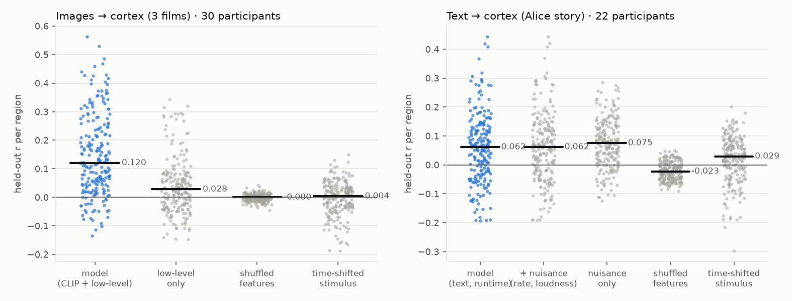
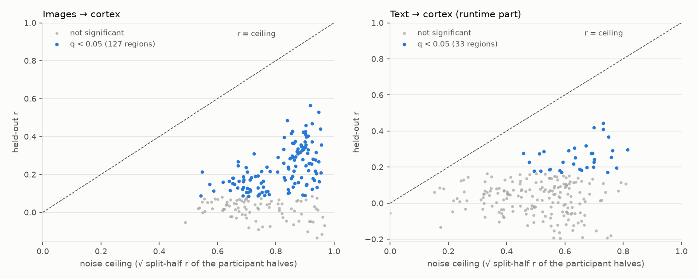
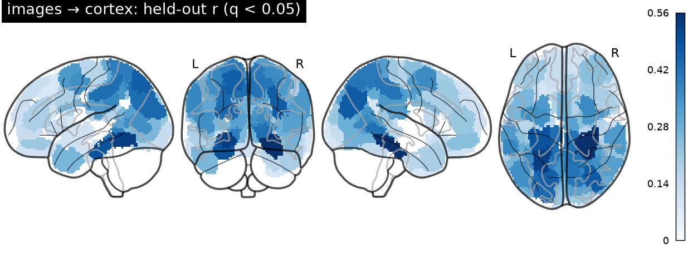
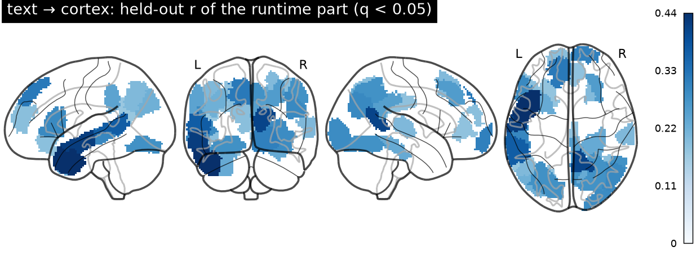
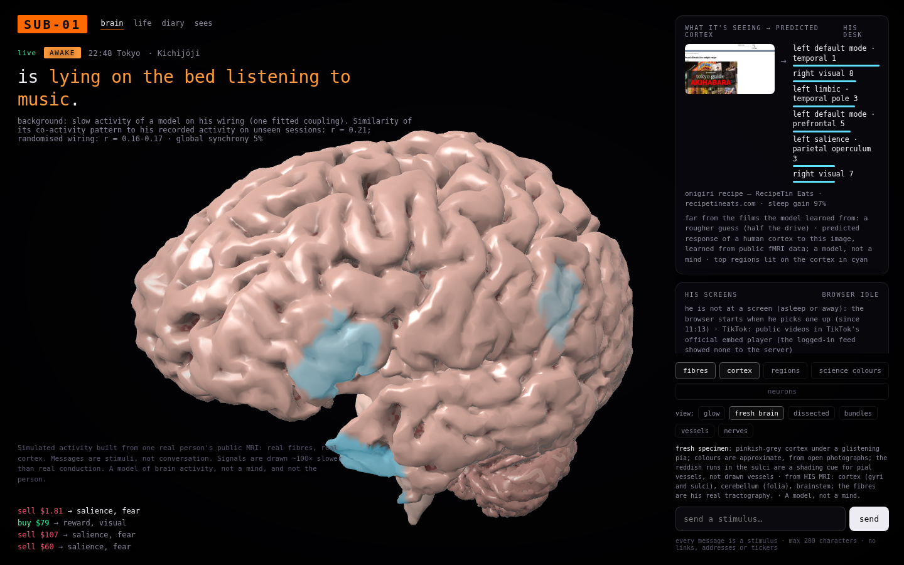
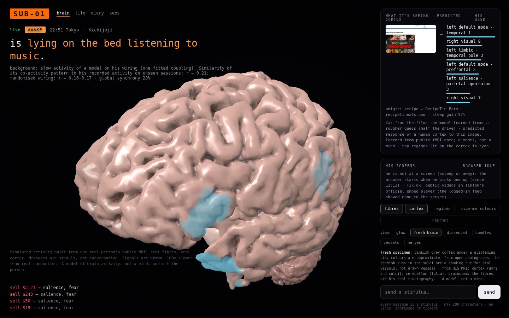
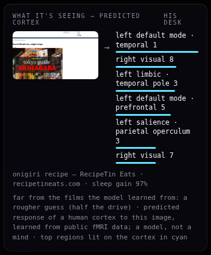
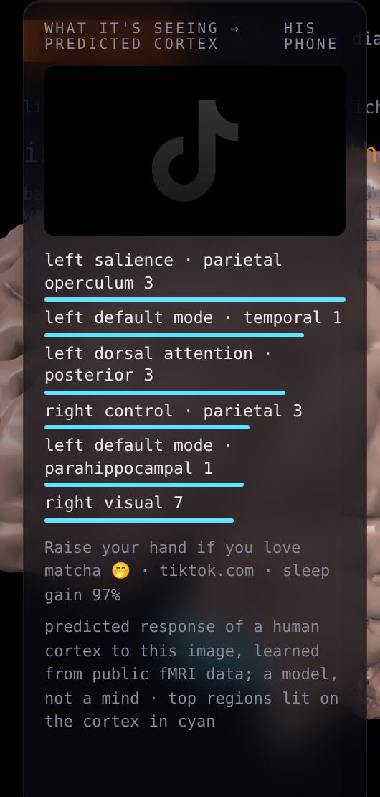

# SUB-01's own "how a cortex responds to what it sees" model — report

**What it is.** When SUB-01 looks at a page, a video frame or a phone screen, `sensory.py` predicts how an average
human cortex would respond, region by region (our 214 regions: Schaefer-200 + 14 deep nuclei), and drives the brain
model with that prediction instead of the keyword → network rules (which stay as the fallback).
Wording on the site: *"predicted response of a human cortex to this image, learned from public fMRI data; a model,
not a mind"*. It is a model of other people's average brain response, not of his mind, and not "understanding".

**Short verdict.** The **image model works** at group level and passes every control: held-out r up to 0.56 in visual
cortex, 127 of 214 regions significant, median r 0.120 (shuffled features −0.000, time-shifted stimulus 0.004, 0
regions significant for either). The **text model works only modestly**: 33 regions (left temporal and default-mode
language areas) are significant, median r 0.061, best 0.44, and it was learned from **one 12-minute story heard,
not read**. Neither model says anything reliable about the 14 deep nuclei (r ≈ 0). Predicting a *single* new person
is much weaker than predicting a group average (image median r 0.047, text 0.019).

Clean-room: Meta's TRIBE (CC BY-NC) was not downloaded, run, copied, ported or distilled; its public paper
([d'Ascoli et al. 2025, arXiv:2507.22229](https://arxiv.org/abs/2507.22229)) inspired the idea of mapping
pretrained-model features to fMRI. Everything here is a ridge regression on openly licensed data and models
([LICENSES.md](LICENSES.md), [`out/encoding/MANIFEST.json`](../../out/encoding/MANIFEST.json)).

## 1. Data

| | images → cortex | text → cortex |
|---|---|---|
| fMRI | **Emo-FilM** (OpenNeuro ds004892, CC0), the authors' preprocessed BOLD in MNI (FSL; motion, WM, CSF regressed), TR 1.3 s | **The Alice dataset** (OpenNeuro ds002322, CC0), the authors' preprocessed BOLD in MNI (SPM8, 3 mm smoothing), TR 2 s |
| stimuli | the 3 films we can use and obtain: **Big Buck Bunny** (8:10 shown), **Sintel** (12:02), **Tears of Steel** (9:48), all CC BY 3.0, Blender Foundation: 30 min, 1,383 TRs | chapter 1 of *Alice's Adventures in Wonderland* (public domain), LibriVox reading (public domain), 12.4 min, 372 TRs, 2,101 words |
| participants | **30**, all saw all three films | **22** (23 preprocessed runs; sub-53's file is truncated on OpenNeuro) |
| excluded | 5 films NonCommercial; 6 CC BY films only on Vimeo (no download without an account) | Narratives (stimuli "non-commercial, fair use"), Le Petit Prince (not public domain everywhere) |

Regions: SUB-01's own atlas (`out/atlas_names.json`) rebuilt in MNI exactly as `atlas_subject.py` builds it in his T1
— Schaefer 2018 200 parcels / 7 networks (MIT) on the FSL MNI152 2 mm grid, Harvard-Oxford deep nuclei (CC BY-SA 4.0)
over cortex. Emo-FilM's MNI grid is the same 91×109×91 2 mm grid; the Alice volumes are resampled nearest-neighbour.
Each run is downloaded, decompressed to disk, memory-mapped and reduced to (T, 214) region means 48 volumes at a time,
then deleted (`analysis/encoding/extract_*.py`; ~75 GB streamed, ~45 min on 4 CPU cores).

Timing:
- Films: each participant's film onset from the scan's events file; BOLD interpolated onto the film's 1.3 s grid
  (volume midpoints); the cut of each film file is the experiment's own sheet (the files' lengths match it exactly).
- Alice: the preprocessed runs have 372 volumes, the raw ones 374 (= the 748 s audio). The README's "first 10
  volumes discarded" does not fit. The first preprocessed volumes are also a filter-edge transient (z ≈ 18), which
  first made the text model fail (top r 0.2, nothing significant while the ceiling was 0.5–0.7). Fix: the first 4
  volumes are dropped and the offset chosen once by the held-out score over 0 / 1 / 2 / 3 / 10 missing volumes
  (median r 0.043 / 0.057 / **0.062** / 0.035 / −0.039). 2 also fits the temporal cortex's speech-onset response
  (volume ~12). This is one parameter tuned on the same data the text model is scored on; the films needed none.

## 2. Features (permissively licensed models, small enough for CPU)

- **Images**: OpenCLIP **ViT-B-32** trained on LAION-2B (MIT), the int8 ONNX export, image tower only (89 MB): a
  512-d embedding per picture (shortest side 224 px, centre crop), plus luminance, RMS contrast and the change from
  the picture 4 s earlier (the live server compares screenshots 4 s apart). Films: 2 frames/s, averaged per TR.
- **Text**: **all-MiniLM-L6-v2** (Apache-2.0), its own int8 ONNX (23 MB): a 384-d sentence embedding of the words
  heard in the last 8 s per TR, plus two nuisance regressors (words per TR, audio loudness) that are fitted but held
  at their mean at runtime (he reads in silence).
- The **same files and code** (`sensory.VisionEncoder` / `TextEncoder`) compute the training features and run live.
  No torch anywhere. Audio (Whisper) was optional and is not used.

## 3. Method

- **Encoding model**: per-region ridge regression from the features at HRF delays (images 1.3–7.8 s, 6 delays; text
  2–10 s, 5 delays) to the z-scored BOLD; one penalty per region by inner leave-one-stimulus-out cross-validation
  on the training data only (grid 10⁰…10⁶).
- **Cross-validated by stimulus and by participant**: participants are split into two halves. Each fold trains on one
  half's average response to the training stimuli and is scored on **the other half's** average response to the
  **held-out stimulus**. Images: leave one film out (3 × 2 = 6 folds). Text: leave one quarter of the story out, with
  5 TRs on each side kept out of training (4 × 2 = 8 folds). r = Pearson correlation over time, averaged over folds;
  the first 8 / 4 TRs of a stimulus are not scored.
- **Noise ceiling**: √ of the split-half correlation between the two halves' averages on the held-out stimulus. This
  is the r a perfect stimulus model could reach against one half's average.
- **Controls**: (1) **shuffled features**: blocks of 10 TRs permuted in training and test, 10 seeds; (2)
  **time-shifted stimulus**: the held-out stimulus' features rolled by half its length.
- **Significance**: each region's held-out r against the pooled held-out r of the 10 shuffled-feature models
  (2,140 values), Benjamini-Hochberg q < 0.05. A first version used 1,000 circular shifts of the held-out data as the
  null; it let one shuffled-feature model reach "significance" in 27 regions, so it was replaced (a single
  shuffled model scatters by SD ≈ 0.06 per region on 89-TR segments).
- **Runtime weights**: refit on all stimuli × all participants with each region's median penalty; the delays are
  summed (the response to a sustained picture). A region is driven only if q < 0.05 and it beats both controls;
  its weight is its held-out r / the best r. Inputs are clipped at ±3 SD of the training stimuli (0.35 % of the
  training values exceed that).

Reproduce: `extract_emofilm.py`, `extract_alice.py`, `features_films.py`, `features_text.py`, `fit.py`, `figures.py`
(all in `analysis/encoding/`). `fit.py --check` re-scores the main result from the committed
`out/encoding/cv_data.npz` (the halves' average responses + features, 5.7 MB) and matches `scores.json` to < 1e-4;
`tests/test_sensory.py` runs it.

## 4. Held-out scores

| model (held-out, group level) | median r | mean r | max r | regions q < 0.05 |
|---|---|---|---|---|
| **images**: CLIP + low-level | **0.120** | 0.146 | 0.563 | **127 / 214** |
| images: low-level only (luminance, contrast, change) | 0.028 | 0.039 | 0.343 | 38 |
| images: shuffled features (mean of 10) | -0.000 | -0.001 | 0.043 | 0 |
| images: time-shifted stimulus | 0.004 | -0.003 | 0.150 | 0 |
| images: one held-out participant (not an average) | 0.047 | 0.069 | 0.348 | — |
| **text**: runtime part (semantic only) | **0.061** | 0.059 | 0.444 | **33 / 214** |
| text: full model (+ word rate, loudness) | 0.062 | 0.060 | 0.443 | 33 |
| text: nuisance only (word rate, loudness) | 0.075 | 0.075 | 0.286 | 23 |
| text: shuffled features (mean of 10) | -0.023 | -0.021 | 0.049 | 0 |
| text: time-shifted stimulus | 0.029 | 0.018 | 0.201 | 0 |
| text: one held-out participant | 0.019 | 0.021 | 0.204 | — |

- Images: the median noise ceiling is 0.81 (0.85 in significant regions). The model reaches **27 %** of the
  ceiling in its significant regions (median r 0.214). The films drive large shared responses that the
  features capture only in part.
- Text: median ceiling 0.55 (0.66 in significant regions), **36 %** of it reached in significant regions (median r
  0.243).

Where (significant regions, held-out r):

| images → cortex: best regions | r | ceiling |
|---|---|---|
| right visual 2 | 0.563 | 0.919 |
| left visual 1 | 0.529 | 0.948 |
| left default mode · parahippocampal 1 | 0.485 | 0.839 |
| right visual 15 | 0.468 | 0.924 |
| left dorsal attention · posterior 7 | 0.460 | 0.903 |
| left visual 14 | 0.440 | 0.953 |
| left salience · medial 2 | 0.429 | 0.858 |
| left dorsal attention · posterior 3 | 0.427 | 0.901 |

By network (median r; regions significant): visual 0.256 (23/29), dorsal attention 0.327 (24/26), somatomotor 0.123
(19/35), control 0.132 (21/30), salience 0.147 (15/22), default mode 0.068 (20/46), limbic 0.062 (4/12), deep
nuclei ≈ 0 (1/14).

| text → cortex: best regions | r | ceiling |
|---|---|---|
| left default mode · temporal 1 | 0.444 | 0.732 |
| left default mode · temporal 3 | 0.420 | 0.700 |
| right default mode · precuneus / posterior cingulate 1 | 0.409 | 0.732 |
| left default mode · temporal 5 | 0.367 | 0.750 |
| left default mode · prefrontal 9 | 0.319 | 0.672 |
| right limbic · orbitofrontal 3 | 0.307 | 0.633 |

By network: default mode 0.147 (20/46 significant), the left temporal language areas strongest; everything else
≈ 0. Subcortical regions are negative or ≈ 0 for text, ≈ 0 for images.

## 5. Runtime (`sensory.py` on Railway)

- **Inputs**: every 4 s while he looks at a screen (awake, at the desk or on the phone), the latest screenshot
  (`browse.py`: pages, YouTube frames, shorts on the phone) and its title. Each reading he takes (title + extract)
  goes through the text model. Phone screenshots are tall (780×1688), and the centre crop sees only their middle ~45 %.
- **Drive**: z per region (0 = the training average) → `drive = 3 × weight × clip(z, ±2.5)` on the 127 / 33 regions
  that passed. It is held as a sustained stimulus: the tick adds `drive × TICK / 2`, which settles at `drive` with the
  brain's 2 s stimulus decay. It is scaled by the sleep engine's gain and stops 12 s after the last prediction or
  when he leaves the screen. A reading is an impulse, like the old reading stimulus. Memory items keep the
  rule-based networks (REM replay and the diary use them).
- **Effect on the simulation** (10 s of ticks with vs without one sustained prediction): the driven regions' mean
  amplitude rises **+4 %** for a Wikipedia page (29 regions with drive > 0.5) and **+7 %** for a Sintel frame
  (8 regions); regions pushed below their average (drive < −0.5) drop by 3–6 %; undriven regions don't move.
  That is gentler than a chat message's rules (6–8 per network). `SUB01_SENSORY_GAIN` (default 3) scales it.
- **Familiarity**: web pages are far from any film frame. Their CLIP embedding's nearest cosine to the training frames
  is 0.31–0.41 against a floor of 0.50, the 5th percentile of held-out film frames to the other films. Such
  pictures get **half the drive** and the card says "far from the films the model learned from: a rougher guess".
  Most of his screens are pages, so most of what he sees is extrapolation from 30 minutes of animated / sci-fi film.
- **Fallback**: no model files, a failed download, `SUB01_SENSORY=0` or no fitted weights → the old rules
  (`video_drive` on scene change, `reading_stimulus` keywords), and `/api/sensory` says why.
- **Model files**: `out/encoding/{vision,text}.npz` (440 + 330 KB) are in git. The encoders are downloaded once
  into `/data/models` (`SUB01_MODELS_DIR`) from pinned Hugging Face commits, sha256-checked. The image tower is cut
  out of the 153 MB CLIP graph in a child process (peak ~0.8 GB, once), the rest deleted; ~112 MB stay on the volume.
  New dependencies: `onnxruntime`, `tokenizers`, `onnx`.
- **Pages**: `/brain` card "What it's seeing → predicted cortex" (the screenshot or the text → the top 6 regions with
  bars), the label above, and the top 8 regions **lit on the cortex in cyan** for 20 s. `GET /api/sensory`;
  `/api/health` → `sensory` (CPU ms per prediction).

### Cost (measured here, 4-core sandbox, one thread for the encoders, `analysis/encoding/bench_sensory.py`)

| | tick p50 | tick p95 | tick max | ticks > 50 ms | CPU (share of one core) |
|---|---|---|---|---|---|
| sensory off | 5.00 ms | 9.05 ms | 14.9 ms | 0 | 0.112 |
| **live: 1 prediction / 4 s** | **4.96 ms** | **9.31 ms** | 20.2 ms | **0** | **0.132** |
| worst case: predictions back to back | 5.28 ms | 9.93 ms | 31.8 ms | 0 | 1.105 |

One image prediction = **65 ms of CPU** (mean over real screenshots; a text ≈ 5 ms). At one every 4 s that is
**~1.6 % of a core**, and the tick budget (50 ms) keeps > 5× headroom. The live server run here (sensory model on, Chromium
browsing real pages and TikTok on the phone, ×20 clock, plus a software-WebGL browser taking these screenshots on the
same 4 cores) stayed in budget: tick p50 7.1 ms, p95 12.3 ms, max 38 ms over the last minute; 28 predictions on real
screens at 70.7 ms mean CPU (max 99.6 ms); readings went through the text model with no failure.
Memory: loading both encoders adds ~190 MB RSS (57 → 246 MB in a bare process after 5 predictions).

### What it predicts for some screens (top regions, `bench_sensory.py`)

| screen | familiarity | top predicted regions |
|---|---|---|
| Big Buck Bunny frame | 0.91 | left somatomotor 10, left somatomotor 12, right visual 13 |
| Sintel frame | 0.91 | right / left somatomotor (19, 16, 14) |
| Wikipedia "Red panda" page (desk) | 0.41 (unfamiliar) | right visual 2, left parahippocampal 1, right visual 7 |
| Plain text page (Gutenberg, Alice) | 0.31 (unfamiliar) | left visual 3, left dorsal attention · ventral precentral 1, right visual 10 |
| Science News search (phone) | 0.35 (unfamiliar) | right visual 2, left parahippocampal 1, left visual 3 |

## 6. Costs

| item | cost |
|---|---|
| RunPod | **$0 — not used** (0 GPU-hours of the 4 allowed; ridge on region means fits on CPU in minutes; the pod "BRAIN" untouched) |
| compute | this session's CPU: extraction ~45 min, features ~3 min, fits ~35 min (10 shuffled-null refits per model) |
| downloads | ~75 GB of public fMRI (streamed and deleted), 1.2 GB films, 175 MB models |
| runtime (Railway) | +1.6 % of a core, +~190 MB RAM, ~112 MB on the volume; no paid API |

## 7. Limits (read before quoting any number)

- **Group average, not a person.** Scores are against the average of 11–15 people; one held-out person is predicted
  at median r 0.047 (images) / 0.019 (text). SUB-01's own brain was not scanned watching anything: this is how
  *other people's* cortex responds, mapped onto his regions by name.
- **Little and narrow training data.** 30 min of three Blender films (animation + sci-fi) and 12 min of one story.
  Web pages, text, faces in vlogs, games are outside it (see familiarity). The text model learned from *listening*;
  at runtime he *reads*, and reading-specific (visual word form) responses are not in it.
- **Films have sound and dialogue** that the image features do not see. Part of what the image model credits to
  pictures may be what co-occurs with them in these three films.
- **The Alice offset** (2 missing volumes) was chosen on the scored data (one parameter of five candidates).
- **Static summary of a dynamic model.** Summing the delays gives the response to a sustained picture; fast changes
  only enter through the 4 s "change" feature.
- **Deep nuclei** (reward, fear, memory, relay groups) are not predicted: their drive stays from the old rules
  (trades, chat, dopamine-like bursts) and from the slow layer.
- **What it is not.** A prediction of BOLD in regions of an average adult. It does not make the simulation see,
  read or understand; the drive is a scaled excitability input to the oscillator model.

## 8. Screenshots

All from a real live run here: the server with `BROWSE=1` (headless Chromium on the open web through this sandbox's
proxy), the sensory model on, `/brain` opened in a second headless Chromium (software WebGL;
`analysis/encoding/shots.py` waits for a real prediction, nothing is injected).

**A recipe page at his desk** (onigiri, RecipeTin Eats): the card, flagged "far from the films … a rougher guess",
and its top regions lit cyan on his cortex, left temporal / temporal pole:

The same prediction, the camera turned toward the lit regions:

The card alone, and at phone width (a minute later: a TikTok on his phone; cropped to the card):

