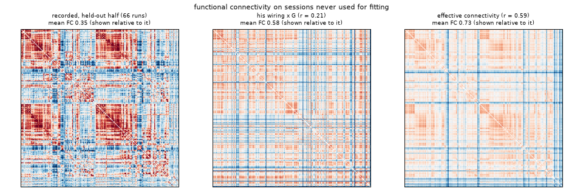
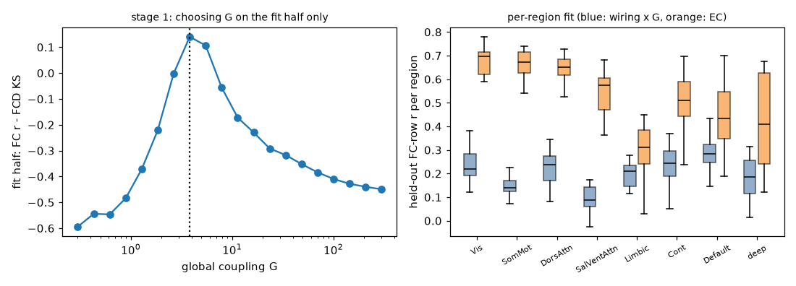
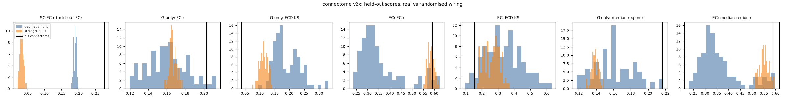

# Real wiring: does SUB-01's connectome do the work?

SUB-01 is a model of large-scale activity built on one real person's brain scans (MyConnectome, OpenNeuro ds000031,
public domain). It is not a mind, not conscious and not the person. This report asks one question and answers it
with numbers on data the model never saw: **does the activity the model generates come from this person's wiring,
and does it beat randomised wiring?**

## Short answer

| | before (v1 connectome, 10 Hz model alone) | now (v2 connectome, Hopf slow layer) |
|---|---|---|
| Structural wiring vs recorded FC (no model), held-out sessions | r = 0.197 | **r = 0.276**, better than all 200 randomised networks (p = 0.01) |
| Model driven by the wiring alone (one fitted coupling), held-out FC similarity | r ≈ 0.02 (same as randomised wiring) | **r = 0.203** |
| … compared with 100 strength-preserving randomised brains | not better | **better than all 100** (p = 0.01) |
| … compared with 100 geometry-preserving randomised brains | not better | **not significantly better** (p = 0.059) |
| … FC dynamics (FCD KS, lower is better) | 0.78 (no dynamics) | **0.038**, better than all 200 nulls (p = 0.01), but sensitive to the coupling grid (see below) |
| Model with effective connectivity fitted on the wiring (≈ 9,200 parameters) | — | r = 0.59, but randomised wiring fitted the same way does as well (p = 0.38 strength, p = 0.06-0.91 geometry) |

So, honestly:

1. **The new connectome carries more of the person's functional organisation** than the old one (SC-FC 0.28 vs
   0.20, both clearly above randomised wiring).
2. **With the new connectome, the wiring alone now generates activity that resembles his recorded activity on unseen
   sessions** (r = 0.20 vs ≈ 0.02 before), and it beats every randomised brain that keeps each region's total
   connection strength. It does **not** clearly beat randomised brains that keep the spatial layout (which regions
   are near each other and how long the connections are): most of what the wiring explains is its geometry. That is
   a known result for human connectomes (e.g. Betzel & Bassett 2018 PNAS; Roberts et al. 2016 NeuroImage) and we
   reproduce it here rather than hide it.
3. **Fitting effective connectivity raises the similarity to r = 0.59, but that gain does not come from his wiring**:
   randomised networks fitted the same way reach the same score. It comes from fitting his recordings.
4. Nothing here is close to the test-retest ceiling (the two halves of his own recordings agree at r = 0.96).

The live model therefore now runs the **wiring-only slow layer by default** (the activity is generated by his
connectome with one fitted number), and the page says what it is and how similar it is. The recorded-fMRI replay,
which produced the old r = 0.40 without using the wiring at all, is now an explicit option ("replaying a real
recorded session").

## 1. What was wrong (reproduced)

The original `analysis/null_test.py` and `analysis/hopf_test.py` were not in the repository; both are reconstructed
here and reproduce the reported numbers on the v1 connectome:

- v1 density 44.8 %, SC-FC r = 0.207 (log(1 + streamlines), all pairs, mean FC of the 131 runs).
- The deployed 10 Hz Stuart-Landau model alone: held-out FC r ≈ 0.02; the BOLD-band Hopf model on v1 with only the
  coupling fitted: FC r 0.016 on held-out sessions at the coupling that gives realistic dynamics (the analytic
  optimum at vanishing coupling, r ≈ 0.2, is a first-order copy of SC whose correlations are far too weak to measure).
- v1 inter-hemispheric connections: only 46 of the 85 homotopic (left-right mirror) region pairs have any streamline,
  median weight 1 streamline.

## 2. Connectome v2

Same DWI (ses-2015 acq-g79 dir-pe0, b = 0/1500/3000, 1.7 mm), same 214 regions (`out/labels_t1.nii.gz`) and the same
T1 → DWI transform (`out/t1_to_dwi.npy`, applied to the image header, no resampling).

Pipeline (MRtrix3 3.0.8 on a RunPod CPU pod, `analysis/pod/tract.sh`):

1. `dwigradcheck`: **the gradient table was mis-oriented for MRtrix** (mean streamline length 46.8 mm as given, 71.7 mm
   with x flipped in scanner space). The first run without this check produced 11 mm median streamlines and almost
   no inter-hemispheric connections; it was discarded.
2. `dwi2response dhollander`, multi-shell multi-tissue CSD, `mtnormalise`.
3. **ACT was tried and not used.** FSL and FreeSurfer are not available, so a 5-tissue image was built from the T1
   (`analysis/make_5tt.py`: bias-corrected 3-class mixture + the atlas' deep nuclei). In a 200k-streamline pilot it
   truncated streamlines (median 15 mm vs 71 mm without ACT, 4 % vs 17.5 % inter-hemispheric). v2 therefore uses
   iFOD2 seeded in the DWI white-matter mask (FOD cutoff 0.06, 10-250 mm) without anatomical constraints.
4. 12 independent chunks × 0.5 M = **6 M streamlines** (10 M were planned; the 2 h pod budget, partly spent on the
   failed runs above, allowed 6 M), SIFT2 weights (fibre bundle capacity), `tck2connectome` (radial search 4 mm).
5. Consistency threshold (`analysis/build_connectome_v2.py`): probabilistic tracking reaches 42 % of all region
   pairs in *every* chunk, so presence alone cannot thin it. Following consistency-based thresholding (Roberts et al.
   2017 NeuroImage), edges present in all chunks are ranked by the coefficient of variation of their SIFT2 weight
   across chunks and the most consistent ones are kept up to **20 % density**.

| | v1 (dipy, deterministic, counts) | v2 (MRtrix3 iFOD2 + SIFT2, consistency) |
|---|---|---|
| density | 44.8 % | 20.0 % |
| inter-hemispheric density | 27.1 % | 7.3 % |
| inter-hemispheric share of total weight | 19.9 % | 9.7 % |
| homotopic pairs with an edge (of 85) | 46 | 22 (42 present in every chunk, 69 in at least a quarter of them) |
| SC-FC r, all 131 runs (log(1 + w), all pairs) | 0.207 | **0.286** |
| SC-FC r, held-out half | 0.197 | **0.276** |
| SC-FC vs geometry-preserving nulls (all runs) | 0.207 vs max 0.158 of 500 (p 0.002, original analysis) | 0.286 vs max 0.208, p = 0.01 |
| SC-FC vs strength-preserving nulls (all runs) | p 0.01 (original analysis) | 0.286 vs max 0.044, p = 0.01 |

**The inter-hemispheric under-representation is not fixed.** Before thresholding, v2 reaches 69 of the 85 homotopic
pairs in at least a quarter of the chunks (42 in every chunk), but long callosal edges have erratic weights across chunks and are the first to
go under the consistency threshold. The model below therefore adds the homotopic pairs explicitly where it fits
effective connectivity (documented, not measured).

## 3. The slow layer (`twin/hopf.py`)

BOLD-band Hopf normal form (Deco, Kringelbach, Jirsa & Ritter 2017 Sci Rep), one node per region:

    dx_j/dt = (a_j - x_j^2 - y_j^2) x_j - w_j y_j + sum_k C_jk (x_k - x_j) + beta eta_xj
    dy_j/dt = (a_j - x_j^2 - y_j^2) y_j + w_j x_j + sum_k C_jk (y_k - y_j) + beta eta_yj

a = -0.02 (just below the bifurcation), beta = 0.02, w_j = 2π f_j with f_j each region's own BOLD peak frequency
(0.008-0.08 Hz) measured on the fit half. C = G × SC (SC = log(1 + w), symmetric, scaled to max 0.2).

- Fitting uses the exact linear (fluctuation) approximation (Ponce-Alvarez & Deco 2024, Sci Rep, "The Hopf whole-brain model and its linear approximation"): with z = x + iy the
  stationary covariance solves M P + P M^H + 2β² I = 0 and the lagged covariance is Re(e^{Mτ} P)/2; solved through
  one eigendecomposition per evaluation (tested against scipy's 2N × 2N Lyapunov solver to 1e-13). Simulated runs
  are sampled exactly at the TR (complex Ornstein-Uhlenbeck process; matches the nonlinear Euler-Maruyama
  simulation, FCD KS 0.03 between them) and then processed exactly like the recordings (detrend, 0.01-0.1 Hz
  Butterworth, z-score).
- **Stage 1, wiring only:** G is the only free parameter, chosen on the fit half by maximising simulated FC r - FCD KS
  (20 values, 0.3-300). FC r alone degenerates to G → 0.
- **Stage 2, effective connectivity** (Deco, Cruzat & Kringelbach 2019 PNAS; Gilson et al. 2016 PLoS Comput Biol):
  starting from G × SC, C_jk += 0.02 (FC_emp - FC_mod)_jk + 0.01 (COVτ_emp - COVτ_mod)_jk, τ = 2.32 s, only on the
  network's own edges plus the 85 homotopic pairs, C ≥ 0, until the fit-half FC r stops improving (≤ 300 steps).
  For v2 that is 9,242 directed parameters.

### Data split

131 QC-passed runs, **split by session**: sessions in chronological order alternate between the halves; multi-run
sessions are balanced by run count. Fit half: 65 runs from 46 sessions; held-out half: 66 runs from 48 sessions; no
session is in both. Everything that is fitted (peak frequencies, G, EC, the lagged covariance, which uses only the
TR = 1.16 s runs) uses the fit half only. The halves differ in acquisition mix (the fit half holds the 20 runs at
TR = 2.5 s, the held-out half the 16 runs at TR 1.49/1.25 s). Test-retest: fit-half mean FC vs held-out mean FC
r = 0.958 (the ceiling for any model of the mean FC).

### Held-out results, connectome v2

20 simulated 10-minute runs per network, scored against the 66 held-out runs.

| | FC r | FCD KS | median per-region r | mean FC (recorded 0.35) |
|---|---|---|---|---|
| wiring only (G = 3.82) | **0.203** | **0.038** | 0.216 | 0.61 |
| effective connectivity | **0.590** | 0.154 | 0.588 | 0.75 |

Both versions make the brain far too synchronised on average (mean FC 0.6-0.75 vs 0.35); FC r compares the pattern,
not the level. Per region (median FC-row r by network, figure right), the wiring-only model fits the default-mode
(0.28), control (0.25) and dorsal-attention (0.24) networks best and the salience/ventral-attention (0.09) and
somatomotor (0.14) networks worst; the effective-connectivity model fits the visual (0.70) and somatomotor (0.67)
networks best and the limbic network (0.31) worst.

## 4. Randomised brains (nulls)

The identical pipeline (stage 1 and stage 2, same split, same seeds) was run on 100 geometry-preserving nulls
(degree and edge-length distribution kept, Betzel & Bassett 2018; `netneurotools.networks.match_length_degree_distribution`)
and 100 strength-preserving nulls (node strengths kept by simulated annealing; `strength_preserving_rand_sa`),
generated from his v2 weights (netneurotools, BSD-3). p = (1 + nulls at least as good) / 101.

| held-out metric (v2) | his wiring | geometry nulls: mean (best) | p | strength nulls: mean (best) | p |
|---|---|---|---|---|---|
| SC-FC r | 0.276 | 0.190 (0.199) | **0.010** | 0.032 (0.047) | **0.010** |
| wiring only: FC r | 0.203 | 0.161 (0.213) | 0.059 | 0.167 (0.178) | **0.010** |
| wiring only: FCD KS | 0.038 | 0.191 (0.096) | **0.010** | 0.114 (0.075) | **0.010** |
| wiring only: median region r | 0.216 | 0.160 (0.218) | **0.040** | 0.139 (0.149) | **0.010** |
| EC: FC r | 0.590 | 0.361 (0.625) | 0.059 | 0.586 (0.623) | 0.376 |
| EC: FCD KS | 0.154 | 0.334 (0.095) | 0.059 | 0.262 (0.169) | **0.010** |

Robustness and caveats:

- **The coupling grid matters for FCD.** The robustness run with G limited to 0.1-30 gave the same picture for
  FC (wiring only: geometry p = 0.059, strength p = 0.01; EC: geometry p = 0.91, strength p = 0.69), but for FCD it
  picked G = 5.3 for his wiring (KS 0.116) and strength-preserving nulls then matched the dynamics *better*
  (p = 0.70). The FCD advantage is therefore **not robust**; the FC result is.
- 64 of 100 geometry nulls choose the largest coupling in the grid. The fit rule is applied identically to all
  networks, but their EC stage then starts from an extreme coupling and does not converge in 300 steps, which is why
  their EC scores spread widely (mean 0.36). With G ≤ 30 (robustness run) they reached 0.60 and the EC p-value was
  0.91: the EC comparison should be read as "no wiring advantage".
- netneurotools reports "out of rewirable edges" for some geometry nulls: within some length bins all possible swaps
  were made, so those nulls stay closer to the original wiring; this makes the geometry test conservative.

### Connectome v1 (old) through the same pipeline

| held-out metric (v1) | his wiring | geometry nulls p | strength nulls p |
|---|---|---|---|
| SC-FC r | 0.175 (pipeline transform) | 0.010 | 0.010 |
| wiring only: FC r | 0.016 | 0.149 | 0.010 (best null 0.016: a tie) |
| EC: FC r | 0.594 | 1.000 | 0.663 |

(first complete run, G 0.01-3; v1 has a weak FC signal at every coupling, r ≈ 0.02-0.04, so the grid does not
change the conclusion.)

## 5. What runs live

`brain_sim.Brain` keeps its public API (stimulate, step, run, state, set_rhythm, drive, group_idx). A
`twin.hopf.SlowLayer` (parameters in `twin/data/slow_layer.npz`, 60 KB) generates the spontaneous slow activity: the
linearised Hopf model is sampled exactly every 0.1 s of model time and its z-scored signal modulates the excitability
of the 10 Hz layer exactly where the replayed recording used to (1.6 per z-unit, scaled by sleep stage).

- Default: the **wiring-only** layer (v2 connectome × G). `SUB01_SLOW=ec` switches to the effective-connectivity layer.
- `live_server.py --replay-real-session` (or `REPLAY_REAL_SESSION=1`) replays a recorded session instead and switches
  the slow layer off. The old `--no-real-baseline` flag is accepted and ignored (it is now the default).
- The page says which background is running, e.g. "slow activity generated by his wiring (one fitted coupling;
  similarity to his recorded activity on unseen sessions r = 0.20)".
- CPU (`analysis/bench_live.py`, 1 thread, process time per simulated second at live settings): slow layer alone
  **0.0005 core**; the existing 10 Hz layer, unchanged by this work, ~0.6-0.7 core on this shared sandbox. The new
  layer adds nothing measurable. The 10 Hz layer itself is the heavy part and is worth optimising for Railway
  (its delay gather is a 214 × 214 fancy index every millisecond).
- The live server does not need torch (only the offline fitting does); tested.

## 6. Compute and costs

All heavy compute ran on RunPod pods created by `analysis/runpod_job.py` (only CPU or RTX A5000, one pod at a time,
deleted on finish/error/60 min, 2 h total cap, never touching pods it did not create such as "BRAIN"); the
user's Mac was not used. Ledger: `data/analysis/costs.jsonl` (git-ignored).

| job | pod | minutes | USD | outcome |
|---|---|---|---|---|
| API / capacity probes (created and deleted at once) | CPU 2-4 vCPU | ~1.5 | 0.00 | — |
| tractography 1 (ACT, wrong gradients) | A5000 host, 9 vCPU | 30.2 | 0.14 | stopped by me: would overrun its time limit |
| tractography 2 (transient proxy error on upload) | CPU 32 | 0.6 | 0.01 | retried |
| tractography 3 (ACT, wrong gradients), 10 M | CPU 32 | 32.1 | 0.51 | done, discarded (11 mm streamlines) |
| tractography 4 (only 9 vCPU offered) | A5000 host | 1.6 | 0.01 | stopped, waited for 32 vCPU |
| tractography 5 (pilot crashed: no numpy in the image) | CPU 32 | 4.8 | 0.08 | found the gradient error |
| tractography 6 (final v2, 6 M) | CPU 32 | 19.2 | 0.31 | **done** |
| nulls + fits, v2 and v1 (G 0.01-3) | CPU 32 | 9.7 | 0.15 | done (first run; G grid too small for v2) |
| nulls + fits, v2 (G 0.1-30) | CPU 32 | 8.0 | 0.13 | done (robustness run) |
| **total** | | **107.7 min** | **$1.33** | |

The final run with the extended coupling grid (G 0.3-300) was done in this sandbox (no pod budget left), with the
same code.

## 7. What is still not real

- The connectome is diffusion-MRI tractography: streamline-based estimates, undirected, without synapses, with known
  false positives and false negatives (especially long callosal and crossing fibres). No ACT, no distortion
  correction (no FSL), 6 M instead of 10 M streamlines, consistency threshold within one subject only.
- The slow layer is a phenomenological oscillator per region (Hopf normal form), not neurons; its signal is compared
  with BOLD directly (no hemodynamic model), with one bifurcation parameter for all regions.
- The fitted model is far too synchronised on average (mean FC 0.6-0.75 vs 0.35 recorded).
- The effective connectivity is fitted to his recordings; its advantage over the wiring-only model is not specific to
  his wiring.
- Most of what the wiring explains is its geometry: randomised brains with the same spatial layout come close.
- The fast 10 Hz layer that the page displays is not fitted to anything; only its slow modulation is.
- Group-level priors (atlas, homotopic edges added to the EC mask) are assumptions, not measurements of this person.

## 8. Honest wording for the site

Short (status line, already on the page):

> background: slow activity generated by his wiring (one fitted coupling; similarity to his recorded activity on
> unseen sessions r = 0.20)

About text:

> SUB-01 runs on a map of one real person's brain wiring, reconstructed from his diffusion MRI. Its slow background
> activity is generated by that wiring with a single fitted number, and is compared with his own recorded resting
> activity on scanning sessions the model never saw: the pattern of which regions move together matches at r = 0.20
> (his own sessions agree with each other at 0.96). That is better than randomised brains that keep each region's
> total wiring, and about as good as randomised brains that keep the spatial layout of the connections - so much of
> what the wiring explains is where things are, not exactly which fibres connect them. It is a model of brain
> activity, not a mind; it is not conscious and it is not the person.

Do not write: "his wiring produces his activity", "a copy of his brain", "thinks", "feels", or the old r = 0.40
(that number came from replaying his recordings, not from the model).

## 9. Reproduce

    python analysis/make_5tt.py                                   # pod inputs (ACT tried, not used)
    python analysis/runpod_job.py --kind cpu --vcpu 32 --image mrtrix3/mrtrix3:3.0.8 --script analysis/pod/tract.sh \
        --upload <5tt.nii.gz> <labels.nii.gz> <mask_t1grid.nii.gz> --fetch connectome_v2_raw.tar.gz --tag tract --max-min 35
    python analysis/build_connectome_v2.py 0.2                     # -> out/connectome_v2.npz
    python analysis/real_wiring.py prep --conn out/connectome_v2.npz --tag v2 --nulls 0
    python analysis/real_wiring.py nulls --tag v2 --nulls 100 --workers 3
    python analysis/real_wiring.py run --tag v2 --workers 3
    python analysis/real_wiring.py report --tags v2 && python analysis/real_wiring.py export --tag v2
    python analysis/figures_real_wiring.py v2
    python -m pytest tests/test_real_wiring.py -q
