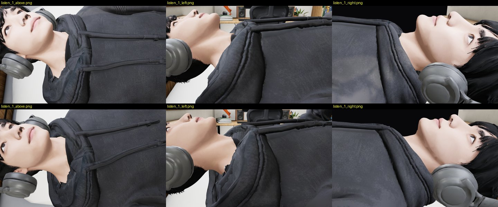
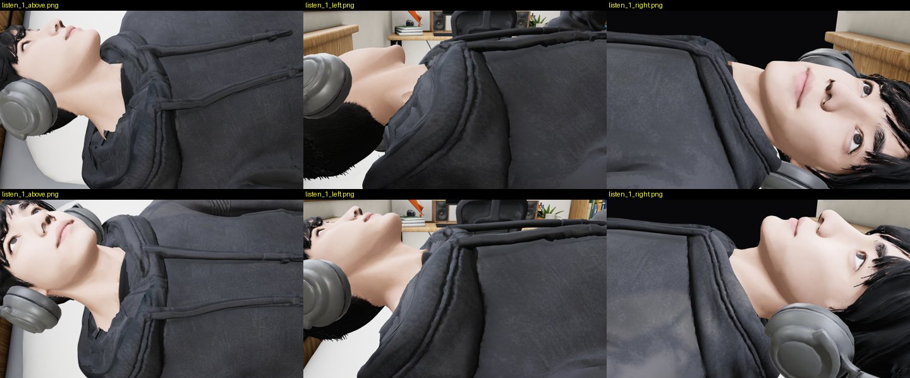
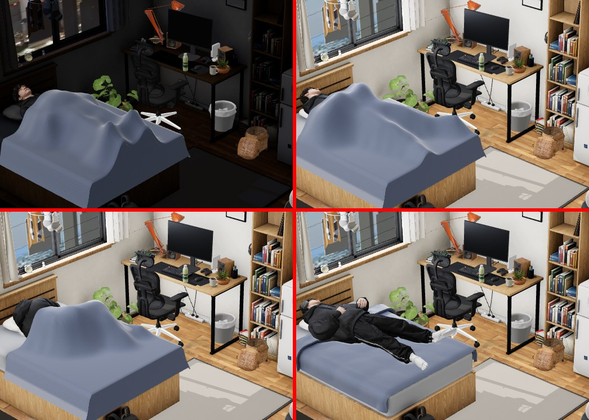
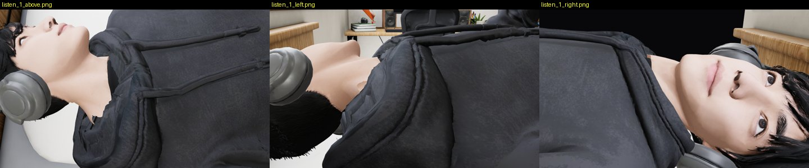

# Review: preview/bed-clips (G17)

- Latest: `41842ca` (WIP), round 4 quick check by G26 (below). Round 3: `48cb1bb`. Round 2: `ebb2756`. Round 1: `ecabd00` (2026-10-07 14:43 UTC, WIP), reviewed 2026-10-07 15:55 UTC by G23.
- Scope: Laying_Nodding with the headphones (music), Laying_Sleeping, the side turn, `capBed`, wired into the default
  page (`boy_mh.js`, `room.html`): this changes the default page by design.

## Round 4 (41842ca, WIP, 2026-10-07 22:45 UTC), quick check 22:58 UTC by G26: NOT OK (headphones only checked)

Top 48cb1bb, bottom 41842ca: listening, from above, left and right. The cups widened by 0.8 cm look the same: both still
sit at the angle of the jaw, under and behind the ear, not over it. Widening doesn't move them up. The cups' centre must
go to the ear's centre (about 3–4 cm up toward the crown and 1–2 cm forward, from these shots). The buttocks, hands-mid-roll
and duvet items were not re-checked this round (out of time at 23:00).

---

## Round 3 (48cb1bb, 2026-10-07 18:29 UTC: re-baked on main's GLB, head turned 9° awake, wrists capped in the turn, toes held), reviewed 20:05 UTC by G26: NOT OK

- **Hand in the head (round 2, defect 2): closed.** My own check (`tools/turnhand.py`, every 2nd frame of the 17.2 s
  turn: each hand's skin against the head skin's radius, by direction). On 48cb1bb no hand vertex comes within
  25 cm of the head. On ebb2756 the same test found the left hand 1.1 cm inside at 2.9 s.
- **Duvet (defect 1, HIGH): unchanged.** Asleep and at 1.3 / 6 / 15.5 s of the turn, the page camera is within
  51–435 px of ebb2756. It is the same tent (image in round 2).
- **Headphones (defect 5): still not on the ears.** 
  Top ebb2756, bottom 48cb1bb: from above, left and right of his head while listening (`room_laying_nodding`, the
  headphones on). The head is turned now, but both cups sit at the angle of the jaw, below and behind the ear, the
  left one pressed into the pillow. Fix: as in round 1, fit each cup to its own ear's centre and lift the band so the
  cushions cover the ears.
- **Back while listening (defect 4)** and the turn's shoulder/toes (defect 3): **not re-measured.** This branch's
  `contact_pass.mjs` crashes for me on 48cb1bb ("Target page, context or browser has been closed" inside its main
  evaluate, `sleep 20` with the turn, run alone; the same command ran on ebb2756). Please check that it runs headless on
  this commit and put its bed table in STATUS. I will re-measure then.

---

## Round 2 (ebb2756, 2026-10-07 17:19 UTC), reviewed 18:50 UTC by G26: NOT OK

Since round 1: main is merged in, so `char_v5.glb` **is main's** now (byte-equal: integration blocker 4 closed, and in
bed you see main's closed collar, note 5). `contacts()`/`penetration()` take the body by name (`bodyMesh`), not the
last skinned mesh (the "main, seen while reviewing" item in INDEX). A one-command rebake. The three HIGH defects remain.

How I checked: this branch's `contact_pass.mjs` on my own server, `listen_music 8 s` (music in the tick) and `sleep 20 s`
with `LIFE={"turn":1}`. G23's `tools/bed.py`. My `tools/bedprobe.py`: the music state, the headphones, close-ups from
above and either side of his head (G23's facing-relative cameras land in the curtain when he lies down).

| row (contract) | listening (mine) | asleep + turn, 600 frames (mine) |
|---|---|---|
| back, 50 cm from the headboard (−1 … +0.5) | **+2.6 … +2.8** | +0.3 … +6.4 (on his side the bins mean little) |
| back, 60 / 90 cm | **+1.4 … +1.5 / +1.1 … +1.2** | – |
| head on the pillow (−2 … 0) | −1.4 … −0.9 ✓ | **−3.2** … −0.5 |
| toes inside the mattress end (> 0) | 3.3 cm ✓ | **−0.4 cm** (past the end, in the turn) |
| hands in his own body / head | 0 ✓ | **4.7 cm into the head**, 392 frames, worst at 15.1 s (rolling back) |
| shoulder into the pillow's edge | – | **9.1 cm** |
| duvet gap over him, max | – | torso **27.3**, arms **31.0**, legs **22.8** cm |
| largest skin jump between frames | 0.4 cm ✓ | ✓ |

(My contact_pass run for the headphone row crashed: the browser closed after 14 s. The headphone number below is the
branch's own table, checked against my close-ups.)

### 1. The duvet is a tent, a tall one even before the turn — HIGH (page camera)

Top left: main, asleep, with the duvet roughly on his body. Top right: this branch, asleep: one smooth tent peaking over
his hips, far above his shape. Bottom left: on his side mid-turn, a tall peak. Bottom right: listening, fine.
Fix as in round 1: set each duvet vertex from the skin under it (highest skin + 1–2 cm, lowering as well as raising)
every update, and cap the drape's span between support points. Check: torso gap max ≤ 4 cm asleep and through the turn.

### 2. His hand goes 4.7 cm into his head while he rolls back — HIGH (new)
contact_pass `self`: in 392 of 600 frames a hand or forearm is inside him, at worst 4.7 cm into the head at t = 15.1 s.
The README does not list it. Fix: in the turn's composition, keep the upper hand ≥ 2 cm off the head's surface during
the roll back (wrist IK). Re-run `self`.

### 3. In the turn: shoulder 9 cm into the pillow's edge, toes 0.4 cm past the mattress end, head 3.2 cm into the pillow — MEDIUM
The README admits the 9 cm. Fix: slide him 4–5 cm toward the foot for the side hold, with the toes kept > 0 (they have
3.3 cm on his back), or narrow the pillow dent's reach.

### 4. Upper back +2.6 … +2.8 cm off the bed while listening — HIGH (unchanged from round 1)
Same numbers as G23's. Fix as in round 1 (bend Spine/Spine01 back until the shoulder-blade band touches).

### 5. Headphones in the hair/head: the left cup 2.9 cm in (the branch's own table) — HIGH (unchanged)

From above and either side: the left cup sits low behind the jaw, pressed into the pillow and the hair. The right cup
sits over the ear. Fix as in round 1: fit each cup to its own ear (no mirroring), ≤ 0.5 cm.

---

## Verdict: NOT OK (WIP). He now lies on the bed; the back still floats, the duvet balloons, and the headphones cut into the head

How I checked: the page with `?debug&nolive` (tests/visual fake server, SwiftShader), driven like contact_pass does
(`live('listen_music', {music})`, `live('sleep')`, then `mh.sleepTurn()`). Shots at 1, 5 and 9 s of the music loop,
asleep, and at 1.3 / 6 / 15.5 s of the turn, from the page camera, over the bed, at the head, hands and feet. This
branch's `contact_pass.mjs` (bed rows): `listen_music 8 s` with music in the tick, `sleep 10 s`. Tool: `tools/bed.py`.

## Measured (mine)
| row (contract) | listening, 240 frames | asleep, 300 frames |
|---|---|---|
| back over the quilt / mattress, by distance from the headboard (−1 … +0.5 cm) | 50 cm: **+2.7 … +2.8**; 60 cm: **+1.3 … +1.5**; 70–80 cm: +0.3 … +0.5; 90 cm: **+1.2 … +1.3** | 50 cm: **+1.5 … +2.6**; 60 cm: +0.3 … **+1.1**; 70–80 cm: −0.6 … 0; 90 cm: +0.3 … **+0.9** |
| row at 100 cm | +24.8 … +25.0 | +23.8 … +24.6 |
| head on the pillow (−2 … 0 cm) | −1.4 … −0.9 ✓ | −1.8 … −0.5 ✓ |
| toes inside the mattress end (> 0) | 4.0 cm ✓ | 4.1 cm ✓ |
| bed / bed frame / floor penetration | 0 / 0 / 0 ✓ | 0 / 0 / 0 ✓ |
| hands in his own body | 0 ✓ | 0 ✓ |
| headphones in his head | **198 vertices, 3.2 cm** (left cup), every frame | – |
| headphones under the pillow | 4 vertices, 0.5 cm | – |
| duvet gap over him (mean / max) | – | torso 4.4 / **20.3 cm**, legs 2.7 / 18.7 cm, arms 3.0 / 9.6 cm |
| largest skin jump between frames | 0.4 cm ✓ | 0.4 cm ✓ |

## Defects, by severity

### 1. The duvet balloons over him, worse during the turn — HIGH (seen at the page camera)

Asleep / turning 1.3 s / on his side 6 s, page camera: the duvet stands in peaks and a tent over his body (gap up to
20.3 cm over the torso, 18.7 cm over the legs), not his shape. The contract says the duvet follows his shape, with no
balloon. Fix: fit the drape to his skin under it at each update (the 30 Hz follow is there, but the shape doesn't come
down to him). Set each duvet vertex to the highest point of his skin under it + 1–2 cm, lowering as well as raising. Re-measure the torso gap max ≤ 4 cm.

### 2. Upper back off the bed: +2.6 to +2.8 cm at the shoulder blades — HIGH (contract −1 … +0.5)
Listening +2.7…+2.8 and asleep +1.5…+2.6 at 50 cm from the headboard. Also over +0.5 at 60 and 90 cm. `capBed` puts
his *lowest* skin on the bed, so the hips touch and the shoulders hang. Fix: in `bed_clip.py`, after levelling, bend
the upper spine (Spine01/Spine) back until the shoulder-blade band touches (−0.5 cm), not only the lowest point. Also
explain the 100 cm row (+24 cm in both): if it is the raised knees, label it so; if it is the buttocks, it is a
blocker.

### 3. Headphones inside his head — HIGH
contact_pass: the left cup is **3.2 cm** inside his head or hair (198 vertices), in every listening frame (right cup
1.3 cm, band 1.2 cm). Fix: in boy_mh.js `HP`, raise `EAR_WIN`/PRESS so the cushion sits on the ear surface: the left
cup needs about 3 cm further out along its axis (the head isn't symmetric: fit each side to its own ear, not mirrored).
Re-measure to ≤ 0.5 cm.

### 4. This branch rewrites `web/room/char_v5.glb` (fc96f54: its own socked feet) — integration BLOCKER
G19 (char-fix-feet) and G10d (char-fix) also rewrite `char_v5.glb`. Three versions of the same file. Its feet are a
third design (natural socks, no reference slides). C must choose one chain: collar script → G19's `feet.mjs` → this
branch's clips re-baked on that GLB (`bed_rebake.sh <final char_v5.glb>`). Don't merge the binary.

### 5. In bed you see main's open collar — note

From above, lying: the black gap and jagged hood at his neck (main's v5). G10d's collar fixes it. Re-check once the GLB
chain in 4 is settled.

## What is fine

He lies on the bed (no float, no drop at the join: 0.4 cm max per frame), head in the pillow, toes inside the mattress,
nothing through the bed or the frame, hands resting on his belly, not in it. The headphones are on his head while the
music plays, and the turn starts and plays (`mh.sleepTurn()` → turning after 20 frames).
