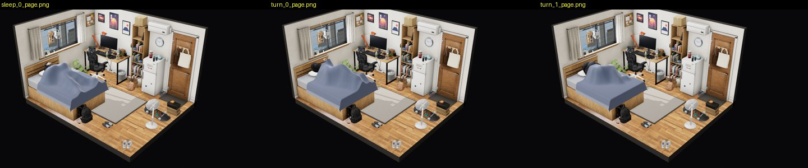
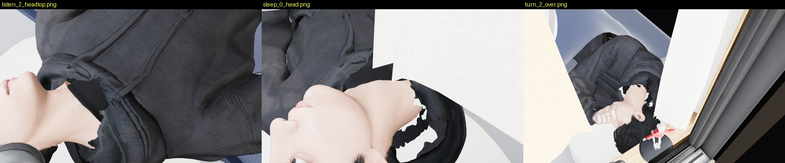
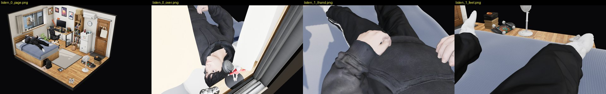

# Review: preview/bed-clips (G17)

- Reviewed: `ecabd00` (2026-10-07 14:43 UTC, WIP), reviewed 2026-10-07 15:55 UTC by G23.
- Scope: Laying_Nodding with the headphones (music), Laying_Sleeping, the side turn, `capBed`, wired into the default
  page (`boy_mh.js`, `room.html`): this changes the default page by design.

## Verdict: NOT OK (WIP). He now lies on the bed; the back still floats, the duvet balloons, and the headphones cut into the head

How I checked: the page with `?debug&nolive` (tests/visual fake server, SwiftShader), driven like contact_pass does
(`live('listen_music', {music})`, `live('sleep')`, then `mh.sleepTurn()`). Shots at 1, 5 and 9 s of the music loop,
asleep, and at 1.3 / 6 / 15.5 s of the turn, from the page camera, over the bed, at the head, hands and feet. This
branch's `contact_pass.mjs` (bed rows): `listen_music 8 s` with music in the tick, `sleep 10 s`. Tool: `tools/bed.py`.

## Measured (mine)
| row (contract) | listening, 240 frames | asleep, 300 frames |
|---|---|---|
| back over the quilt / mattress, by distance from the headboard (−1 … +0.5 cm) | 50 cm: **+2.7 … +2.8**; 60 cm: **+1.3 … +1.5**; 70–80 cm: +0.3 … +0.5; 90 cm: **+1.2 … +1.3** | 50 cm: **+1.5 … +2.6**; 60 cm: +0.3 … **+1.1**; 70–80 cm: −0.6 … 0; 90 cm: +0.3 … **+0.9** |
| row at 100 cm | +24.8 … +25.0 | +23.8 … +24.6 |
| head on the pillow (−2 … 0 cm) | −1.4 … −0.9 ✓ | −1.8 … −0.5 ✓ |
| toes inside the mattress end (> 0) | 4.0 cm ✓ | 4.1 cm ✓ |
| bed / bed frame / floor penetration | 0 / 0 / 0 ✓ | 0 / 0 / 0 ✓ |
| hands in his own body | 0 ✓ | 0 ✓ |
| headphones in his head | **198 vertices, 3.2 cm** (left cup), every frame | – |
| headphones under the pillow | 4 vertices, 0.5 cm | – |
| duvet gap over him (mean / max) | – | torso 4.4 / **20.3 cm**, legs 2.7 / 18.7 cm, arms 3.0 / 9.6 cm |
| largest skin jump between frames | 0.4 cm ✓ | 0.4 cm ✓ |

## Defects, by severity

### 1. The duvet balloons over him, worse during the turn — HIGH (seen at the page camera)

Asleep / turning 1.3 s / on his side 6 s, page camera: the duvet stands in peaks and a tent over his body (gap up to
20.3 cm over the torso, 18.7 cm over the legs), not his shape. The contract says the duvet follows his shape, with no
balloon. Fix: fit the drape to his skin under it at each update (the 30 Hz follow is there, but the shape doesn't come
down to him). Set each duvet vertex to the highest point of his skin under it + 1–2 cm, lowering as well as raising. Re-measure the torso gap max ≤ 4 cm.

### 2. Upper back off the bed: +2.6 to +2.8 cm at the shoulder blades — HIGH (contract −1 … +0.5)
Listening +2.7…+2.8 and asleep +1.5…+2.6 at 50 cm from the headboard. Also over +0.5 at 60 and 90 cm. `capBed` puts
his *lowest* skin on the bed, so the hips touch and the shoulders hang. Fix: in `bed_clip.py`, after levelling, bend
the upper spine (Spine01/Spine) back until the shoulder-blade band touches (−0.5 cm), not only the lowest point. Also
explain the 100 cm row (+24 cm in both): if it is the raised knees, label it so; if it is the buttocks, it is a
blocker.

### 3. Headphones inside his head — HIGH
contact_pass: the left cup is **3.2 cm** inside his head or hair (198 vertices), in every listening frame (right cup
1.3 cm, band 1.2 cm). Fix: in boy_mh.js `HP`, raise `EAR_WIN`/PRESS so the cushion sits on the ear surface: the left
cup needs about 3 cm further out along its axis (the head isn't symmetric: fit each side to its own ear, not mirrored).
Re-measure to ≤ 0.5 cm.

### 4. This branch rewrites `web/room/char_v5.glb` (fc96f54: its own socked feet) — integration BLOCKER
G19 (char-fix-feet) and G10d (char-fix) also rewrite `char_v5.glb`. Three versions of the same file. Its feet are a
third design (natural socks, no reference slides). C must choose one chain: collar script → G19's `feet.mjs` → this
branch's clips re-baked on that GLB (`bed_rebake.sh <final char_v5.glb>`). Don't merge the binary.

### 5. In bed you see main's open collar — note

From above, lying: the black gap and jagged hood at his neck (main's v5). G10d's collar fixes it. Re-check once the GLB
chain in 4 is settled.

## What is fine

He lies on the bed (no float, no drop at the join: 0.4 cm max per frame), head in the pillow, toes inside the mattress,
nothing through the bed or the frame, hands resting on his belly, not in it. The headphones are on his head while the
music plays, and the turn starts and plays (`mh.sleepTurn()` → turning after 20 frames).
