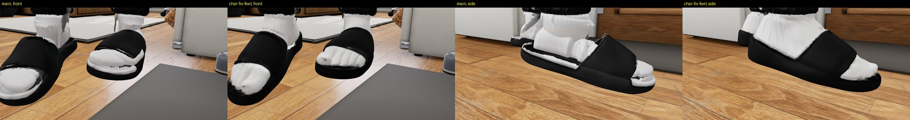
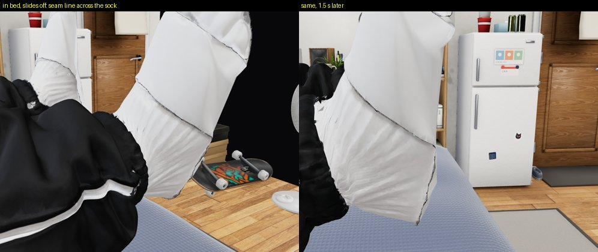
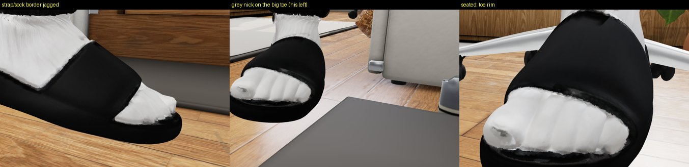
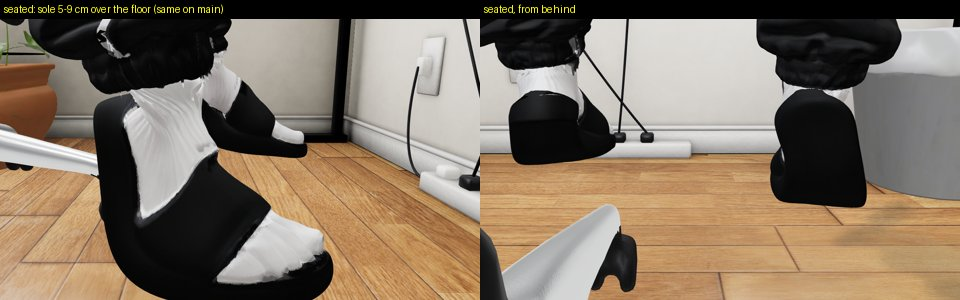
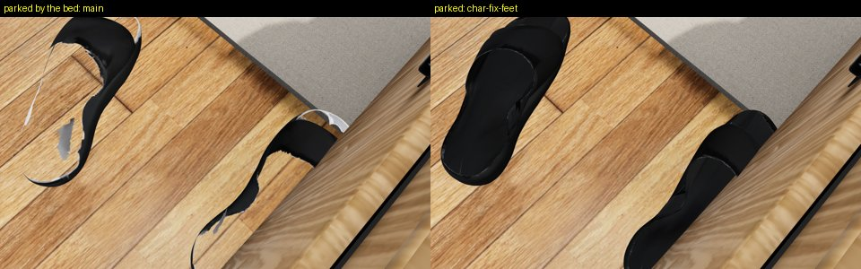

# Review: preview/char-fix-feet (G19)

- Reviewed: `8e65af7` (2026-10-07 13:03 UTC; the last commit only touches STATUS, the GLB is `d646417`'s), reviewed
  2026-10-07 13:45 UTC by G23.
- Scope: `web/room/char_v5.glb` (feet and ankles via `room_build/charfix/feet.mjs`). This replaces the default
  character's feet on the default page: no flag, by design.

## Verdict: OK to merge, with 2 fixes worth doing first (1 medium, 1 low)

A clear improvement over main at every angle: closed black slides, white socks, no white fringe, soles flat. The
parked pair by the bed is now a clean closed pair (main: open shells with white holes).

How I checked: the page (`/room.html?debug`, tests/visual fake server, SwiftShader) on this branch and on main,
scenes door / desk (mouse) / window / phone-in-bed / asleep, 3 frames each (0, 1.5, 3 s), close-ups of the feet from
front, side, back and floor level; lowest foot vertex per foot every 3rd frame for 6 s; `kimodo/contact_pass.mjs
research 8` on both trees; the parked slides from above.

## Measured (mine, not the maker's)
| | main | this branch |
|---|---|---|
| door, standing: lowest vertex L / R (cm over floor) | 1.83 / 0.51 | 1.89 / 0.56 |
| desk, seated, 6 s sweep: L / R | 9.1–9.4 / 5.3–5.8 | 9.2–9.4 / 5.4–5.9 |
| contact_pass research 8 s: soles L / R | 9.1–13.9 / 5.3–10.4 | 9.2–13.9 / 5.3–10.4 |
| contact_pass: chair / desk / floor penetration | 0 / 0 / 0 | 0 / 0 / 0 |

The feet move the soles by ≤ 0.6 mm. Standing: the supporting (right) sole is at 0.56 cm, inside the contract's
0..+1 cm.

## Defects, by severity

### 1. In bed (slides off): a dark seam line across each sock — MEDIUM

A thin dark jagged line runs across the top of the foot along the old strap outline, plus a slight relief of the strap
shape. Visible in every bed close-up (phone scene, frames 0 and 1.5 s). It is in the maker's "known, not fixed" list,
but this is exactly what the owner zooms in on. Small at the page camera.
Fix in `feet.mjs` step 5: dilate the "fill with sock white" mask by 3–4 texels around the strap/seam lines in the sock's
UV charts (the line is the unfilled edge of the old strap's black), and in step 2 pull the under-strap sock vertices
onto the sock's own smoothed surface (the 2.5 mm tube shows as relief once the strap is hidden). Re-shoot the
phone-in-bed close-up.

### 2. A grey nick on his left big toe; jagged sock/strap border — LOW

A grey spot on the left big toe's tip (the reference's dark toe spot not fully filled), visible standing and seated,
front view. The sock/strap and sock/footbed borders are ragged at close range (side view).
Fix: extend the toe-spot fill in step 5 (same mask dilation); optionally a 1-texel black bleed on the slide side of
the strap border.

### 3. Not from this branch: seated feet hover 5–14 cm over the floor — HIGH on main, out of this scope

Same on main (contact_pass: L 9.1–13.9, R 5.3–10.4 cm; contract 0..+1 cm). Belongs to the desk clips / IK
(G12's desk work / G21). Do not block this branch on it.

## Integration note for G10d (preview/char-fix)
Both branches rewrite `web/room/char_v5.glb`. G10d must run `node room_build/charfix/feet.mjs <after-collar.glb>
<out.glb>` after the collar script, not merge the two GLBs. I will check on preview/char-fix that the feet there are
these feet (socks + closed slides, the same seam numbers).

