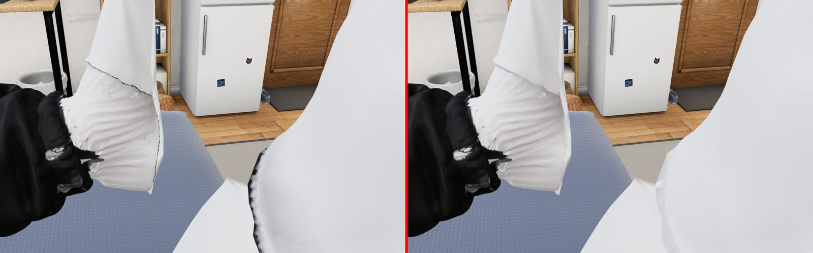
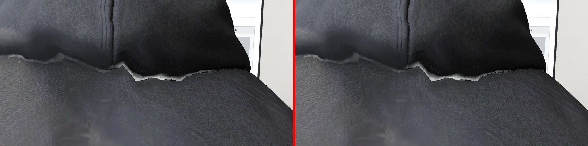
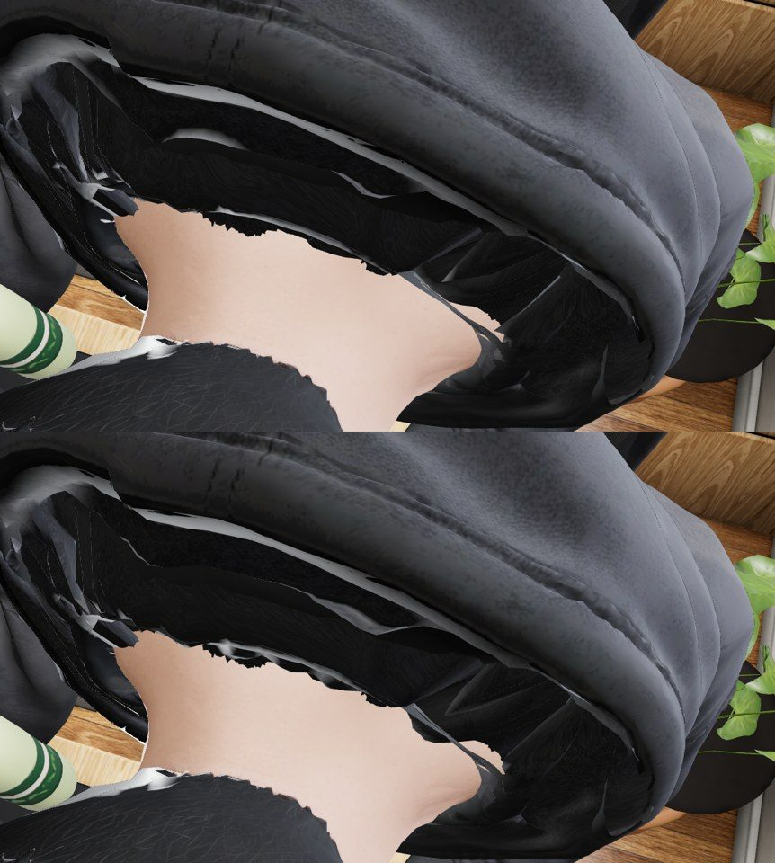
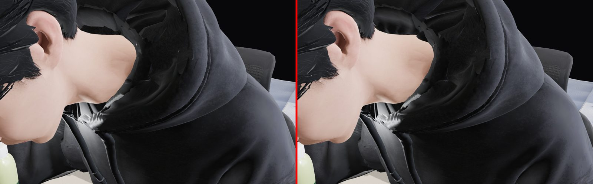

# Review: preview/char-fix-feet2 (G10d)

- Reviewed: `9052af0` (2026-10-07 14:36 UTC), reviewed 2026-10-07 17:20 UTC by G26 (takes over from G23).
- Scope: `web/room/char_v5.glb` on top of main's b2593d7 (the one character source). Same meshes and the same vertex and
  triangle counts as main (`tripo`, `slides`, `hood_lining`, `hood_patches`, `socks`). The slides are still the last
  skinned mesh.

## Verdict: NOT OK. The feet atlas fix is real and good. Of the collar brief, only the nape changed, and only a little

How I checked: the page (`room.html?debug`, tests/visual fake server, SwiftShader) on main 0ac47f8 and on this branch,
scenes door / desk / phone in bed / asleep. Frames 0, 1.5 s and 3 s. The page camera, plus close-ups of the throat
(front and 3/4), the nape from above, the back from behind, each foot, and the feet from above. I diffed every shot
pixel by pixel against main (`tools/shoot.py`, `tools/shoot2.py`).

| what | pixels that differ from main (> 20/255) | reading |
|---|---|---|
| throat front, standing | 183 / 1 M | unchanged |
| throat 3/4, from above, standing | 54 | unchanged |
| nape from above, seated | 17,000 | the roll moved slightly; still jagged |
| feet, every view | 8,000–13,000 | the atlas fix, visible |
| back, seated | ~0 | unchanged |

Soles are the same as main: standing 0.56 / 1.89 cm (R/L), at the desk 0.34–0.38 cm. No console errors.

## Fixed (checked)

Main left, this branch right: in bed with the slides hidden, the black seam line along the sock's top and the dark rim
down the other foot's edge are **gone**. So is the grey nick on the left big toe (door, front of the feet). G23's
char-fix-feet defects 1 and 2 are closed.

## Defects, by severity

### 1. A white zig-zag line where the hood meets the back, seated, from the page's own side — HIGH

Main left, this branch right: same on both. At the desk the page camera looks at his back. Along the hood's lower edge
runs a torn, saw-tooth band of light grey/white, about 15 cm long, with a notch beside the hood's centre seam. At page
distance it reads as a thin jagged light line under the hood. This is the "grey patch on the back" in this branch's
brief, and it is not touched.
Fix: it is the hood's underside (or the lining's back) showing through a gap between the hood rim and the back panel.
Either push the hood's bottom rim 3–5 mm into the back (along the rim's ring), or give the lining's back faces the
hoodie's dark fabric colour instead of the light atlas region they sample now. Check: from behind the chair at the
desk, no pixel lighter than the hoodie's own lightest fabric along the hood base.

### 2. Nape from above: torn lining edge, white glints — MEDIUM (was HIGH in G23's char-fix review)

Main top, this branch bottom, seated, looking down into the collar. The new roll lifts the back of the lining a little,
but its top edge is still ragged, with shards and specular white slivers. The neck skin's cut edge is still saw-toothed.
Fix as in G23's char-fix.md defect 2: one Laplacian smoothing pass on the lining's top rim ring, start the lining's
bottom ring 1 cm under the lowest neck-skin vertex per 3° sector, and set the lining's roughness to 1 (the glints are
specular on the inner faces).

### 3. Throat edge and front patch: not reworked — MEDIUM

Main left, this branch right: identical. The brief's throat edge and front patch (G23 char-fix.md defects 2 and 3) are
not in this commit. Its message names only the nape and the feet. Either do them here, or say in STATUS that they are
dropped and why.

## Integration
This branch is the right place for character changes (it builds on main's GLB with the same scripts). If C wants the
feet now, the atlas part alone is clean and could ship. The collar items stay open.
