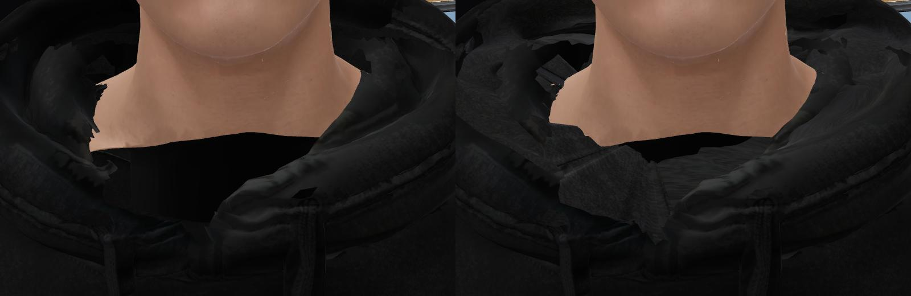
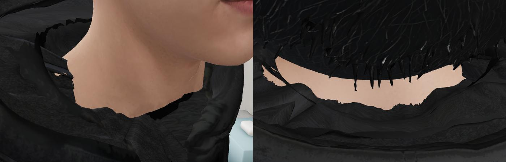
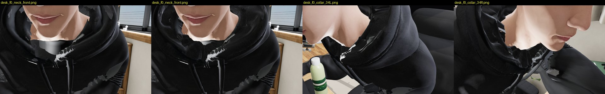
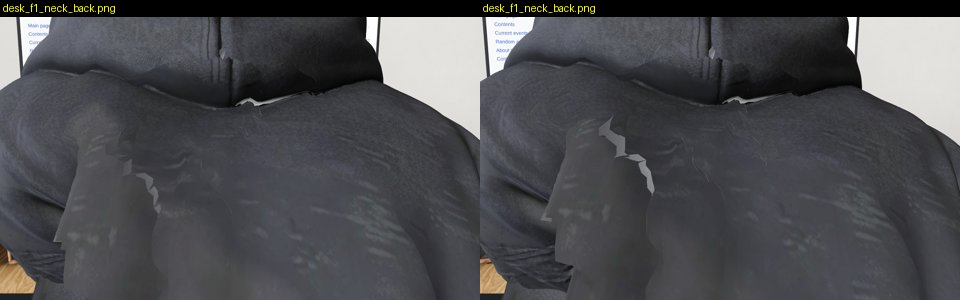

# Review: preview/char-fix (G10d)

- Reviewed: `92003d6` (2026-10-07 13:58 UTC), reviewed 2026-10-07 14:45 UTC by G23.
- Scope: `web/room/char_v5.glb` with two new parts, `hood_lining` and `hood_patches` (collar only). Default character
  on the default page, no flag, by design.

## Verdict: NOT OK yet. The collar is a clear step up from main; the brief's feet are missing, and the throat edge is ragged

How I checked: the page (`/room.html?debug`, tests/visual fake server, SwiftShader) on this branch and on main, scenes
door / desk (mouse) / phone in bed / asleep, frames 0 and 2 s, cameras on the neck from the front, back, 3/4 left and
right from above, straight down from behind, and down from the front. Mesh list read from the GLB; the page's
`skinMesh()` checked live (still `slides`: the new parts do not break the slides-off logic).

Main left, this branch right, standing at the door: the black hole under the chin is now fabric.

## Defects, by severity

### 1. No socks or slides from the reference: G19's feet are not in this GLB — BLOCKER for the brief
Meshes: `tripo_mesh…, slides, hood_lining, hood_patches`. No `socks` mesh: the feet are still main's (white fringe,
open slides). The brief is collar + feet. Fix: run G19's script on your output as its README says:
`node room_build/charfix/feet.mjs <your char_v5.glb> web/room/char_v5.glb` (from preview/char-fix-feet), keep
`slides` as the last skinned mesh, commit. I will check the feet numbers match char-fix-feet.md.

### 2. Throat and nape: a ragged cut edge, a black sliver, a pinhole of light — HIGH (the owner's first close-up)

Left (3/4 right, from above, standing): the neck skin ends in a torn, saw-tooth edge; under it a thin **black void**
between the skin and the lining at the front of the throat, and at the left of the neck a **bright pinhole** (light
through a gap between the lining and a patch). Right (straight down behind the head): the lining's top edge round the
nape is jagged with flat shards, skin showing in uneven bites between hair and lining.
Fix: in `lining.py`, start the groove's bottom ring **under** the neck skin's lowest edge (take the lowest neck-skin
vertex per 3° sector, go 1 cm below it and 2 mm inside), so the skin's cut edge always sits on lining, never on air.
Close the pinhole: the patch fan and the lining must share the loop vertices (weld), not just meet. Smooth the lining's
top rim (one Laplacian pass on the rim ring, or follow the hood's inner rim through a 5-point moving average).

### 3. The front fill reads as a patch — MEDIUM

Main / this branch seated at the desk, then 3/4 left and right. The filled area under the chin (front fan by the
drawstring) is a flat, lighter grey polygon with a different grain from the hood around it (also in image 0, front
left of the throat). Fix: darken and match the patch's texture scale to the hood's fabric there (sample the hood's
own UVs next to the loop instead of the 7.6 cm tiled patch), and give the fan a slight dome (push its centre 3–5 mm
outward) so it doesn't render as a flat plate.

### 4. Pre-existing on main, not from this branch: a light grey jagged patch on the back of the hoodie — MEDIUM

Main left, this branch right, seated, from behind: the same lighter patch with jagged edges below the right shoulder
blade. A texture chart seam in the hoodie. Out of scope here; worth a separate fix (C to route).

## What is fine
Collar closed all round in every pose I shot. From the back and the sides there are no back faces and you can't see
into the body. The hood's outer shape and the face are untouched. The bed still takes the slides off (the page's
`skinMesh()` is still `slides`).
