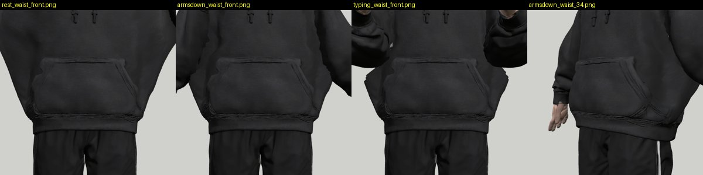
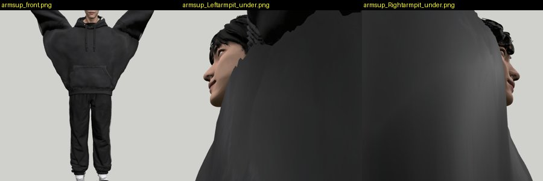
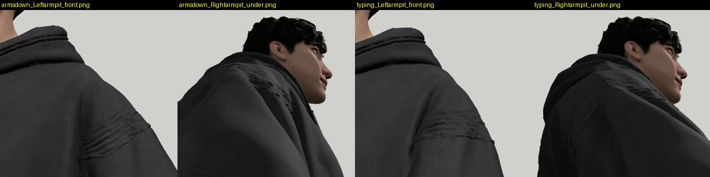
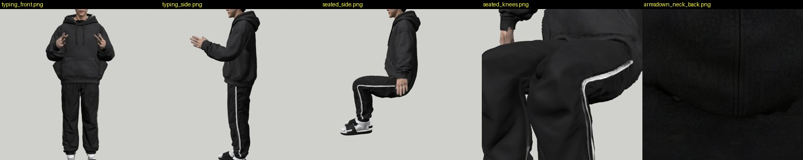

# Review: preview/mixamo-pipeline (G20)

- Reviewed: `2cbbfa1` (2026-10-07 12:53 UTC), reviewed 2026-10-07 13:25 UTC by G23.
- Scope: `web/room/char_mixamo.glb` (v5 on the 65-bone Mixamo skeleton). The page does not load it yet (that is G21),
  so the default page is unchanged by construction: `room.html` / `boy_mh.js` are not in the diff.

## Verdict: NOT OK (rig usable, skin weights at the flank not shippable)

How I checked: my own three.js page loading the GLB through the branch's `web/room/char_mixamo.js`, bones posed by hand
(world-axis rotations) because no Mixamo-skeleton clip GLB is committed (raw FBX rightly not in git): arms down 63°
(v5's modelled pose), a typing pose (arms down 75°, forward 25°, elbows 85°), arms up 40°, seated (hips 90°, knees 90°).
Close-ups of armpits, elbows, flanks, knees, hips, neck. Weights read straight from the skinned mesh.

## Defects, by severity

### 1. Flank "fins": hoodie torso vertices skinned to the upper arm, down to the waist — HIGH

Rest (T) / arms down / typing / arms down 3/4. With the arms down or typing, the hoodie's sides break into pointed
corners at pocket height on both sides; in typing a horizontal notch cuts across each flank.

Measured: **4,792 vertices** of the torso region (rest |x| < 30 cm, 0.85–1.25 m high) carry ≥ 10 % `LeftArm`/`RightArm`
(+ForeArm) weight, **911 carry ≥ 30 %**, the lowest at **y = 1.04 m** (hips are at 0.92 m, the armpit ~1.30 m).
Arms down 63°: those vertices move up to **15.7 cm**. This is what every seated/typing clip will show at the page camera.

Fix: in `rig/autorig/fit.py`'s weight step, clamp the arm bones' influence on the torso: zero `*Arm`/`*ForeArm` weight
below the armpit line (≈ y 1.22 m at rest) for vertices whose nearest bone segment is the spine, with a 4–6 cm falloff
up to the armpit; renormalise into `Spine`/`Spine01`. Re-measure: torso-region vertices with arm weight ≥ 10 % below
1.22 m → 0, arms-down move of the flank ≤ 2 cm.

### 2. Arms up: a web from the armpit to the hem — HIGH for any stretch/gesture clip

Arms raised 40° above horizontal: the whole hoodie side stretches into a wing from wrist to waist, flank moves
**10.3 cm, 7.2 cm outward**. Same root cause as 1; will show in Stretching / Standing_Clap / Angry_Gesture.
Fix: same clamp; then re-shoot arms-up 40° and 90° from the front.

### 3. Armpit crease streaks — MEDIUM

Dark parallel streaks across the shoulder/armpit seam in arms-down and typing (front and from below): a narrow band of
stretched/folded triangles where the weight jumps between `Spine` and `*Arm`. G20's own number: arm in torso ≤ 2.5 cm
in every clip (contract target ≤ 1.2 cm, G20's STATUS says so too). Fix: smooth the shoulder/arm weights over a wider
band (σ ≈ 3–4 cm across the armpit), then re-run `qa.mjs` and show the arm-in-torso number ≤ 1.2 cm.

### 4. Not tested here (needs G21's page wiring)
Soles −0.5…−2.1 cm in the clip frame (G20's number), contact with chair/desk/bed. Checked on preview/mixamo-wiring.

## What is fine

Elbows bend cleanly in the typing pose (no candy-wrapper at the elbow or wrist), knees and the seat of the trousers in
the seated pose are clean, the back of the neck/hood is closed, fingers present (65 bones, `finger1-1.R` …).
