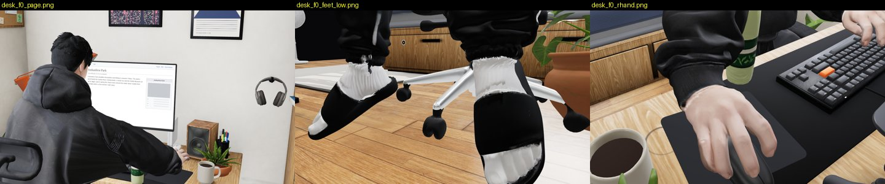
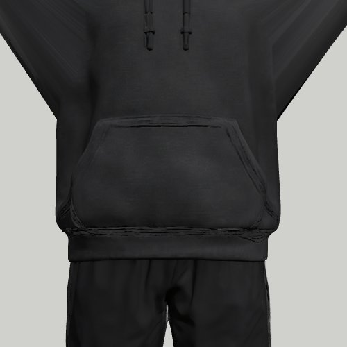
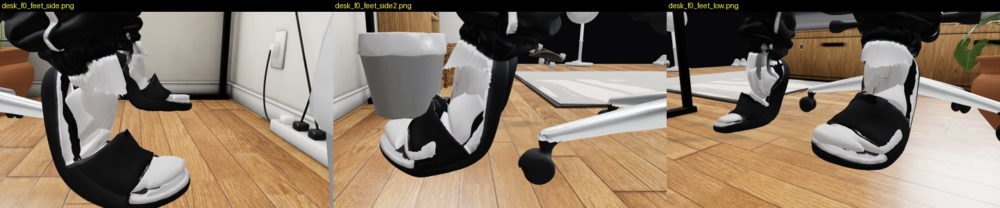
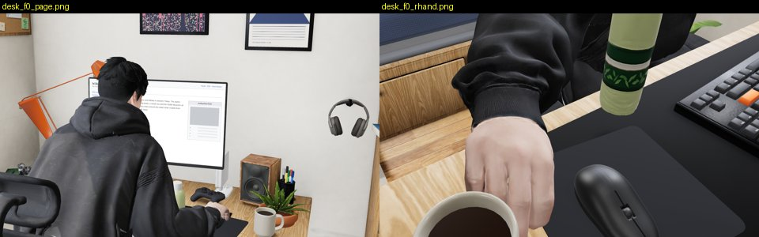
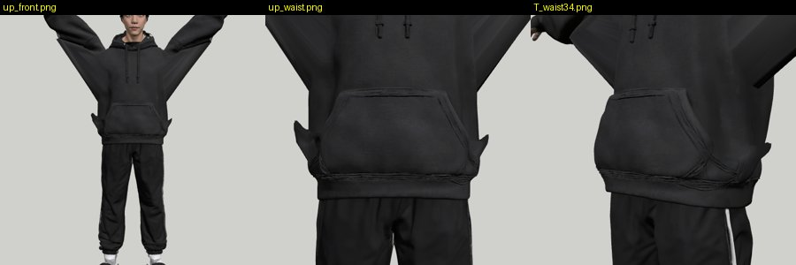
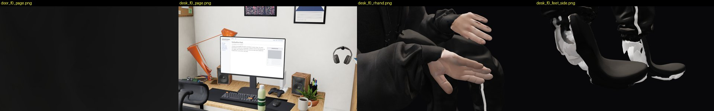
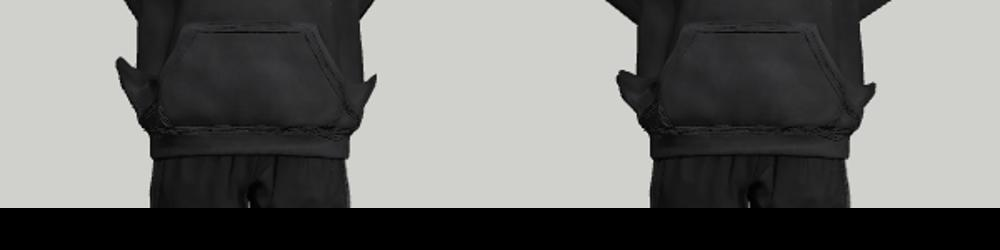
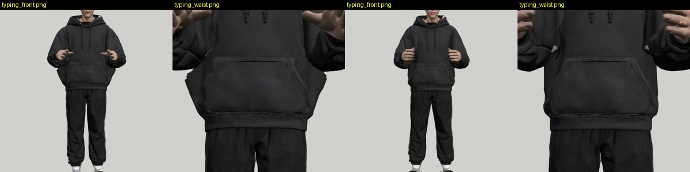
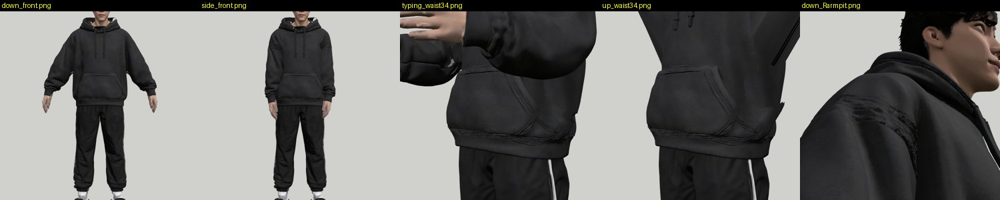

# Review: preview/mixamo-wiring (G21)

- Latest: `d663a1d`, reviewed 2026-10-07 17:50 UTC by G26 (round 5: OK). Round 4: `94061b7`. Round 3 was `edd3a02` (G23).
- Default page (no flag) on this branch: v5 loads, boy_mh ready, desk_mouse_ik at the desk, hips at 0.83 m, the same as
  main. **Unchanged.**

## Round 5 (d663a1d, 2026-10-07 17:27 UTC), reviewed 17:50 UTC by G26: OK

All four round-4 defects are closed, checked on the page:
- **One source:** `char_mixamo.glb` now has `tripo, slides, hood_lining, hood_patches, socks`. It is autorigged from
  main's `char_v5.glb` (b2593d7, merged), so `?char=mixamo` and the default page show the same person.
- **Feet at the desk:** soles 0.19 / 0.72 cm (L/R) over the floor, from 7.4 / 4.3. White socks in black slides, no
  shards.
- **Right hand:** on the mouse, every frame I shot.
- **Hem horns:** `w2.mjs` arms up 40°: 4 vertices > 3 cm, max 3.3 cm, all at y 1.29 m (the shoulder, not the hem). T:
  0 vertices, 2.3 cm. Sides / typing: 0, 0.7 cm.
- **Default page:** desk and door, the page camera and the right hand, pixel-equal to main (≤ 6 px over 20/255); soles
  identical. No console errors.
 

Left over, not this branch's: the hood base's light zig-zag on the back shows here too. It comes with main's GLB
(char-fix-feet2.md, defect 1), and the rig will need one more autorig run when that GLB changes. G22 can re-bake the
standing clips on this `char_mixamo.glb` now.

---

## Round 4 (94061b7, 2026-10-07 15:53 UTC), reviewed 17:25 UTC by G26: NOT OK

`?char=mixamo` now loads. The three `room_mx_*` desk clips are committed, `boy_mh` starts, there are no console
errors, and he sits in the chair at the desk, lies on the bed (phone, asleep) and stands at the window. **Round 3's
blocker is closed.** The default page is unchanged: the only `room.html` change is the same ternary rewritten.
Checked on the page (tests/visual fake server, SwiftShader): desk / phone / asleep / window, frames 0, 1.5 s and 3 s,
with the page camera and close-ups of the feet from both sides and low, the hands and the waist. The hem test is
G23's `tools/mx/w2.mjs`, re-run on this GLB.

### 1. BLOCKER (binding decision): `char_mixamo.glb` is not built from main's `char_v5.glb`
Its meshes are `tripo_mesh…, slides`: no `hood_lining`, `hood_patches` or `socks`. It is still the pre-b2593d7 v5,
with the open collar and the old slides. The character has one source, main's `web/room/char_v5.glb` (b2593d7), so
`?char=mixamo` shows a different person from the default page. G22's standing clips wait on this too.
Fix: `rig/autorig.sh` on main's `web/room/char_v5.glb` (all five meshes, `slides` kept as the last skinned mesh),
re-run `mx_room.sh`, commit, and say so in STATUS.

### 2. At the desk his feet hang 4–7.6 cm in the air, tilted, with torn white shards — HIGH

`desk_mouse_ik`, every frame for 6 s: left sole 7.35–7.61 cm, right 4.12–4.71 cm over the floor. The slides tip about
40° toe-down in mid-air, and white fringe and sock shards stick out above the straps. (On the default page, main's v5
sits at 0.34–0.38 cm.) The commit says "heels up on our high chair", but neither the toes nor the heels touch
anything.
Fix: after the rebuild (1), plant the soles: the toe IK target on the floor (y = 0 +0.5 cm) and the heel free, or both
flat. Check with `contact_pass.mjs` at the desk: lowest sole vertex 0…+1 cm on every frame.

### 3. The right hand rests on the coffee cup, not on the mouse — HIGH

At the page camera his right hand drapes over the rim of the mug beside the mouse pad, every frame. On v5, the same slot
(`desk_mouse_ik`) has it on the mouse. The carried-over clip puts the wrist about 10 cm short and to the right.
Fix: in `mx_convert.mjs`, for `desk_mouse_ik`, re-solve the right arm onto the page's mouse socket (as v5's IK does)
instead of copying v5's joint rotations. Check: the palm centre within 2 cm over the mouse on every frame.

### 4. Hem horns: unchanged on 94061b7 — HIGH for clap / angry gesture

`w2.mjs` on this GLB: arms up 40°, 359 hoodie vertices move > 3 cm, max **7.2 cm**, down to y **0.93 m**. T: 172
vertices, 4.8 cm. Typing and arms at the sides: 0 vertices > 3 cm. These are the same numbers as edd3a02: "the arm part
ends at the shoulder" did not reach the hem. The fix is as in round 2: no `ForeArm`/`Hand`/finger weight on any hoodie
vertex.

---

## Round 3 (edd3a02): NOT OK, `?char=mixamo` does not load its clips

### 0. BLOCKER: `room/mh_mx/room_mx_typing.glb` is 404; boy_mh.js never starts, he floats in the void

`room.html?debug&char=mixamo`, desk scene: the page camera shows the empty chair; the close-ups show him in black
space. Console: `MakeHuman clips: Error: room/mh_mx/room_mx_typing.glb ... 404`. `mh.ready` is still false after
180 s, the old clip slots play (`type`, `stand`), and his hips are at **y = 73.6 m** (the unscaled skeleton).
`char_mixamo.js` `ROOM.clips` asks for `room_mx_typing`, `room_mx_sit_to_type` and `room_mx_type_to_sit`. None is
in `web/room/mh_mx/` (13 files committed, against 28 in `mh_v5/`: also missing `desk_type_ik`, `desk_watch`,
`room_sit_down`, `room_stand_up`, `room_sleeping_idle`, `room_laying_*`, `room_mx_*`).
Fix: commit every GLB that boy_mh.js asks for under `clipDir`, or fall back to `mh_v5` per missing clip, and make a
failed clip load visible (a hard failure in tests/visual for `?char=mixamo`, not just a console warning). Then I review
the desk/bed/stand clips in the page.

### 1 (still open). Hem horns when the arms go up: the same on edd3a02

Re-measured on the new GLB: arms up 40°, 359 hoodie vertices move > 3 cm, max **7.2 cm**, down to y **0.93 m**. T: 172
vertices, 4.8 cm. Typing and arms at the sides are still clean (0 vertices > 3 cm, max 2.2 cm). Fix as in round 2.

---

# Round 2 (edf0bce), kept for reference
## Verdict: NOT OK yet (WIP). The weights are a real fix; one new defect at the hem.

How I checked: the same hand-posed test as for G20, but with **absolute arm directions** (G21 now binds as modelled,
arms down, so rest-relative rotations are not comparable): arms as modelled (63° down) as the reference, then arms
at the sides, typing, T, arms up 40°. Metric: vertices whose main bone is `Spine*`/`Hips` (the hoodie's body, every
2nd vertex) that move more than 3 cm when only the arms move. Tool: `tools/mx/w2.mjs`.

| pose | G20 (2cbbfa1): moved > 3 cm / > 6 cm / max | G21 (edf0bce) |
|---|---|---|
| arms at the sides | 154 / 0 / 5.9 cm | **0 / 0 / 2.0 cm** |
| typing | 37 / 0 / 5.7 cm | **0 / 0 / 2.2 cm** |
| T | 2,123 / 643 / 16.2 cm | 195 / 0 / 4.9 cm |
| arms up 40° | 2,504 / 1,696 / 24.1 cm | 386 / 60 / 7.3 cm |

G20 left, G21 right: the flank "fins" in typing are gone.

## Defects, by severity

### 1. Horns at the hem's sides when the arms go up — HIGH for clap / angry gesture / stretch
(image: round 3 above)
Arms up 40° (left) and T (right): a pointed flap sticks out of each side of the hoodie at pocket height. The moved
vertices go down to **y 0.95 m** (the hem), 386 over 3 cm, max 7.3 cm. Likely cause: bound arms-down, the sleeve cuff
and the hand sit right next to the hoodie's hem, so the nearest-bone weights give hem vertices some `ForeArm`/`Hand`
weight; the new span rule limits along the limb, not across the gap to the body.
Fix: in `fit.py`, the "hoodie takes no arm weight beyond 7 cm from the shoulder" rule must also cover `ForeArm`/`Hand`
(and fingers) for every vertex of the hoodie part, whatever its distance to the cuff. Check: arms up 40° and T, hoodie
vertices moved > 3 cm below y 1.15 m → 0.

### 2. Armpit residual 2.0–2.4 cm — MEDIUM, agreed with the maker's reading
I agree with STATUS_WIRING: what remains is pose against a baggy body, not weights. The dark streak across the
shoulder seen in the armpit close-ups is in the texture (it is there in the bind pose too), not a weights fold: I
withdraw that point from my G20 review.

### 3. Feet: char_mixamo has main's old slides
The Mixamo character still carries main's open slides with the white fringe. When G19's feet land (`feet.mjs`), the
autorig input must be the G19 (+G10d) `char_v5.glb`, not main's.

## Still to review when it lands
`?char=mixamo` on the page: desk clips at the page camera and close-ups, soles/seat/keys with `contact_pass.mjs`, the
default page byte-for-byte unchanged without the flag.

