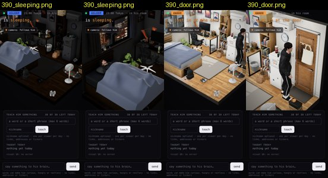
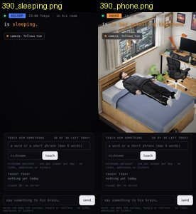

# Review: preview/phone-camera (G25)

- Reviewed: `ba06b4f` (2026-10-07 17:07 UTC), reviewed 2026-10-07 17:50 UTC by G26.
- Scope: `web/room.html` camera logic, phones only (`camera.aspect < 1`), plus a test (`tests/visual/test_phone_camera.py`).

## Verdict: NOT OK. One fix away: the framing is right, but once it framed a stale bone and the canvas went black

How I checked: my own tool (`tools/phonecam.py`), not the branch's test. The page at 390×844 (mobile) and 1280×800, on
this branch and on main 0ac47f8. Scenes asleep, phone in bed, door, desk, walking. Each time the follow camera runs
4 s (the page's goal plus the 1.2/s lerp), and then I shoot with the header, as a visitor sees it. I record his
head's pixel position against the header's bottom (156 px on 390).

| 390×844 | main: head px (x, y) | branch: head px | reading |
|---|---|---|---|
| asleep | (11, 209), on the left edge, bed cut | (121, 312) | framed, under the header |
| phone in bed | (11, 206) | (121, 312) | framed |
| door | (371, 166), at the right edge | (198, 249) | centred |
| walking | (192, 141), **under the header** | (195, 247) | under the header no more |
| desk | (78, 256) | (78, 349) | the monitor shot slid under the header ✓ |

At **1280**, all five scenes are identical to main: the same camera positions and head pixels. Desktop is unchanged.

390, asleep and at the door: main, then this branch.

## Defects

### 1. Right after load, asleep, the camera flew to y = 115 m: a black canvas — HIGH (intermittent: 1 of 2 runs)

Left: the first scene after the 390 page loaded was "asleep". `pose().clip` was still the old rig's
`Armature|Sleep_Normally|baselayer`, and the camera ended at (8.7, **115.5**, 5.1): an empty dark canvas. Right: the
same branch with asleep as the second scene, framed fine. `narrow()` only checks `boy.visible && bones.Hips`.
`frameHim()` then trusts whatever `bones.Hips` is, and while the old rig is still live that bone sits ~100 m up
(the unscaled skeleton G23 saw on `?char=mixamo`). On main, the fixed overview hid this.
Fix: frame only the character that is drawn and ready (v5: `mh.ready`), and clamp the goal: if the hips are outside
the room box (x −1.75…3.5, y 0…2.5, z −1.3…3.5), keep the overview. Add this case to the test: the first scene after
load, asleep, at 390.

### 2. Merge with main conflicts in `tests/visual/scenes.py` — LOW
The branch is on b851745. `web/room.html` merges cleanly with main 0ac47f8, but `scenes.py` does not. Merge main
in and re-run the test before C takes it.
