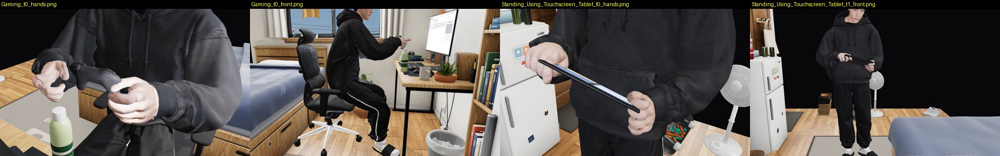
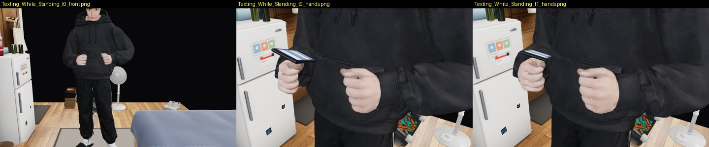
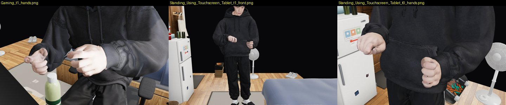
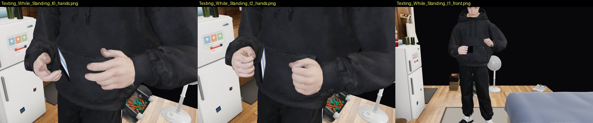
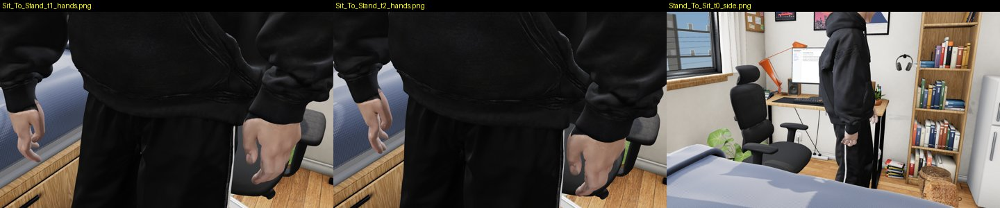
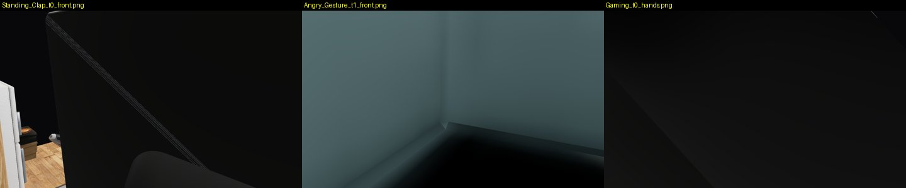
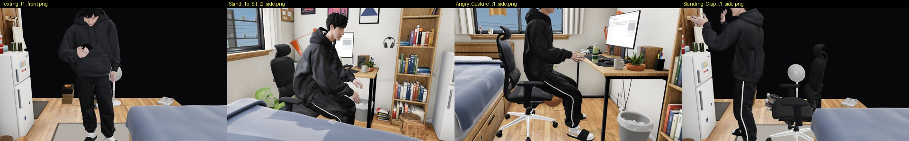

# Review: preview/standing-clips (G22)

- Latest: `9640cbf`, round 2 by G26 (below). Round 1: `7aec913` (2026-10-07 14:14 UTC, WIP), reviewed 2026-10-07 15:10 UTC by G23.
- Scope: 9 Mixamo clips on `char_mixamo.glb` via `room.html?char=mixamo&clip=<Clip>` (`standing_preview.js`).
- Default page: the new `room.html` block only runs with both `char=mixamo` and `clip` (code read; it returns before
  touching anything otherwise). Unchanged without the flag.

## Round 2 (9640cbf, 2026-10-07 16:09 UTC; clips from 63efec3), reviewed 17:45 UTC by G26: NOT OK, blocked on the rig

Checked through the page flag on Texting_While_Standing, Gaming and Standing_Using_Touchscreen_Tablet: soles every frame
of the whole clip, and shots at 30 % and 60 % (the preview's own front view, plus the hands). Tool: `tools/clips.py`.

| clip | lowest foot over floor, cm | frames > 1 cm | errors |
|---|---|---|---|
| Texting_While_Standing | 0.39–0.40 | 0 / 707 | none |
| Gaming (seated) | 0.39 | 0 / 151 | none |
| Standing_Using_Touchscreen_Tablet | 0.40 | 0 / 994 | none |

### Closed

- Defect 1: Gaming now holds the page's controller between his hands, and the tablet clip holds a plain dark tablet with
  its screen up to him. No more miming.
- Defect 4: the front camera has a clear view on all three.
- Defect 3 (hands in thighs): I take G22's surface numbers. My renders show the hands beside the leg, not in it.

### Open
1. **BLOCKER (binding decision): the clips are baked for the old `char_mixamo.glb`**, which is not main's
   `char_v5.glb`: old slides with the white fringe, open collar. Not G22's fault: it waits on G21 (mixamo-wiring
   round 4, defect 1). Fix: `standing_rebake.sh` on the rebuilt `char_mixamo.glb`, then the contact and sheet again.
   I re-review then.
2. **Texting_While_Standing: the phone is held out at his right hip, not in front of him — MEDIUM.**
   
   At 30 % and 60 % the phone sits at the side of his body at hip height, screen up and outward, while his head looks
   down to the front. The other hand is a loose fist over the pocket with nothing to tap. It reads as holding a phone,
   not texting. Fix: bring the phone hand's IK target to 25–30 cm in front of the sternum, 10 cm under the chin, and
   put the left thumb over the screen, or drop the two-handed part.
3. **Gaming: only the right hand grips — LOW.** The left hand's fingers stay open beside the controller's left grip.
   Fix: curl the left fingers round the grip (the socket's grip pose, as for the right).

---

## Verdict: NOT OK (WIP). Contact is good; two clips have no prop, and one holds the phone wrong

How I checked: every clip loaded in the page through the flag (tests/visual fake server, SwiftShader). Soles measured
every frame of the whole clip (lowest skin vertex of each foot over what is under it). Shots at 10 / 45 / 80 % of each
clip (front and side from the preview's own `SP.view`, plus close-ups of the feet and hands), and Sit_To_Stand again at
75 / 90 / 99 %. `CLIP=<Clip> kimodo/contact_pass.mjs` (this branch's clip mode) on Scared, Angry_Gesture, Gaming,
Sit_To_Stand, Stand_To_Sit. Tool: `tools/clips.py`.

## Measured (mine)
| clip | kind | lowest foot over floor, cm (min–max over all frames) | frames > 1 cm | seat gap, cm | hands in thighs (contact_pass) |
|---|---|---|---|---|---|
| Texting | standing | 0.39–0.40 | 0 / 556 | – | – |
| Texting_While_Standing | standing | 0.39–0.40 | 0 / 707 | – | – |
| Standing_Using_Touchscreen_Tablet | standing | 0.40 | 0 / 994 | – | – |
| Standing_Clap | open chair | 0.22–0.40 | 0 / 143 | – | – |
| Angry_Gesture | desk chair | 0.31–0.40 | 0 / 175 | −0.3 … +1.8 | 0 |
| Gaming | desk chair | 0.39 | 0 / 151 | −0.3 … +0.3 | 0 |
| Scared | open chair | 0.12–3.23 (the jump) | 5 / 302 | −0.7 min | **28 frames, 256 verts, 2.5 cm** (t 5.07 s) |
| Sit_To_Stand | page's sit-down chair | 0.33–0.40 | 0 / 62 | +0.4 min | **17 frames, 2,013 verts, 8.5 cm** (t 2.07 s) |
| Stand_To_Sit | page's sit-down chair | 0.36–0.40 | 0 / 67 | −0.1 min | **27 frames, 2,672 verts, 7.0 cm** (t 0) |

contact_pass found nothing inside the chair, desk, walls, bed, other furniture or the floor in any of the five.

## Defects, by severity

### 1. Gaming and the tablet clip have no prop: he mimes into the air — HIGH

Gaming (seated): both hands pinch an invisible controller. Standing_Using_Touchscreen_Tablet: claw hands at the belly
with nothing in them for 33 s. The owner reads this as an unnatural pose straight away.
Fix: attach `room/controller.glb` to the sockets for Gaming (both hands, grip from the clip's first frame, as the
phone). For the tablet, either a simple tablet prop (a rounded slab, 25 × 17 × 0.7 cm, on the left socket) or drop the
clip from the set until there is one.

### 2. Texting_While_Standing: the phone is edge-on, screen facing sideways — HIGH

In the right hand the phone stands on its long edge, screen turned out to his right, not up toward his face. The
other hand's thumb taps at nothing. (Texting, the other phone clip, holds it right.)
Fix: in `standing_preview.js`, set the phone's orientation in the socket from the clip (screen normal toward the head
bone, averaged over the clip) instead of the palm normal on frame 0, or give this clip its own socket rotation in
`standing_clips.meta.json`. Check: the screen normal within 30° of the direction from the phone to his eyes over the clip.

### 3. Hands in thighs: Sit_To_Stand 8.5 cm, Stand_To_Sit 7.0 cm, Scared 2.5 cm — MEDIUM, needs a check

contact_pass's leg capsules flag thousands of hand vertices in the standing part of both transitions (hands hanging at
the sides). In my renders the hands hang **beside** the trouser leg, fingers at most just touching the cloth, so the
capsule (radius 15–16 cm, from the baggy trousers) probably overstates it. Either way, say which it is: test the hand
vertices against the trouser **surface** (nearest-triangle side), not the capsule, and report that number. If it is
real, move the arms 3–5° out from the body in the bake (the arm-clearance step G21 described).

### 4. The preview's "front" camera lands inside a wall or the chair for chair clips — LOW (tooling)

`SP.view("front")` for Standing_Clap, Scared, Angry_Gesture and Gaming renders a wall or the chair's back. The `side`
view is fine. Fix: also test the line of sight from the camera to his chest (raycast against the room), not only
"inside the room box".

### 5. Feet are main's old slides — note
`char_mixamo.glb` comes from main's v5: open slides with the white fringe (see Texting's feet close-up). Re-run autorig on
the G19 (+G10d) `char_v5.glb` once those land.

## What is fine

Feet stay planted: 0.3–0.4 cm over the floor in every standing frame. The seat holds him in the seated clips (gap
within −0.7 … +0.3 cm, nothing under the cushion). No furniture or wall penetration. Texting's phone grip looks natural.
Sit/stand at the page's own chair reads right from the side.
