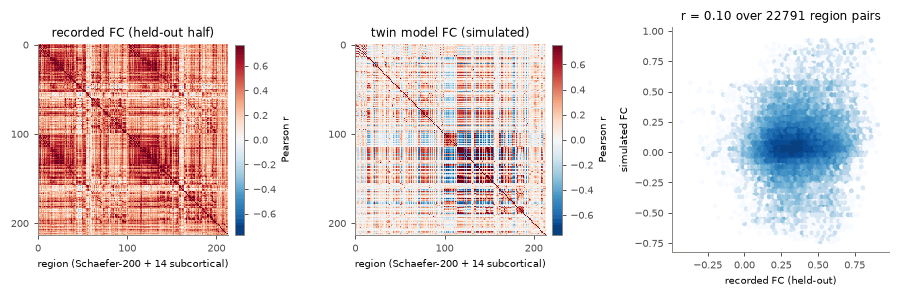
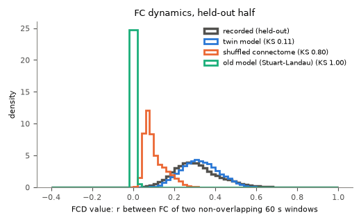
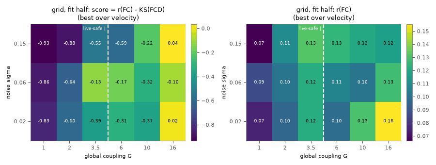
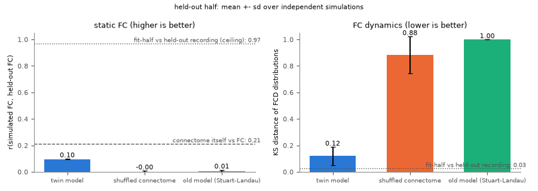

# Fitting the twin to the recorded resting-state activity (`twin/fit.py`)

SUB-01 v2 is a digital twin model of one real person's brain structure and recorded activity (MyConnectome,
OpenNeuro ds000031). It is not a mind, not conscious and not the person. This section describes how the free
parameters of the neural mass model (`twin/model.py`, see `docs/twin/model.md`) were fitted to the person's
recorded resting-state fMRI, and how well the fitted model reproduces recordings it was not fitted to.

Everything here is reproducible with

```bash
OMP_NUM_THREADS=1 python -m twin.fit all --workers 3     # about 2 h on 3 cores; checkpoints in /home/user/fitcache/full
python -m twin.fit write                                 # re-write params.json, twin_score.json and the figures
python -m twin.fit all --quick                           # 2-3 minute smoke run of the same pipeline (outputs in the cache)
python -m pytest tests/test_fit.py -q
```

The checkpoint directory can be moved with `--cache` or the environment variable `SUB01_FITCACHE`.

## Data

- **Recordings.** The 131 resting-state runs that passed the homotopic-correlation QC (`out/rest/qc.json`,
  `kept = true`; ses-012 was rejected). They come from 94 sessions:
  - 91 sessions of the original year of scanning (ses-011 to ses-104, 2012-10-18 to 2014-03-11; Siemens Skyra 3 T,
    multiband 4, TE 30 ms). ses-011 has TR 1.00 s and 595 kept volumes, all others TR 1.16 s and 513 kept volumes
    (about 10 minutes); ses-093 has five runs.
  - ses-WashU (2015-04-02, Siemens Trio, TR 2.5 s, 235 volumes): 20 runs (10 eyes open, 10 "rest").
  - ses-2022 (2022-10-03, GE SIGNA UHP, multi-echo, TR 1.49 s, 158 volumes): 4 runs stored as 3 echo files each.
  - ses-2022b (2022-10-18, TR 1.25 s, 287 volumes): 4 runs.
- **Licence.** OpenNeuro ds000031 v2.0.2; `dataset_description.json` gives the licence as CC0 (public-domain
  dedication). Dataset paper: Nat Commun (2015) 6:8885, doi:10.1038/ncomms9885.
- **TR check.** The TR stored in every `out/rest/*.npz` was read by `process_rest.py` from the BIDS sidecar of that
  run. I re-read the sidecars of six runs from the GitHub mirror of the dataset (`OpenNeuroDatasets/ds000031`, via
  raw.githubusercontent.com; openneuro.org itself was not needed) and they agree: ses-011 1.0 s, ses-014 and
  ses-093 1.16 s (the value usually reported for MyConnectome), ses-WashU 2.5 s, ses-2022 1.49 s, ses-2022b 1.25 s.
  The dataset README warns that some RepetitionTime values were converted by the curators; the main-protocol value
  1.16 s matches the paper, so I take the stored values as correct.
- **Scan dates** for the chronological ordering come from `sub-01/sub-01_sessions.tsv` of the same mirror (only the
  `sescode` and `date` columns are kept, in `twin/data/session_dates.json`).
- **Preprocessing of the recordings** (`process_rest.py`, not changed here): region means in the person's own atlas
  (Schaefer-200 7-network + 14 Harvard-Oxford subcortical), drop the first 5 volumes, linear detrend, 2nd-order
  Butterworth band-pass 0.01-0.1 Hz applied forwards and backwards (`filtfilt`), z-score per region. There is no
  motion, white-matter/CSF or global-signal regression, so the recorded FC carries a large global component (mean
  FC 0.34-0.36).
- **Multi-echo runs.** The three echo files of one ses-2022 run are not independent recordings. They are merged
  into one acquisition (mean of the three z-scored echoes, z-scored again) so that each acquisition counts once.
  The split works on the 131 files; the statistics use 123 acquisitions.

## Split (no leakage)

Sessions are sorted by scan date and assigned alternately to the fit half and the held-out half, starting with
fit ("interleave"). Both halves therefore span the whole year (fit: ses-011 ... ses-104 + ses-2022; held-out:
ses-013 ... ses-103 + ses-WashU + ses-2022b). Every run of a session goes to the same half.

| half | sessions | runs (files) | acquisitions | main-protocol runs (TR 1.16 s) |
|---|---|---|---|---|
| fit | 47 | 58 | 50 | 45 |
| held-out | 47 | 73 | 73 | 49 |

The held-out half happens to contain the 20 WashU runs (another scanner and TR), so its mean FC is partly from a
different protocol. This is a harder test than a same-protocol split, and I kept it because the rule was fixed
before looking at any score.

Only fit-half data are used for targets, the search and the selection. No normalisation is estimated from the
data at all (each run is z-scored on its own). The held-out half is touched once, at the end, with fixed
parameters and fresh random seeds.

**Robustness split ("chronological").** The first 47 sessions by date (ses-011 ... ses-059, 47 runs) are the fit
half and the last 47 (ses-060 ... ses-2022b, 84 runs) the held-out half.

## Targets and objective

- **Static FC.** Pearson correlation matrix of each acquisition, Fisher-z averaged over the acquisitions of a half
  (r clipped to ±0.999999 before arctanh). Compared over the 22,791 region pairs of the upper triangle.
- **FC dynamics (FCD).** For each run: FC in 60 s sliding windows (52 volumes at TR 1.16 s) with a 6 s step, then
  the Pearson correlation between the upper-triangle FC vectors of every pair of windows that do not overlap
  (overlapping windows share samples, which inflates FCD trivially). The values of all runs are pooled into one
  distribution (Hansen et al. 2015; Deco et al. 2017).
  - The FCD distribution depends on the acquisition. Against the TR-1.16 s runs of the fit half, the KS distance is
    0.03 for the TR-1.16 s runs of the held-out half, but 0.19 for the WashU runs (TR 2.5 s) and 0.62 for the
    ses-2022b runs. The
    simulation is sampled like the main protocol, so FCD targets use the main-protocol runs only (TR 1.16 s,
    513 volumes). Static FC uses all runs.
- **Simulated BOLD is processed exactly like a recording.** `simulate_bold` samples the Balloon-Windkessel BOLD every
  1.16 s after a 20 s burn-in; the record is cut into "runs" of 518 volumes, and each run goes through the same
  code path as the recordings (`preprocess`: drop 5 volumes, detrend, the same Butterworth filter, z-score), then
  the same FC and FCD functions.
- **Objective (maximised):** score = r(simulated FC, fit-half FC) - KS(simulated FCD, fit-half FCD), with equal
  weights, so a parameter set cannot win on static FC alone. KS is the two-sample Kolmogorov-Smirnov statistic
  (0 = same distribution, 1 = disjoint).

## Free parameters and search

**Twin model** (`twin/model.py`, all local parameters at their documented defaults; see `docs/twin/model.md`):

| parameter | key | search range | why |
|---|---|---|---|
| global coupling G | `G` | 0.5-3.5 (grid up to 16) | scales the delayed long-range input on the degree-normalised weights |
| conduction velocity v | `velocity` | 2-20 m/s | sets the delays L / v |
| noise sigma | `noise` | 0.01-0.3 rate units / sqrt(s) | drives the fluctuations |

Regional excitability was not fitted: 214 extra parameters would be fitted to a noisy objective whose evaluation
costs about 40 s of compute, and the grid already shows that the static FC pattern is barely sensitive to the
global parameters (see Results), so the risk of overfitting was larger than the expected gain.

**Why G stops at 3.5 (live constraint).** The fitted parameters are loaded by the live server, where the sleep
engine multiplies G by 2 (light NREM) and 3 (deep NREM) while the inhibitory balance stays at its resting value.
`twin.fit.live_check` runs each stage and a heavy-stimulation recovery test. G = 3.5 passes (deep NREM: up/down
states, 93 % of power below 4 Hz). G = 4 fails: deep NREM saturates (mean E 0.97, no slow oscillation); from
G = 6 light NREM also drifts into up states (G = 16: mean E 1.0 in both NREM stages). The awake state and the
stimulus recovery were fine at every G tested. The grid still covers G up to 16 so that the cost of this constraint is
visible, and one held-out evaluation without it is reported.

**Procedure** (identical for the twin and both baselines, every evaluation = 2 simulated runs of 518 volumes,
about 20 minutes of simulated time):
1. Coarse grid, 36 points: G {1, 2, 3.5, 6, 10, 16} x v {3, 8} m/s x sigma {0.02, 0.06, 0.15}.
2. CMA-ES (Hansen 2016; pip `cma` 4.5.0) on log-scaled parameters mapped to [0, 1], started at the best grid point
   inside the box, step size 0.2, population 12, 4 generations.
3. Replication: the 4 best distinct candidates are simulated again with 3 new seeds; the candidate with the best
   mean score over its 4 evaluations is selected. This limits the winner's curse of a noisy objective and measures
   the seed variability.
4. The selected twin parameters must pass `live_check`; otherwise the next candidate is taken.

Simulations use the batched simulator `twin.model.simulate_bold` (one sparse matrix-vector product per 1 ms step
for all sets of a batch), on 3 processes (one per model) with one BLAS thread each.

**Baselines**, each with the same search:
- **Shuffled connectome:** the same twin model on a connectome whose (streamline count, fibre length) pairs are
  permuted jointly over all region pairs i < j (zero-count pairs included) and mirrored. This keeps the weight
  distribution, the density and the distribution of fibre lengths (so of delays) and destroys the wiring. The same
  degree normalisation is applied. The search used shuffle 0; each held-out replicate uses a different shuffle
  (0-4). Its G range was not limited (it never runs live), which can only favour the baseline.
- **Old model:** `brain_sim.Brain` (delayed Stuart-Landau oscillators at 10 Hz, a = -5, log1p weights normalised to
  mean in-strength 1, the same exponential integrator) re-implemented in batched form (`simulate_sl_bold`, checked
  against `brain_sim.Brain`: mean amplitude within 1 %). It has no firing rate, so the Balloon-Windkessel input is
  the fractional change of the oscillation amplitude, u = 0.25 (|z| / <|z|> - 1); everything after that is
  identical. Fitted: coupling g (0.5-60) and noise (0.1-2) by grid + CMA-ES; velocity {3, 8} m/s on the grid.

**Held-out evaluation.** The selected parameters of each model are simulated with seeds never used in the search:
5 independent replicates of 6 runs each (about 1 hour of simulated time per replicate). For each replicate FC r
and FCD KS are computed against the held-out targets; the tables give mean ± SD over the replicates.

## Results

### Fitted parameters (`twin/params.json`)

| parameter | value | unit |
|---|---|---|
| G | 2.85 | - (degree-normalised weights, leading eigenvalue 1) |
| velocity | 7.1 | m/s |
| noise sigma | 0.078 | rate units / sqrt(s) |

All other parameters keep the defaults of `twin/model.py`. `TwinBrain()` loads the file by default
(`tests/test_fit.py` checks it).

- **Selection.** After replication, the selected set had a mean search score of -0.050 ± 0.033 (SD over 4 seeds;
  r 0.087 ± 0.010, KS 0.14). The runner-up (G 3.5, v 8 m/s, sigma 0.06) scored -0.060 ± 0.057 with a higher r
  (0.111) and a worse KS (0.17). The two are within seed noise of each other, so the exact optimum is not well
  determined; the objective's FCD term decided it.
- **Close to the pre-fit defaults.** G 3.0, v 6 m/s, sigma 0.06 were the defaults. The fit mainly confirms the
  regime; it does not move the model somewhere new.
- **Live behaviour with these parameters** (`live_check`): awake mean E 0.122 with no up states; light NREM 0.101;
  deep NREM 0.316 with up/down states (31 % of samples up, 92 % of power below 4 Hz); REM 0.083. After 20 s of
  heavy random stimulation (E up to 0.45) the network is back at its resting rate (0.123) within 10 s.
- **Real time:** 0.095 s of wall time per simulated second on one thread with the live settings (limit 0.3 s).
  `tests/test_fit.py` re-measures it.

### Held-out scores (`web/twin_score.json`)

Held-out half: 73 runs (73 acquisitions) from 47 sessions; FCD on its 49 main-protocol runs. Mean ± SD over 5
independent replicates, each 6 simulated 10-minute runs.

| model | r(FC) held-out | KS(FCD) held-out | simulated mean FC | in-sample (fit half) r / KS |
|---|---|---|---|---|
| **twin (fitted)** | **0.097 ± 0.004** | **0.12 ± 0.07** | 0.07 | 0.093 / 0.14 |
| shuffled connectome, same model, own search | -0.001 ± 0.009 | 0.88 ± 0.14 | 0.01 | -0.001 / 0.88 |
| old model (Stuart-Landau), own search | 0.006 ± 0.009 | 1.00 ± 0.00 | 0.00 | 0.006 / 1.00 |
| twin without the live constraint (G 16, v 8, sigma 0.15) | 0.151 ± 0.008 | 0.10 ± 0.04 | 0.28 | 0.133 / 0.11 |

Reference numbers on the same held-out half:

| reference | r |
|---|---|
| connectome itself: log(1 + streamline count) vs held-out FC, all pairs | 0.213 |
| same, connected pairs only, log count | 0.240 |
| test-retest ceiling: fit-half mean FC vs held-out mean FC | 0.970 |
| recorded FCD, fit half vs held-out half (KS, lower is better) | 0.027 |

Per run (held-out):

| comparison | mean r | SD | 10th-90th percentile |
|---|---|---|---|
| simulated FC (all 30 runs) vs one recorded run | 0.074 | 0.023 | 0.044-0.103 |
| one simulated 10-min run vs one recorded run | 0.071 | 0.022 | 0.042-0.100 |
| one recorded run vs another recorded run (run-to-run) | 0.547 | 0.131 | 0.386-0.720 |
| fit-half mean FC vs one held-out run | 0.72 | | |

What this means:
- **The twin beats both baselines.** It is the only model of the three whose FC has any relation to the recorded FC,
  and its FC-dynamics distribution is close to the recorded one (KS 0.12, against 0.88 and 1.00). The shuffled
  connectome, run through the same model with its own full search, gives r = 0.00, so the small positive r of the
  twin depends on the person's wiring and not on the dynamics alone. Both baselines are near a floor, though (see
  the baseline paragraph in the independent re-score section below).
- **The static FC match is weak.** r = 0.10 is far below the test-retest ceiling (0.97), below the plain
  correlation between the person's connectome and the recorded FC (0.21), and below the r = 0.4-0.6 often reported
  for whole-brain models, which are mostly fitted to group-average connectomes and group FC. A simulated run
  matches a recorded run much less well (0.07) than two recorded runs match each other (0.55).
- **It is not a simulation-length problem.** r hardly changes with more simulated data: 0.094 with one 10-minute
  run, 0.095 with 8, 0.098 with 30. The model's FC pattern is stable but different from the recorded one: the left
  panel of `fit_fc.png` shows the recorded FC with its network blocks and strong homotopic pairs; the simulated FC
  is dominated by a few hub regions that correlate positively or negatively with many others.
- **The FCD term costs static FC.** Within the live-safe range the grid point with the best r (0.13 at 2 runs) had
  a worse FCD match. The objective r - KS traded about 0.02-0.04 of r for a better FCD.
- **The live constraint costs static FC.** Allowing G = 16 raises held-out r to 0.15 and mean FC to 0.28 (recorded
  0.36), with a similar FCD match. Those parameters saturate both NREM stages in the live server, so they are not
  used.
- **Seed variability:** SD 0.004 for held-out r and 0.07 for held-out KS across replicates. In the search (2 runs
  per evaluation) the SD of the score over seeds was 0.03-0.06, which is as large as the differences between the
  top candidates.

### Robustness: chronological split

First 47 sessions (ses-011 ... ses-059) for fitting, last 47 (ses-060 ... ses-2022b, including WashU and both 2022
sessions) held out. Parameters were chosen from the 36 grid points only (G ≤ 3.5), scored against the
chronological fit half: G 3.5, v 8 m/s, sigma 0.06. Held-out: r = 0.125 ± 0.004, KS = 0.13 ± 0.03 (ceiling 0.93,
connectome itself 0.22). This is the same picture as the main split: a weak but reproducible static FC match and a
good FCD match.

### Figures

- `fit_fc.png`: held-out recorded FC, simulated FC of the fitted twin (30 runs) and their scatter over all region
  pairs.
- `fit_fcd.png`: FCD distributions (held-out recording, twin, shuffled connectome, old model). The KS values in the
  legend are for the pooled replicates; the table gives the mean over replicates.
- `fit_landscape.png`: the 36-point grid on the fit half (best over the two velocities), score and r(FC), with the
  live-safe limit G ≤ 3.5.
- `fit_scores.png`: held-out r(FC) and KS(FCD) of the three models with the reference lines.






### Independent re-score (second reviewer, different code)

A reviewer re-computed the held-out numbers with separate code that imports nothing from `twin/fit.py` (own
Fisher-z FC, own windowed FCD, own preprocessing; only `twin.model.simulate_bold` / `TwinBrain` for the simulation),
taking the held-out sessions from `web/twin_score.json`, reading `twin/params.json`, and using seeds not used in the
pipeline (424242 and 777):
- 5 replicates x 6 simulated 10-minute runs: r = 0.098 ± 0.001, KS = 0.125 ± 0.054, simulated mean FC 0.074
  (pipeline: 0.097 ± 0.004, 0.12 ± 0.07, 0.072).
- `TwinBrain()` stepped like the live server (params from `params.json`, BOLD read with `bold()` every 1.16 s,
  2 runs): r = 0.096, KS = 0.17, mean FC 0.070, so the fitted batch simulator and the live model agree.
- Reference numbers re-computed from the recordings: test-retest ceiling 0.970, connectome vs FC 0.213 (all pairs)
  and 0.240 (connected pairs), mean FC 0.362 (held-out) and 0.341 (fit half).
- The held-out sessions are disjoint from the fit sessions and every QC-kept run belongs to one of them.

Sensitivity of the old-model baseline to its oscillation parameter `a`, which the committed search keeps at the awake
value -5 (fit-half score, one 20-minute record per point, velocity 8 m/s, noise 0.25, g 5 and 40, a = -2, -0.5, 0, 0.5):
r between -0.007 and 0.005 and KS 1.00 in all eight cases, so the near-zero score of the old model is not an artefact
of fixing `a` (the oscillation amplitude carries no slow BOLD-band signal that depends on the wiring).

How to read the baseline comparison: both baselines are close to a floor (FC r about 0, FCD KS 0.9-1.0), so "the twin
beats them" shows that the twin's FC is not noise, not that it is competitive with good whole-brain fits. The FCD
contrast is also parameter dependent: in the search, the shuffled connectome reached KS 0.46 at G 10 (score worse
because r was -0.07), against 0.88 at its selected parameters. A matching FCD distribution only says that the
windowed FC of the model is about as reproducible from window to window as the recorded one (median FCD around 0.3);
it does not show that the model reproduces which regions co-fluctuate, which is what the weak static r measures.

### Exploration before the search (not part of the committed pipeline)

These runs used 1 simulated run per point and are only indicative.
- **Pre-fit defaults, varying G (1.5-12) and sigma (0.03-0.12):** r(FC) 0.07-0.12 and mean FC 0.02-0.10.
- **Linear analysis of the balanced network:** with the full inhibitory balance (`isp_frac = 1`) the slow-mode loop
  gain G·H0·lambda_max(W) saturates at about 0.68 as G grows, because the balancing inhibition c_IE grows with G and
  lowers each node's static gain H0. The network therefore cannot approach the slow-mode instability that produces
  large, structured BOLD correlations in noise-driven models. A linear noise-driven model on these weights,
  FC = corr((I - kW)^-1 (I - kW)^-T), reaches at best r = 0.23 against the fit-half FC (at small k), and r drops as
  k → 1 and the global mode takes over. So about 0.2 is the most this connectome supports in that model class.
- **Partial inhibitory balance (`isp_frac` 0-0.75, c_IE refined by simulating the Vogels rule,
  `isp_refine_batch`):** this makes the slow mode reachable, but the network becomes multistable. Depending on G it
  falls into a low-rate state (mean E 0.03), sits near rest with weak FC, or jumps into a globally synchronous
  high-rate state (mean FC 0.5-0.75). The best indicative score was r 0.14 with KS 0.09. In `live_check` such
  parameter sets collapse in NREM (mean E 0.02, no slow oscillation) and do not return to rest after heavy
  stimulation (mean E 0.24-0.50 after 10 s quiet, against 0.12-0.13 before), so `isp_frac` was left at 1 and not
  searched.

## Compute

| part | wall time | simulated time |
|---|---|---|
| exploration (scans above, live checks) | about 35 min on 3 cores | about 10 h |
| first run of the pipeline (grids; stopped when the live constraint was added) | 33 min on 3 cores | grids reused |
| final pipeline run (CMA-ES, replication, held-out evaluation) | 91 min on 3 cores | 123 h in total with the grids |

In total about 2.7 hours of wall clock on 3 cores, slightly more than the 2.5 h planned. The search made
288 evaluations (96 per model). Checkpoints (one small file per evaluation, about 60 MB in total) live outside the
repository in `/home/user/fitcache/full`.

## What is not realistic / limitations

- **Weak static FC fit.** Held-out r = 0.10, less than the connectome itself (0.21). The twin reproduces the
  distribution of FC fluctuations (FCD) but not the detailed pattern of which regions correlate. It is not a
  faithful copy of this person's functional connectivity.
- **Mean FC is too low** (0.07 simulated vs 0.36 recorded). The recordings have no global-signal or nuisance
  regression, so their FC includes a large global component (and possibly motion and physiological noise) that the
  model does not generate.
- **The live constraint limits G to ≤ 3.5.** The sleep engine's coupling factors (x2, x3) make larger G saturate in
  NREM. Better resting fits exist (r 0.15 at G = 16) but cannot run live without changing the sleep mapping in the
  model.
- **Only three global parameters are fitted.** There is no regional heterogeneity (excitability, receptor maps or
  gradients) and no fitted hemodynamics. Structural connectivity from single-subject tractography misses many
  interhemispheric (callosal) connections, while homotopic FC is among the strongest in the recordings.
- **Noisy objective.** With 20 simulated minutes per evaluation, the seed SD of the score (0.03-0.06) is comparable
  to the differences between the best candidates; the optimum is a region, not a point.
- **Small search budget.** 4 CMA-ES generations of 12 per model. A longer search could find somewhat better
  parameters, but the grid and the replication show no parameter set inside the live-safe box with r above about
  0.13.
- **FCD is compared on the main protocol only** (TR 1.16 s Skyra runs), because the FCD distribution of the other
  protocols differs (KS up to 0.62). Static FC uses all runs, so the held-out FC target mixes protocols; 20 of its
  73 runs come from the WashU scanner (TR 2.5 s).
- **Old-model baseline.** Its BOLD input is the oscillation amplitude, because the Stuart-Landau model has no firing
  rate; its best coupling lies at the edge of the search range (g 59 of 60), but its score is flat over the whole
  range (r ≤ 0.02, KS ≈ 1.0).
- **Shuffled baseline.** The search used one shuffle; the held-out evaluation used five different shuffles at those
  parameters.

## References

- Deco G, Kringelbach ML, Jirsa VK, Ritter P (2017) The dynamics of resting fluctuations in the brain:
  metastability and its dynamical cortical core. Sci Rep 7:3095.
- Hansen ECA, Battaglia D, Spiegler A, Deco G, Jirsa VK (2015) Functional connectivity dynamics: modeling the
  switching behavior of the resting state. NeuroImage 105:525-535.
- Hansen N (2016) The CMA evolution strategy: a tutorial. arXiv:1604.00772 (software: pip `cma`).
- MyConnectome dataset paper (2015): Long-term neural and physiological phenotyping of a single human.
  Nat Commun 6:8885, doi:10.1038/ncomms9885.
- Vogels TP, Sprekeler H, Zenke F, Clopath C, Gerstner W (2011) Inhibitory plasticity balances excitation and
  inhibition in sensory pathways and memory networks. Science 334:1569-1573.
- Model, hemodynamics and their sources: `docs/twin/model.md`.

