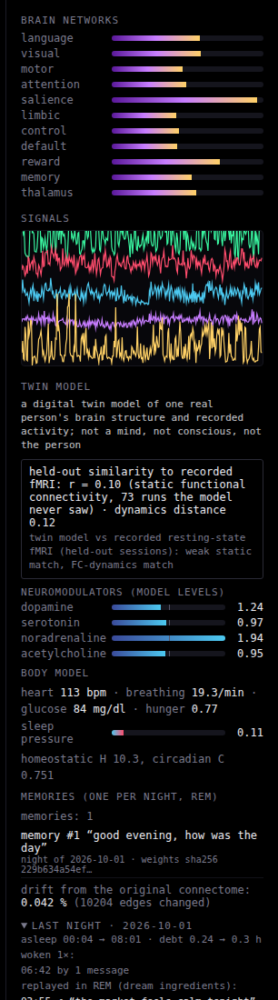
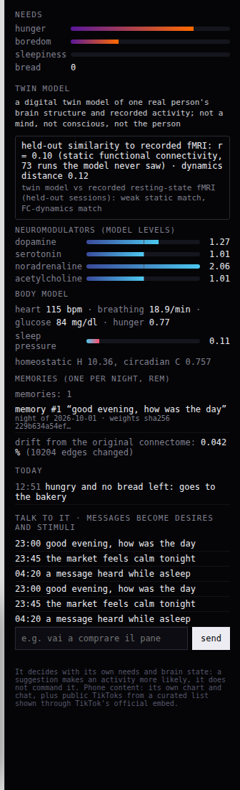

# SUB-01 v2: the digital twin, assembled

*A digital twin model of one real person's brain structure and recorded activity; not a mind, not conscious, not the person.* Chat messages are stimuli, not conversation. Nothing here is a claim of consciousness, experience or intent, and no individual is named.

## Overview

SUB-01 v2 replaces the old rhythm generator with a model whose pieces are each built from published equations and
documented, and wires them into the live server (`live_server.py`, branch `feature/twin-integration`):

| piece | file | what it does in the live loop |
|---|---|---|
| neural mass model | `twin/model.py` (`TwinBrain`, via `brain_sim.make_brain`) | 214 delayed Wilson-Cowan E/I regions on the connectome, fitted G / velocity / noise (`twin/params.json`); the old model stays available with `--model sl` |
| neuromodulators | `twin/neurochem.py` | `on_trade` for every trade; `update(dt, sleep_levels=engine.modulators)`; `region_gain(levels)` -> `brain.set_gain` |
| sleep | `sleep.py` | sleep-wake circuit; exposes `modulators`, `H`, `C`, `pressure`; sets the rhythm parameters |
| body | `twin/body.py` | stepped in sim time with the levels, the amygdala excess and the stage; `intero_drive()` stimulates the insula proxy; `life.py` takes hunger from it and calls `eat` |
| plasticity | `twin/plasticity.py` | `hebbian` while awake; chat responses recorded; `consolidate` once in the first REM of each night; `brain.set_weights(W)` about once per sim minute |
| fit + score | `twin/fit.py`, `web/twin_score.json` | held-out numbers shown on the pages |

Per tick (50 ms of model time) `Live.tick()` does: sleep engine -> neuromodulators (tonic from the sleep circuit, phasic
from trades) -> trades into the brain -> gain -> body (in sim time, up to about 180 s per call at `--time-scale 3600`) and
its drive -> 50 integration steps -> chat-response probes and Hebbian update -> REM consolidation -> the `twin` object in
the tick message (score, levels, vitals, sleep H / C / pressure, memories, drift). State is kept in the data directory
(`twin_state.json`, `weights.npz`, `memories.json`, `pending_responses.json`); `out/connectome.npz` is only read. The
pages (`/brain`, `/`) show a compact Twin panel (`web/twin_panel.js`) fed by that object.

How a chat message becomes a memory: it is filtered, becomes a stimulus, and the model's activity over the next 2 s of
model time is compared with the 2 s before; the 8 regions with the largest increase and their summed increase are
recorded (`record_response`). In the first REM episode of the night the message with the largest response is consolidated:
the weights among its regions are raised by 1 %, and a record with the sha256 of the weights is appended.

The Twin panel on `/brain` (left) and on the life page `/` (right), from a local `--demo` run after one accelerated
synthetic night (`twin/screenshots.py`; the memory shown is from that synthetic chat):

 

## Held-out scores

Label shown on the pages: *twin model vs recorded resting-state fMRI (held-out sessions): weak static match, FC-dynamics match*.

| model | r(FC), held-out | KS(FCD), held-out (lower is better) | simulated mean FC |
|---|---|---|---|
| **twin (fitted)** | **0.097 ± 0.004** | **0.12 ± 0.069** | 0.072 |
| shuffled connectome, same model, own search | -0.001 ± 0.009 | 0.882 ± 0.14 | 0.01 |
| old Stuart-Landau model, own search | 0.006 ± 0.009 | 0.999 ± 0.0 | 0.001 |
| twin without the live constraint (G 16) | 0.151 ± 0.008 | 0.101 ± 0.035 | 0.283 |

Held-out half: 73 runs from 47 sessions, FCD on 49 runs; mean ± SD over 5 replicates of 6 simulated 10-minute runs.

| reference | r |
|---|---|
| connectome (log streamline count) vs recorded FC, all pairs | 0.213 |
| same, connected pairs only | 0.24 |
| test-retest ceiling (fit-half mean FC vs held-out mean FC) | 0.97 |
| recorded mean FC (held-out) | 0.362 |
| one recorded run vs another recorded run | 0.547 |
| one simulated run vs one recorded run | 0.071 |

The match is weak and static; see the fit section for what it does and does not show. Source: `web/twin_score.json` (written by `python -m twin.fit write`).

## CPU use of the live server

| phase | wall s | whole server, % of one core | model step only, % | whole tick logic (model + neurochem + body + plasticity + life), % | ticks/s |
|---|---|---|---|---|---|
| nobody watching | 60.0 | 13.2 | 10.9 | 12.6 | 20.01 |
| one viewer connected | 60.0 | 13.6 | 11.0 | 12.8 | 20.0 |

`live_server.py --demo`, real time, twin model, real-baseline replay on, no eye, `OMP_NUM_THREADS=1`; target <= 30 % of one core: **met** (worst case 13.6 %). Measured by `python twin/measure_cpu_live.py` (2026-10-01 03:44:38 UTC); numbers in `twin/data/cpu_live.json`. shared sandbox (other jobs run on the same CPUs); a dedicated Railway vCPU may differ.

## 1. Neural mass model

Source file: `docs/twin/model.md`.

SUB-01 v2 is a digital twin model of one real person's brain structure and recorded activity (MyConnectome,
OpenNeuro ds000031). It is not a mind, not conscious and not the person. This section covers the simulated part:
the population dynamics that run on the person's connectome, and the BOLD signal computed from them.

`TwinBrain` replaces the old Stuart-Landau model (`brain_sim.Brain`, unchanged) behind the same interface.
`brain_sim.make_brain(kind)` builds either model. The environment variable `SUB01_MODEL` picks the default, which is
`twin`. `live_server.py` builds its brain with `make_brain()`: `--model twin|sl` (or `SUB01_MODEL`), so the old model
still runs on the same pages. All numbers below come from `python -m twin.bench_model`, run on 1 BLAS thread in the build sandbox,
and are stored in `twin/data/model_bench.json`.

### Choice of model

I compared two published models, both with excitatory and inhibitory populations:

| | Wilson-Cowan with inhibitory plasticity (Abeysuriya et al. 2018) | Reduced Wong-Wang E-I with feedback inhibition control (Deco et al. 2014) |
|---|---|---|
| state per region | E, I (+ adaptation A here) | S_E, S_I |
| fastest time constant | tau_E = 10 ms, so dt = 1 ms works with Heun | tau_GABA = 10 ms, so a similar dt |
| intrinsic rhythm | yes: noise-driven alpha/beta near a Hopf point | no: noisy fixed point |
| BOLD fitting | used for MEG; Hellyer 2016 used it for BOLD | standard for BOLD functional connectivity (FC) |
| sleep slow waves | adaptation added: up/down states | needs extra currents |

I chose Wilson-Cowan for three reasons:
- It costs about the same per step as Wong-Wang.
- It produces the oscillating signal the live page draws (`wave`).
- Adding an adaptation current to the same equations gives NREM slow oscillations, so one model covers wake and sleep.

Wong-Wang would have been the more standard choice for fitting BOLD FC. It remains an option for the fit branch.

### Equations

For region k (k = 1..214), with E_k the excitatory rate, I_k the inhibitory rate and A_k the adaptation variable,
all normalised to 0..1:

```
tau_E dE_k/dt = -E_k + S_E( c_EE E_k + c_IE,k I_k - b_A A_k + P + p_k + h_k + dP(a)
                           + G sum_j W_kj E_j(t - L_kj / v) + gate(a) u_k(t) ) + tau_E sigma xi_k(t)
tau_I dI_k/dt = -I_k + S_I( c_EI E_k + c_II I_k + Q )
tau_A dA_k/dt = -A_k + E_k
S(x)          = 1 / (1 + exp(-beta g_k (x - theta)))
```

Where the terms come from:
- **E and I equations:** Wilson & Cowan (1972), in the whole-brain form of Abeysuriya et al. (2018). The model has
  delayed long-range E->E coupling and local E/I populations. Differences from Abeysuriya et al. (2018), all chosen
  here and not taken from that paper: (1) the I->I self-coupling c_II = -1 (their Eq. 2 is
  tau_I dI/dt = -I + S(c_EI E + noise), with no c_II and no Q; Wilson & Cowan 1972 do contain I->I); (2) the
  adaptation variable A; (3) the gain, excitability offset and external-input gate; (4) the noise, which is added
  to dE (sigma sqrt(dt) N(0,1) per step) and only to E, whereas they add Gaussian input noise inside the sigmoid to
  both populations; (5) rho = 0.14 instead of 0.15; (6) stochastic Heun instead of 4th-order Runge-Kutta.
- **Adaptation A:** spike-frequency adaptation as a slow negative feedback on E. It is the standard mechanism for
  up/down-state slow oscillations; Cakan et al. (2022) used it in a whole-brain sleep model.
- **g_k:** the `set_gain` vector, a per-region gain on the slope of the sigmoid (neural gain; Eldar et al. 2013).
  1 is the fitted baseline, so `set_gain(ones)` changes nothing (this is tested bit for bit).
- **Integration:** stochastic Heun with additive noise (sigma sqrt(dt) N(0,1) added to E each step), dt = 1 ms.
  Every conduction delay is at least one step, so the delayed input is fixed within a step.
  - Explicit Euler at dt = 1 ms inflated the E standard deviation by about 20 %, because it adds artificial growth to
    the about 18 Hz oscillation. Heun at 1 ms matches Heun at 0.5 ms: mean E 0.122 vs 0.122, SD 0.051 vs 0.052,
    same peak frequency. `test_heun_step_size_converged` checks this.
  - E is clipped to [0, 1].

**Inhibitory balance.** c_IE,k is computed so that each region's deterministic fixed point is at E = rho. This is the
fixed point that the inhibitory synaptic plasticity rule of Vogels et al. (2011), dc_IE/dt = -eta I (E - rho), would
reach without fluctuations. Hellyer et al. (2016) and Abeysuriya et al. (2018) use this rule. I solve it analytically,
so construction has no warm-up cost:

```
I* = S(c_EI rho + c_II I* + Q)          (bisection)
x* = theta + ln(rho / (1 - rho)) / beta
c_IE,k = (x* - c_EE rho - P - p_k - isp_frac G rho sum_j W_kj + b_wake rho) / I*      (clipped to <= 0)
h_k = -(1 - isp_frac) G rho sum_j W_kj    (homeostatic intrinsic offset; 0 by default)
```

With noise and oscillation the time-averaged rate settles about 12 % below rho: mean E is 0.123 instead of 0.14, and
every region stays within 0.03 of it. Simulating the plasticity rule itself (`isp_refine()`, or the `isp_seconds`
parameter) only reaches 0.128. The reason is that the rule's real fixed point is <I (E - rho)> = 0, not <E> = rho, and
E and I covary during the oscillation. A fit can store a refined `c_ie` vector in `params.json`.

I first tried `isp_frac = 0`, which balances the network input through the intrinsic offset instead. That makes the
network's slow mode easier to push towards instability, but it was bistable in the awake state. 20 s of heavy
stimulation left it stuck in a high-activity state (E about 0.45). With `isp_frac = 1` it recovers within 4 s
(E 0.123 -> 0.31 during stimulation -> 0.128 after 8 s). So the default is the full inhibitory-plasticity balance.

### Parameters

| symbol | key | value | unit | source |
|---|---|---|---|---|
| tau_E, tau_I | tau_e, tau_i | 0.010, 0.020 | s | Abeysuriya et al. 2018 (Table 1) |
| c_EE, c_EI | c_ee, c_ei | 3.5, 3.75 | - | Abeysuriya et al. 2018 (Table 1) |
| c_II | c_ii | -1 | - | chosen here, not in Abeysuriya et al. 2018 (see below) |
| P | P | 0.31 | input units | Abeysuriya et al. 2018 (Table 1) |
| Q | Q | 0 | input units | not in Abeysuriya et al. 2018 (no I input there) |
| beta, theta | beta, theta | 4, 1 | - | Abeysuriya et al. 2018 (Table 1 has mu = 1, sigma = 0.25, so beta = 1/sigma = 4) |
| rho | rho | 0.14 | rate (0..1) | 0.15 in Abeysuriya et al. 2018; see below |
| G | G | 3.0 | - | pre-fit default; fitted later |
| v | velocity | 6 | m/s | as brain_sim; typical 5-10 m/s; fitted later |
| sigma | noise | 0.06 | rate / sqrt(s) | chosen (see Defaults) |
| tau_A | tau_a | 0.25 | s | chosen: about 1 Hz up/down cycle |
| b_A awake / deep NREM | b_wake, b_nrem | 0 / 3.0 | - | chosen (sleep mapping) |
| dP deep NREM | p_nrem | -0.15 | input units | chosen (sleep mapping) |
| external gate deep NREM | gate_nrem | 0.5 | - | chosen (thalamic gating) |
| stimulus gain, saturation, decay | stim_gain, stim_max, stim_tau | 0.08, 20, 2 | input/unit, units, s | chosen; the 2 s decay matches brain_sim |
| drive gain | drive_gain | 0.08 | input per drive unit | same scale as stimuli (both shifted `a` in the old model) |
| dt | dt | 0.001 | s | stability check above |

On the sources:
- **Abeysuriya values (checked by the reviewer against the PLOS Computational Biology full text, Table 1 and
  Eqs. 1-4):** c_EE 3.5, c_EI 3.75, c_IE(0) -2.5, mu 1, sigma 0.25, P 0.31, tau_E 0.01 s, tau_I 0.02 s, rho 0.15.
  The paper has no I->I coupling and no input to I.
  - The reviewer's linear analysis of one isolated node with exactly the paper's equations (c_II = 0, c_IE = -2.5)
    gives a Hopf bifurcation at P = 0.335 (paper: 0.34) and 10-11.3 Hz near it (paper: about 11 Hz), so the
    sigmoid, time constants and signs are implemented as published.
  - **c_II = -1 is an addition made here.** With c_II = 0 and the balanced c_IE the deep-NREM and light-NREM
    settings saturate (mean E 0.99 and 0.51 in a 10 s test) because the sleep engine's coupling x2 / x3 is not
    compensated by inhibition; c_II = -1 keeps all four stages in a usable range. The price is that the awake
    regional rhythm is at about 18 Hz (beta) instead of about 10 Hz (c_II = 0 gave a 10.4 Hz awake rhythm).
  - The model's own isolated-node Hopf point (G = 0, balanced at rho, c_II = -1) is at rho of about 0.138; at
    E = 0.15 the node oscillates at about 9.8 Hz with eigenvalue real part +5/s.
- **Why rho = 0.14:** I set rho to 0.14, just at the Hopf point. Each node is then a noise-driven oscillator with
  waxing and waning amplitude rather than a fixed limit cycle.
- **Changing parameters:** all keys can be overridden by `TwinBrain(params=...)` or by `twin/params.json`, which the
  fit writes. `load_params()` accepts `{"params": {...}}` or a flat dict, plus `excitability` (n,) and `c_ie` (n,).

### Connectome and delays

`out/connectome.npz` holds streamline counts and fibre lengths (mm) from the person's diffusion MRI: 214 regions
(Schaefer-200 + 14 Harvard-Oxford subcortical). All 214 regions are kept.

**Normalisation.** The weights are W = C / sqrt(s_i s_j), where C is the streamline-count matrix (zero diagonal) and
s_i is the row sum of C. The leading eigenvalue is exactly 1, and W stays symmetric. I did not keep brain_sim's
log1p with mean in-strength normalisation for the following reason:
- A linear noise-driven network, FC = norm((I - kW)^-1 (I - kW)^-T), can be compared with the mean recorded FC over
  131 runs (`resting_fc` and `empirical_fc` in the bench).
- With log1p weights the leading mode is dominated by hub regions. At a mean FC of about 0.3, its correlation with the
  recorded FC is 0.07-0.11.
- With raw counts and degree normalisation the correlation is 0.20-0.24, at least as good as the connectome itself:
  r(SC, recorded FC) = 0.215.
- `sc_power` (default 1) lets the fit try counts**p.

**Delays.** Each edge has delay round(L_kj / v / dt) steps, at least 1; with v = 6 m/s the maximum is 60 ms. The
delayed coupling is one sparse matrix-vector product per step:
- The history is a ring buffer of length 2H in which each sample is written twice. The last H samples are then
  always one contiguous view.
- Edge (i <- j) with delay d reads column (H-1-d) n + j of that view. The sparse matrix (20,408 non-zeros) is
  therefore built once.
- Every edge keeps its own delay: there is no delay binning and no per-region Python loop.
- The batched simulator puts B parameter sets, each with its own velocity, into one block matrix.

### Hemodynamics (BOLD)

I use the Balloon-Windkessel model (Buxton et al. 1998; Friston et al. 2000) with the revised BOLD output equation of
Stephan et al. (2007). I copied no code; I checked the values against the SPM12 source (`spm_fx_fmri.m`,
`spm_gx_fmri.m`): kappa = 0.64/s, gamma = 0.32/s, tau = 2 s, alpha = 0.32, E0 = 0.4, V0 = 4 (%), epsilon = 1,
nu0 = 40.3/s, r0 = 25/s, TE = 0.04 s, with k1 = 4.3 nu0 E0 TE, k2 = epsilon r0 E0 TE, k3 = 1 - epsilon.

- **Integration:** the hemodynamic states are integrated in log space (Stephan et al. 2008), every 10 ms, and the
  log states are clipped to [-3, 3].
- **Neural input:** u = 0.25 (E / rho - 1), averaged over the 10 ms. The factor keeps u > -gamma, so blood flow stays
  positive.
- **Field strength:** MyConnectome was scanned at 3 T with TE 30 ms; the 1.5 T constants only scale the amplitude.
- **Impulse response** (u = 1 for 0.5 s): peak at 4.5 s (+1.7 %), undershoot -0.13 % at 12.6 s, back to baseline by
  35 s.
- **Output:** `bold()` returns the current percent signal change.

### Sleep, stimuli, drive and display

| live server input | what it does in the model |
|---|---|
| `b.a` (sleep engine: -5 awake/REM ... 0 deep NREM) | sets depth d = (a + 5) / 5, which scales adaptation b_A = 3 d, excitability dP = -0.15 d and the external gate 1 - 0.5 d (see below) |
| `set_rhythm(f, coupling, noise)` | G = G0 x coupling. sigma = sigma0 x noise / 0.5 (0.5 is the awake noise in sleep.py). f is stored but not imposed: rhythms emerge from the E/I time constants and adaptation |
| `stimulate(group, x)` | adds x to that group's stimulus, which decays with tau = 2 s. Input = 0.08 x 20 tanh(stim / 20) (saturating) |
| `b.drive` (recorded resting signal x 1.6 per z-unit x stage gain) | input = 0.08 x drive (slow excitability) |
| `set_gain(g)` | g_k multiplies the sigmoid slope (neuromodulation) |
| `set_weights(W)` | replaces W (same normalisation as `W0`), keeps the delay history and by default re-solves c_IE at the baseline G (slow homeostasis assumed to have converged); a refined c_IE from `params.json` / `isp_seconds` is kept as an additive correction |

The physiological reasons for the depth mapping:
- **Adaptation b_A = 3 d:** low acetylcholine in NREM unblocks K+ adaptation currents (McCormick 1992).
- **Excitability dP = -0.15 d:** lower cholinergic and noradrenergic tone.
- **External gate 1 - 0.5 d:** the thalamus transmits less sensory input in NREM (Steriade, McCormick & Sejnowski 1993).
- REM has a = -5 in sleep.py, so it is awake-like (high acetylcholine), with the sleep engine's lower coupling and
  higher noise.

**Display.** `step()` returns x = act cos(phi), which is a display signal, not a model variable.
- act = 2 tanh(0.75 (E / rho) / 2): the excitatory rate relative to rest, soft-limited below 2.
- phi is the phase of (E - E_1s) + i k (I - I_1s), where E_1s and I_1s are 1-second running means and k comes from
  the local Jacobian's eigenvector.
- So np.abs(x) follows the firing rate and x.real oscillates with the model's own E/I rhythm.
- `state()` returns group means of act, plus the Kuramoto order parameter of phi as `sync`.

Measured per stage, over 10 s after 3 s of settling (bench `stages`):

| stage | mean E | dominant frequency (region / global mean) | power < 4 Hz | sync | display mean of abs(x) | up-state fraction |
|---|---|---|---|---|---|---|
| AWAKE | 0.123 | 18 / 11 Hz | 1 % | 0.15 | 0.37 | 0 |
| NREM light | 0.115 | 5 / 3 Hz | 8 % | 0.40 | 0.27 | 0.08 |
| NREM deep | 0.331 | 0.9 / 0.9 Hz | 93 % | 0.94 | 0.30 | 0.34 |
| REM | 0.082 | 12 / 9.5 Hz | 5 % | 0.09 | 0.30 | 0 |

Deep NREM gives synchronous slow oscillations of about 0.9 Hz, alternating up and down states (Steriade et al. 1993
describe < 1 Hz). The awake rhythm is beta-range (about 18 Hz at the regional level). In Abeysuriya's model the
frequency may depend on coupling; here it is set by c_II, the balance and the delays, and the fit may move it.

**Reactivity.** A stimulus of 8 units to the reward group, compared over the 0-1 s window (bench `reactivity`,
10 trials):

| stage | specific response (rate change in the group minus the rest of the brain) |
|---|---|
| AWAKE | +0.063 (+51 % of the resting rate) |
| NREM light | +0.043 |
| NREM deep | +0.015 |
| REM | +0.072 |

So the same stimulus gets about a 4 times weaker specific response in deep NREM. In deep NREM, a stimulus mainly
triggers or joins a global up state, consistent with reduced specific propagation in sleep (Massimini et al. 2005).
The live server additionally scales stimuli by the sleep engine's stage gain.

### Batched simulator for the fit

`simulate_bold(params_list, seconds, tr, seed=0, W=None, burn=20, return_rates=False) -> (B, T, n)` float32.
- **Per-set parameters:** each set may have its own G, velocity, noise, excitability (n,) and c_ie (n,). Local constants
  (time constants, couplings, dt) are taken from the first set.
- **Weights:** W may be (n, n) or (B, n, n).
- **State:** awake rest, with no stimuli and no drive.
- **Sampling:** BOLD is sampled every `tr` s after `burn` s.

Throughput on 1 thread:

| batch size | simulated seconds per wall second |
|---|---|
| B = 1 | 12.8 |
| B = 8 | 3.2 per set, 25.6 in total |

`test_batched_matches_single` checks the batched path against the live path: same mean rate (±0.005) and BOLD
standard deviation within a factor of 1.6.

### Real-time budget

Live settings: dt = 1 ms, BOLD on, step(5) x 10 per 50 ms tick, plus `state()`. On 1 thread:

| stage | wall time per simulated second | share of one core |
|---|---|---|
| AWAKE | 0.10 s | 10 % |
| NREM deep | 0.09 s | 9 % |

This is under the 0.3 s (30 %) limit. `test_realtime_budget_single_thread` asserts it.

### Pre-fit defaults and how they compare with the data

**Defaults.** G = 3, v = 6 m/s, sigma = 0.06. I chose them for a regime that is neither saturated nor silent:
- mean E is 0.12 and the regional E standard deviation is 0.05;
- no up states while awake;
- it recovers from heavy stimulation.

**Resting FC.** With no drive, 900 s of simulated BOLD band-passed to 0.01-0.1 Hz (bench `resting_fc`):

| measure | value |
|---|---|
| r(simulated FC, recorded FC averaged over 131 runs) | 0.12 |
| r(connectome, recorded FC), for comparison | 0.215 |
| r(simulated FC, connectome) | 0.36 |
| split-half reliability of the simulated FC | 0.58 |
| mean simulated FC | 0.04 (recorded: 0.34) |
| BOLD standard deviation | 0.015 % (recorded BOLD is about 0.5-1 %) |

So the default model, without the recorded drive, is far from the recorded FC. The fit branch tunes this, and
`twin/params.json` is written by the fit, not here.

**Driven run.** When the recorded resting signal drives the model, as the live server does, the simulated BOLD
correlates r = 0.91 per region with the recording at a 5 s lag (one 300 s run). This only shows that the drive passes
through the model and the hemodynamics intact. The recording is itself the input, so it is not a prediction.

### Data and licences

- **MyConnectome** (OpenNeuro ds000031), public domain (PDDL): the connectome (weights and fibre lengths) and the
  resting-state runs used for the FC comparison and the drive.
- **SPM12:** source read only to check the hemodynamic constants; no code copied.
- **Neurolib, TVB:** looked at for orientation (MIT, GPL); no code copied.
- **Abeysuriya et al. (2018) Table 1:** checked against the open-access full text (see Parameters).

### What is not realistic

- **Regions:**
  - One E and one I population per parcel is a mean-field abstraction. Rates are normalised (0..1) and are not spikes/s.
  - Subcortical regions, including the thalamus, use the same cortical equations. There are no thalamic burst/tonic
    modes and no spindles.
- **Connections:**
  - Tractography streamline counts are not synaptic strengths.
  - There is no direction of connections and no distinction between E->E and E->I long-range targets.
  - There is one conduction velocity for all fibres.
- **Sleep and neuromodulation:**
  - Both are modelled as parameter changes (gain, excitability, adaptation, gate), not as receptor kinetics.
  - The sleep engine's coupling x3 in deep NREM drives up states to near-maximal rates (E about 0.9), higher than real
    cortical up states.
  - `f_hz` is ignored.
- **Equations differ from the cited paper:** I->I coupling (c_II = -1), adaptation, gain/gate terms, noise placement
  and rho are choices made here (see Equations); c_II = 0 (the paper's form) is not usable for the sleep stages.
- **REM:** the sleep engine's coupling x0.6 is not compensated by inhibition, so mean E in REM (0.082) is below the
  awake value (0.123); real REM cortex is about as active as wake.
- **BOLD baseline:** the balloon input is u = 0.25 (E / rho - 1), so a mean rate below rho gives a constant negative
  BOLD offset (about -0.6 % at the default, up to -2 % for other parameters). Only the fluctuations
  are comparable with recorded data (which are z-scored), not the absolute level.
- **Balance:** the inhibitory balance is the analytic fixed point (mean rate about 12 % below target). It is not
  updated during the day; only `set_weights` re-solves it.
- **Fluctuations without the drive:**
  - Resting BOLD fluctuations are about 50 times smaller than recorded BOLD.
  - Mean simulated FC is much lower than recorded FC.
  - The infraslow dynamics of the real data are largely missing unless the recorded signal is fed in.
- **Hemodynamics:**
  - Constants are 1.5 T textbook values, identical in every region.
  - The neural input to the balloon model is the excitatory rate, a common proxy; synaptic activity would be another.
- **Display:** `x` is a display transform (rate envelope x cos of the E/I phase), chosen to fit the old page.

### References

- Abeysuriya RG, Hadida J, Sotiropoulos SN, et al. (2018) A biophysical model of dynamic balancing of excitation and
  inhibition in fast oscillatory large-scale networks. PLoS Comput Biol 14(2):e1006007.
- Buxton RB, Wong EC, Frank LR (1998) Dynamics of blood flow and oxygenation changes during brain activation: the
  balloon model. Magn Reson Med 39:855-864.
- Cakan C, Dimulescu C, Khakimova L, Obst D, Flöel A, Obermayer K (2022) Spatiotemporal patterns of adaptation-induced
  slow oscillations in a whole-brain model of slow-wave sleep. Front Comput Neurosci 15:800101.
- Deco G, Ponce-Alvarez A, Hagmann P, Romani GL, Mantini D, Corbetta M (2014) How local excitation-inhibition ratio
  impacts the whole brain dynamics. J Neurosci 34:7886-7898.
- Eldar E, Cohen JD, Niv Y (2013) The effects of neural gain on attention and learning. Nat Neurosci 16:1146-1153.
- Friston KJ, Mechelli A, Turner R, Price CJ (2000) Nonlinear responses in fMRI: the Balloon model, Volterra kernels,
  and other hemodynamics. NeuroImage 12:466-477.
- Hellyer PJ, Jachs B, Clopath C, Leech R (2016) Local inhibitory plasticity tunes macroscopic brain dynamics and
  allows the emergence of functional brain networks. NeuroImage 124:85-95.
- Massimini M, Ferrarelli F, Huber R, Esser SK, Singh H, Tononi G (2005) Breakdown of cortical effective connectivity
  during sleep. Science 309:2228-2232.
- McCormick DA (1992) Neurotransmitter actions in the thalamus and cerebral cortex and their role in neuromodulation
  of thalamocortical activity. Prog Neurobiol 39:337-388.
- Stephan KE, Weiskopf N, Drysdale PM, Robinson PA, Friston KJ (2007) Comparing hemodynamic models with DCM.
  NeuroImage 38:387-401.
- Stephan KE, Kasper L, Harrison LM, et al. (2008) Nonlinear dynamic causal models for fMRI. NeuroImage 42:649-662.
- Steriade M, Nuñez A, Amzica F (1993) A novel slow (< 1 Hz) oscillation of neocortical neurons in vivo.
  J Neurosci 13:3252-3265.
- Steriade M, McCormick DA, Sejnowski TJ (1993) Thalamocortical oscillations in the sleeping and aroused brain.
  Science 262:679-685.
- Vogels TP, Sprekeler H, Zenke F, Clopath C, Gerstner W (2011) Inhibitory plasticity balances excitation and
  inhibition in sensory pathways and memory networks. Science 334:1569-1573.
- Wilson HR, Cowan JD (1972) Excitatory and inhibitory interactions in localized populations of model neurons.
  Biophys J 12:1-24.

## 2. Fit to the recorded activity and held-out scores

Source file: `docs/twin/fit.md`.

SUB-01 v2 is a digital twin model of one real person's brain structure and recorded activity (MyConnectome,
OpenNeuro ds000031). It is not a mind, not conscious and not the person. This section describes how the free
parameters of the neural mass model (`twin/model.py`, see `docs/twin/model.md`) were fitted to the person's
recorded resting-state fMRI, and how well the fitted model reproduces recordings it was not fitted to.

Everything here is reproducible with

```bash
OMP_NUM_THREADS=1 python -m twin.fit all --workers 3     # about 2 h on 3 cores; checkpoints in /home/user/fitcache/full
python -m twin.fit write                                 # re-write params.json, twin_score.json and the figures
python -m twin.fit all --quick                           # 2-3 minute smoke run of the same pipeline (outputs in the cache)
python -m pytest tests/test_fit.py -q
```

The checkpoint directory can be moved with `--cache` or the environment variable `SUB01_FITCACHE`.

### Data

- **Recordings.** The 131 resting-state runs that passed the homotopic-correlation QC (`out/rest/qc.json`,
  `kept = true`; ses-012 was rejected). They come from 94 sessions:
  - 91 sessions of the original year of scanning (ses-011 to ses-104, 2012-10-18 to 2014-03-11; Siemens Skyra 3 T,
    multiband 4, TE 30 ms). ses-011 has TR 1.00 s and 595 kept volumes, all others TR 1.16 s and 513 kept volumes
    (about 10 minutes); ses-093 has five runs.
  - ses-WashU (2015-04-02, Siemens Trio, TR 2.5 s, 235 volumes): 20 runs (10 eyes open, 10 "rest").
  - ses-2022 (2022-10-03, GE SIGNA UHP, multi-echo, TR 1.49 s, 158 volumes): 4 runs stored as 3 echo files each.
  - ses-2022b (2022-10-18, TR 1.25 s, 287 volumes): 4 runs.
- **Licence.** OpenNeuro ds000031 v2.0.2; `dataset_description.json` gives the licence as CC0 (public-domain
  dedication). Dataset paper: Nat Commun (2015) 6:8885, doi:10.1038/ncomms9885.
- **TR check.** The TR stored in every `out/rest/*.npz` was read by `process_rest.py` from the BIDS sidecar of that
  run. I re-read the sidecars of six runs from the GitHub mirror of the dataset (`OpenNeuroDatasets/ds000031`, via
  raw.githubusercontent.com; openneuro.org itself was not needed) and they agree: ses-011 1.0 s, ses-014 and
  ses-093 1.16 s (the value usually reported for MyConnectome), ses-WashU 2.5 s, ses-2022 1.49 s, ses-2022b 1.25 s.
  The dataset README warns that some RepetitionTime values were converted by the curators; the main-protocol value
  1.16 s matches the paper, so I take the stored values as correct.
- **Scan dates** for the chronological ordering come from `sub-01/sub-01_sessions.tsv` of the same mirror (only the
  `sescode` and `date` columns are kept, in `twin/data/session_dates.json`).
- **Preprocessing of the recordings** (`process_rest.py`, not changed here): region means in the person's own atlas
  (Schaefer-200 7-network + 14 Harvard-Oxford subcortical), drop the first 5 volumes, linear detrend, 2nd-order
  Butterworth band-pass 0.01-0.1 Hz applied forwards and backwards (`filtfilt`), z-score per region. There is no
  motion, white-matter/CSF or global-signal regression, so the recorded FC carries a large global component (mean
  FC 0.34-0.36).
- **Multi-echo runs.** The three echo files of one ses-2022 run are not independent recordings. They are merged
  into one acquisition (mean of the three z-scored echoes, z-scored again) so that each acquisition counts once.
  The split works on the 131 files; the statistics use 123 acquisitions.

### Split (no leakage)

Sessions are sorted by scan date and assigned alternately to the fit half and the held-out half, starting with
fit ("interleave"). Both halves therefore span the whole year (fit: ses-011 ... ses-104 + ses-2022; held-out:
ses-013 ... ses-103 + ses-WashU + ses-2022b). Every run of a session goes to the same half.

| half | sessions | runs (files) | acquisitions | main-protocol runs (TR 1.16 s) |
|---|---|---|---|---|
| fit | 47 | 58 | 50 | 45 |
| held-out | 47 | 73 | 73 | 49 |

The held-out half happens to contain the 20 WashU runs (another scanner and TR), so its mean FC is partly from a
different protocol. This is a harder test than a same-protocol split, and I kept it because the rule was fixed
before looking at any score.

Only fit-half data are used for targets, the search and the selection. No normalisation is estimated from the
data at all (each run is z-scored on its own). The held-out half is touched once, at the end, with fixed
parameters and fresh random seeds.

**Robustness split ("chronological").** The first 47 sessions by date (ses-011 ... ses-059, 47 runs) are the fit
half and the last 47 (ses-060 ... ses-2022b, 84 runs) the held-out half.

### Targets and objective

- **Static FC.** Pearson correlation matrix of each acquisition, Fisher-z averaged over the acquisitions of a half
  (r clipped to ±0.999999 before arctanh). Compared over the 22,791 region pairs of the upper triangle.
- **FC dynamics (FCD).** For each run: FC in 60 s sliding windows (52 volumes at TR 1.16 s) with a 6 s step, then
  the Pearson correlation between the upper-triangle FC vectors of every pair of windows that do not overlap
  (overlapping windows share samples, which inflates FCD trivially). The values of all runs are pooled into one
  distribution (Hansen et al. 2015; Deco et al. 2017).
  - The FCD distribution depends on the acquisition. Against the TR-1.16 s runs of the fit half, the KS distance is
    0.03 for the TR-1.16 s runs of the held-out half, but 0.19 for the WashU runs (TR 2.5 s) and 0.62 for the
    ses-2022b runs. The
    simulation is sampled like the main protocol, so FCD targets use the main-protocol runs only (TR 1.16 s,
    513 volumes). Static FC uses all runs.
- **Simulated BOLD is processed exactly like a recording.** `simulate_bold` samples the Balloon-Windkessel BOLD every
  1.16 s after a 20 s burn-in; the record is cut into "runs" of 518 volumes, and each run goes through the same
  code path as the recordings (`preprocess`: drop 5 volumes, detrend, the same Butterworth filter, z-score), then
  the same FC and FCD functions.
- **Objective (maximised):** score = r(simulated FC, fit-half FC) - KS(simulated FCD, fit-half FCD), with equal
  weights, so a parameter set cannot win on static FC alone. KS is the two-sample Kolmogorov-Smirnov statistic
  (0 = same distribution, 1 = disjoint).

### Free parameters and search

**Twin model** (`twin/model.py`, all local parameters at their documented defaults; see `docs/twin/model.md`):

| parameter | key | search range | why |
|---|---|---|---|
| global coupling G | `G` | 0.5-3.5 (grid up to 16) | scales the delayed long-range input on the degree-normalised weights |
| conduction velocity v | `velocity` | 2-20 m/s | sets the delays L / v |
| noise sigma | `noise` | 0.01-0.3 rate units / sqrt(s) | drives the fluctuations |

Regional excitability was not fitted: 214 extra parameters would be fitted to a noisy objective whose evaluation
costs about 40 s of compute, and the grid already shows that the static FC pattern is barely sensitive to the
global parameters (see Results), so the risk of overfitting was larger than the expected gain.

**Why G stops at 3.5 (live constraint).** The fitted parameters are loaded by the live server, where the sleep
engine multiplies G by 2 (light NREM) and 3 (deep NREM) while the inhibitory balance stays at its resting value.
`twin.fit.live_check` runs each stage and a heavy-stimulation recovery test. G = 3.5 passes (deep NREM: up/down
states, 93 % of power below 4 Hz). G = 4 fails: deep NREM saturates (mean E 0.97, no slow oscillation); from
G = 6 light NREM also drifts into up states (G = 16: mean E 1.0 in both NREM stages). The awake state and the
stimulus recovery were fine at every G tested. The grid still covers G up to 16 so that the cost of this constraint is
visible, and one held-out evaluation without it is reported.

**Procedure** (identical for the twin and both baselines, every evaluation = 2 simulated runs of 518 volumes,
about 20 minutes of simulated time):
1. Coarse grid, 36 points: G {1, 2, 3.5, 6, 10, 16} x v {3, 8} m/s x sigma {0.02, 0.06, 0.15}.
2. CMA-ES (Hansen 2016; pip `cma` 4.5.0) on log-scaled parameters mapped to [0, 1], started at the best grid point
   inside the box, step size 0.2, population 12, 4 generations.
3. Replication: the 4 best distinct candidates are simulated again with 3 new seeds; the candidate with the best
   mean score over its 4 evaluations is selected. This limits the winner's curse of a noisy objective and measures
   the seed variability.
4. The selected twin parameters must pass `live_check`; otherwise the next candidate is taken.

Simulations use the batched simulator `twin.model.simulate_bold` (one sparse matrix-vector product per 1 ms step
for all sets of a batch), on 3 processes (one per model) with one BLAS thread each.

**Baselines**, each with the same search:
- **Shuffled connectome:** the same twin model on a connectome whose (streamline count, fibre length) pairs are
  permuted jointly over all region pairs i < j (zero-count pairs included) and mirrored. This keeps the weight
  distribution, the density and the distribution of fibre lengths (so of delays) and destroys the wiring. The same
  degree normalisation is applied. The search used shuffle 0; each held-out replicate uses a different shuffle
  (0-4). Its G range was not limited (it never runs live), which can only favour the baseline.
- **Old model:** `brain_sim.Brain` (delayed Stuart-Landau oscillators at 10 Hz, a = -5, log1p weights normalised to
  mean in-strength 1, the same exponential integrator) re-implemented in batched form (`simulate_sl_bold`, checked
  against `brain_sim.Brain`: mean amplitude within 1 %). It has no firing rate, so the Balloon-Windkessel input is
  the fractional change of the oscillation amplitude, u = 0.25 (|z| / <|z|> - 1); everything after that is
  identical. Fitted: coupling g (0.5-60) and noise (0.1-2) by grid + CMA-ES; velocity {3, 8} m/s on the grid.

**Held-out evaluation.** The selected parameters of each model are simulated with seeds never used in the search:
5 independent replicates of 6 runs each (about 1 hour of simulated time per replicate). For each replicate FC r
and FCD KS are computed against the held-out targets; the tables give mean ± SD over the replicates.

### Results

#### Fitted parameters (`twin/params.json`)

| parameter | value | unit |
|---|---|---|
| G | 2.85 | - (degree-normalised weights, leading eigenvalue 1) |
| velocity | 7.1 | m/s |
| noise sigma | 0.078 | rate units / sqrt(s) |

All other parameters keep the defaults of `twin/model.py`. `TwinBrain()` loads the file by default
(`tests/test_fit.py` checks it).

- **Selection.** After replication, the selected set had a mean search score of -0.050 ± 0.033 (SD over 4 seeds;
  r 0.087 ± 0.010, KS 0.14). The runner-up (G 3.5, v 8 m/s, sigma 0.06) scored -0.060 ± 0.057 with a higher r
  (0.111) and a worse KS (0.17). The two are within seed noise of each other, so the exact optimum is not well
  determined; the objective's FCD term decided it.
- **Close to the pre-fit defaults.** G 3.0, v 6 m/s, sigma 0.06 were the defaults. The fit mainly confirms the
  regime; it does not move the model somewhere new.
- **Live behaviour with these parameters** (`live_check`): awake mean E 0.122 with no up states; light NREM 0.101;
  deep NREM 0.316 with up/down states (31 % of samples up, 92 % of power below 4 Hz); REM 0.083. After 20 s of
  heavy random stimulation (E up to 0.45) the network is back at its resting rate (0.123) within 10 s.
- **Real time:** 0.095 s of wall time per simulated second on one thread with the live settings (limit 0.3 s).
  `tests/test_fit.py` re-measures it.

#### Held-out scores (`web/twin_score.json`)

Held-out half: 73 runs (73 acquisitions) from 47 sessions; FCD on its 49 main-protocol runs. Mean ± SD over 5
independent replicates, each 6 simulated 10-minute runs.

| model | r(FC) held-out | KS(FCD) held-out | simulated mean FC | in-sample (fit half) r / KS |
|---|---|---|---|---|
| **twin (fitted)** | **0.097 ± 0.004** | **0.12 ± 0.07** | 0.07 | 0.093 / 0.14 |
| shuffled connectome, same model, own search | -0.001 ± 0.009 | 0.88 ± 0.14 | 0.01 | -0.001 / 0.88 |
| old model (Stuart-Landau), own search | 0.006 ± 0.009 | 1.00 ± 0.00 | 0.00 | 0.006 / 1.00 |
| twin without the live constraint (G 16, v 8, sigma 0.15) | 0.151 ± 0.008 | 0.10 ± 0.04 | 0.28 | 0.133 / 0.11 |

Reference numbers on the same held-out half:

| reference | r |
|---|---|
| connectome itself: log(1 + streamline count) vs held-out FC, all pairs | 0.213 |
| same, connected pairs only, log count | 0.240 |
| test-retest ceiling: fit-half mean FC vs held-out mean FC | 0.970 |
| recorded FCD, fit half vs held-out half (KS, lower is better) | 0.027 |

Per run (held-out):

| comparison | mean r | SD | 10th-90th percentile |
|---|---|---|---|
| simulated FC (all 30 runs) vs one recorded run | 0.074 | 0.023 | 0.044-0.103 |
| one simulated 10-min run vs one recorded run | 0.071 | 0.022 | 0.042-0.100 |
| one recorded run vs another recorded run (run-to-run) | 0.547 | 0.131 | 0.386-0.720 |
| fit-half mean FC vs one held-out run | 0.72 | | |

What this means:
- **The twin beats both baselines.** It is the only model of the three whose FC has any relation to the recorded FC,
  and its FC-dynamics distribution is close to the recorded one (KS 0.12, against 0.88 and 1.00). The shuffled
  connectome, run through the same model with its own full search, gives r = 0.00, so the small positive r of the
  twin depends on the person's wiring and not on the dynamics alone. Both baselines are near a floor, though (see
  the baseline paragraph in the independent re-score section below).
- **The static FC match is weak.** r = 0.10 is far below the test-retest ceiling (0.97), below the plain
  correlation between the person's connectome and the recorded FC (0.21), and below the r = 0.4-0.6 often reported
  for whole-brain models, which are mostly fitted to group-average connectomes and group FC. A simulated run
  matches a recorded run much less well (0.07) than two recorded runs match each other (0.55).
- **It is not a simulation-length problem.** r hardly changes with more simulated data: 0.094 with one 10-minute
  run, 0.095 with 8, 0.098 with 30. The model's FC pattern is stable but different from the recorded one: the left
  panel of `fit_fc.png` shows the recorded FC with its network blocks and strong homotopic pairs; the simulated FC
  is dominated by a few hub regions that correlate positively or negatively with many others.
- **The FCD term costs static FC.** Within the live-safe range the grid point with the best r (0.13 at 2 runs) had
  a worse FCD match. The objective r - KS traded about 0.02-0.04 of r for a better FCD.
- **The live constraint costs static FC.** Allowing G = 16 raises held-out r to 0.15 and mean FC to 0.28 (recorded
  0.36), with a similar FCD match. Those parameters saturate both NREM stages in the live server, so they are not
  used.
- **Seed variability:** SD 0.004 for held-out r and 0.07 for held-out KS across replicates. In the search (2 runs
  per evaluation) the SD of the score over seeds was 0.03-0.06, which is as large as the differences between the
  top candidates.

#### Robustness: chronological split

First 47 sessions (ses-011 ... ses-059) for fitting, last 47 (ses-060 ... ses-2022b, including WashU and both 2022
sessions) held out. Parameters were chosen from the 36 grid points only (G ≤ 3.5), scored against the
chronological fit half: G 3.5, v 8 m/s, sigma 0.06. Held-out: r = 0.125 ± 0.004, KS = 0.13 ± 0.03 (ceiling 0.93,
connectome itself 0.22). This is the same picture as the main split: a weak but reproducible static FC match and a
good FCD match.

#### Figures

- `fit_fc.png`: held-out recorded FC, simulated FC of the fitted twin (30 runs) and their scatter over all region
  pairs.
- `fit_fcd.png`: FCD distributions (held-out recording, twin, shuffled connectome, old model). The KS values in the
  legend are for the pooled replicates; the table gives the mean over replicates.
- `fit_landscape.png`: the 36-point grid on the fit half (best over the two velocities), score and r(FC), with the
  live-safe limit G ≤ 3.5.
- `fit_scores.png`: held-out r(FC) and KS(FCD) of the three models with the reference lines.


#### Independent re-score (second reviewer, different code)

A reviewer re-computed the held-out numbers with separate code that imports nothing from `twin/fit.py` (own
Fisher-z FC, own windowed FCD, own preprocessing; only `twin.model.simulate_bold` / `TwinBrain` for the simulation),
taking the held-out sessions from `web/twin_score.json`, reading `twin/params.json`, and using seeds not used in the
pipeline (424242 and 777):
- 5 replicates x 6 simulated 10-minute runs: r = 0.098 ± 0.001, KS = 0.125 ± 0.054, simulated mean FC 0.074
  (pipeline: 0.097 ± 0.004, 0.12 ± 0.07, 0.072).
- `TwinBrain()` stepped like the live server (params from `params.json`, BOLD read with `bold()` every 1.16 s,
  2 runs): r = 0.096, KS = 0.17, mean FC 0.070, so the fitted batch simulator and the live model agree.
- Reference numbers re-computed from the recordings: test-retest ceiling 0.970, connectome vs FC 0.213 (all pairs)
  and 0.240 (connected pairs), mean FC 0.362 (held-out) and 0.341 (fit half).
- The held-out sessions are disjoint from the fit sessions and every QC-kept run belongs to one of them.

Sensitivity of the old-model baseline to its oscillation parameter `a`, which the committed search keeps at the awake
value -5 (fit-half score, one 20-minute record per point, velocity 8 m/s, noise 0.25, g 5 and 40, a = -2, -0.5, 0, 0.5):
r between -0.007 and 0.005 and KS 1.00 in all eight cases, so the near-zero score of the old model is not an artefact
of fixing `a` (the oscillation amplitude carries no slow BOLD-band signal that depends on the wiring).

How to read the baseline comparison: both baselines are close to a floor (FC r about 0, FCD KS 0.9-1.0), so "the twin
beats them" shows that the twin's FC is not noise, not that it is competitive with good whole-brain fits. The FCD
contrast is also parameter dependent: in the search, the shuffled connectome reached KS 0.46 at G 10 (score worse
because r was -0.07), against 0.88 at its selected parameters. A matching FCD distribution only says that the
windowed FC of the model is about as reproducible from window to window as the recorded one (median FCD around 0.3);
it does not show that the model reproduces which regions co-fluctuate, which is what the weak static r measures.

#### Exploration before the search (not part of the committed pipeline)

These runs used 1 simulated run per point and are only indicative.
- **Pre-fit defaults, varying G (1.5-12) and sigma (0.03-0.12):** r(FC) 0.07-0.12 and mean FC 0.02-0.10.
- **Linear analysis of the balanced network:** with the full inhibitory balance (`isp_frac = 1`) the slow-mode loop
  gain G·H0·lambda_max(W) saturates at about 0.68 as G grows, because the balancing inhibition c_IE grows with G and
  lowers each node's static gain H0. The network therefore cannot approach the slow-mode instability that produces
  large, structured BOLD correlations in noise-driven models. A linear noise-driven model on these weights,
  FC = corr((I - kW)^-1 (I - kW)^-T), reaches at best r = 0.23 against the fit-half FC (at small k), and r drops as
  k → 1 and the global mode takes over. So about 0.2 is the most this connectome supports in that model class.
- **Partial inhibitory balance (`isp_frac` 0-0.75, c_IE refined by simulating the Vogels rule,
  `isp_refine_batch`):** this makes the slow mode reachable, but the network becomes multistable. Depending on G it
  falls into a low-rate state (mean E 0.03), sits near rest with weak FC, or jumps into a globally synchronous
  high-rate state (mean FC 0.5-0.75). The best indicative score was r 0.14 with KS 0.09. In `live_check` such
  parameter sets collapse in NREM (mean E 0.02, no slow oscillation) and do not return to rest after heavy
  stimulation (mean E 0.24-0.50 after 10 s quiet, against 0.12-0.13 before), so `isp_frac` was left at 1 and not
  searched.

### Compute

| part | wall time | simulated time |
|---|---|---|
| exploration (scans above, live checks) | about 35 min on 3 cores | about 10 h |
| first run of the pipeline (grids; stopped when the live constraint was added) | 33 min on 3 cores | grids reused |
| final pipeline run (CMA-ES, replication, held-out evaluation) | 91 min on 3 cores | 123 h in total with the grids |

In total about 2.7 hours of wall clock on 3 cores, slightly more than the 2.5 h planned. The search made
288 evaluations (96 per model). Checkpoints (one small file per evaluation, about 60 MB in total) live outside the
repository in `/home/user/fitcache/full`.

### What is not realistic / limitations

- **Weak static FC fit.** Held-out r = 0.10, less than the connectome itself (0.21). The twin reproduces the
  distribution of FC fluctuations (FCD) but not the detailed pattern of which regions correlate. It is not a
  faithful copy of this person's functional connectivity.
- **Mean FC is too low** (0.07 simulated vs 0.36 recorded). The recordings have no global-signal or nuisance
  regression, so their FC includes a large global component (and possibly motion and physiological noise) that the
  model does not generate.
- **The live constraint limits G to ≤ 3.5.** The sleep engine's coupling factors (x2, x3) make larger G saturate in
  NREM. Better resting fits exist (r 0.15 at G = 16) but cannot run live without changing the sleep mapping in the
  model.
- **Only three global parameters are fitted.** There is no regional heterogeneity (excitability, receptor maps or
  gradients) and no fitted hemodynamics. Structural connectivity from single-subject tractography misses many
  interhemispheric (callosal) connections, while homotopic FC is among the strongest in the recordings.
- **Noisy objective.** With 20 simulated minutes per evaluation, the seed SD of the score (0.03-0.06) is comparable
  to the differences between the best candidates; the optimum is a region, not a point.
- **Small search budget.** 4 CMA-ES generations of 12 per model. A longer search could find somewhat better
  parameters, but the grid and the replication show no parameter set inside the live-safe box with r above about
  0.13.
- **FCD is compared on the main protocol only** (TR 1.16 s Skyra runs), because the FCD distribution of the other
  protocols differs (KS up to 0.62). Static FC uses all runs, so the held-out FC target mixes protocols; 20 of its
  73 runs come from the WashU scanner (TR 2.5 s).
- **Old-model baseline.** Its BOLD input is the oscillation amplitude, because the Stuart-Landau model has no firing
  rate; its best coupling lies at the edge of the search range (g 59 of 60), but its score is flat over the whole
  range (r ≤ 0.02, KS ≈ 1.0).
- **Shuffled baseline.** The search used one shuffle; the held-out evaluation used five different shuffles at those
  parameters.

### References

- Deco G, Kringelbach ML, Jirsa VK, Ritter P (2017) The dynamics of resting fluctuations in the brain:
  metastability and its dynamical cortical core. Sci Rep 7:3095.
- Hansen ECA, Battaglia D, Spiegler A, Deco G, Jirsa VK (2015) Functional connectivity dynamics: modeling the
  switching behavior of the resting state. NeuroImage 105:525-535.
- Hansen N (2016) The CMA evolution strategy: a tutorial. arXiv:1604.00772 (software: pip `cma`).
- MyConnectome dataset paper (2015): Long-term neural and physiological phenotyping of a single human.
  Nat Commun 6:8885, doi:10.1038/ncomms9885.
- Vogels TP, Sprekeler H, Zenke F, Clopath C, Gerstner W (2011) Inhibitory plasticity balances excitation and
  inhibition in sensory pathways and memory networks. Science 334:1569-1573.
- Model, hemodynamics and their sources: `docs/twin/model.md`.

## 3. Neuromodulators and receptor-weighted gain

Source file: `docs/twin/neurochem.md`.

SUB-01 v2 is *a digital twin model of one real person's brain structure and recorded activity; not a mind, not
conscious, not the person*. This component adds four neuromodulator levels (dopamine DA, serotonin 5-HT,
noradrenaline NE, acetylcholine ACh) and turns them into a per-region gain vector for the whole-brain model. The
regional pattern comes from real receptor-density maps, but these are **group post-mortem data from other people,
not this person's receptors**. The dynamics that link market trades to "dopamine" and "noradrenaline" are simple
phenomenological rules chosen to make the model respond in a documented way. They are not a measurement of
anyone's brain chemistry.

Code: `twin/neurochem.py` (runtime; numpy only), `twin/build_receptors.py` (offline data build),
`twin/plot_receptors.py` (figure), `tests/test_neurochem.py` (20 tests).
Data: `twin/data/receptors_214.csv`, `twin/data/zilles2017_all_layers.csv`, sources and licences in
`twin/data/RECEPTORS_SOURCES.md`.

### Receptor maps (data)

**Licence decision.** The obvious source, the Schaefer-parcellated PET maps of Hansen et al. 2022 (*Nat Neurosci*
25:1569; `netneurolab/hansen_receptors`), is **CC BY-NC-SA 4.0**. The same holds for the `neuromaps` repository and
its Beliveau/Nørgaard annotations. Most other neuromaps PET annotations state no licence. The project is public and
linked to a token, so it is treated as potentially commercial. **None of those data, or values derived from them,
are used or committed.** The one permissive (CC0) neuromodulator PET map, D2 raclopride (Malén et al. 2022
*NeuroImage* 255:119149), is hosted only on OSF, which is blocked here, and no GitHub mirror exists.

**What is used instead:** quantitative in-vitro receptor autoradiography from Zilles & Palomero-Gallagher 2017
(*Front. Neuroanat.* 11:78, **CC BY 4.0**), Supplementary Table 2. It gives mean density over all cortical layers
in **fmol/mg protein** for 15 receptors in 44 cortical areas, pooled over post-mortem brains. The file was taken
from the MIT-licensed mirror `AlGoulas/receptor_principles` (Goulas et al. 2021 *PNAS* 118:e2020574118), pinned
commit. It is parsed with a stdlib xlsx reader, and the parse was cross-checked cell-by-cell against Goulas'
independent `.npy` arrays (15 x 44 supragranular values, max difference 0).

Receptors used (7 of 15), with the sign of their effect on gain:

| receptor | system | coupling | sign | weight w | note |
|---|---|---|---|---|---|
| D1 | DA | Gs | + | 1.0 | D1 raises PFC excitability/gain (Seamans & Yang 2004 *Prog Neurobiol* 74:1) |
| 5-HT2 (ketanserin site, mostly 5-HT2A) | 5-HT | Gq | + | 0.5 | density-weighted 5-HT2A gain as in Deco et al. 2018 *Curr Biol* 28:3065 |
| 5-HT1A | 5-HT | Gi (GIRK) | - | 0.5 | inhibitory |
| alpha1 | NE | Gq | + | 1.0 | |
| alpha2 | NE | Gi | - | 0.5 | half weight, so NE is net gain-increasing (Aston-Jones & Cohen 2005) |
| M1 | ACh | Gq | + | 0.5 | |
| alpha4beta2 (nicotinic) | ACh | cation channel | + | 0.5 | |

Not available under a permissive licence: **D2, DAT, 5-HTT, NET** (see sources file). NE therefore uses
alpha1/alpha2 receptor density rather than NET (transporter) density as an innervation proxy.

**Mapping to the 214 model regions** (`twin/build_receptors.py`):
1. Each of the 44 areas gets an **approximate MNI centroid**, hand-set from standard cytoarchitectonic/Brodmann
   anatomy (Caspers et al. 2006 *NeuroImage* 33:430 for PFt/PFm/PGa/PGp). These are not from a probabilistic
   atlas; expect errors of roughly 10-15 mm. 37B/37L/37M are read as basal/lateral/medial parts of area 37.
2. Schaefer-200 (7 networks) MNI centroids come from ThomasYeoLab/CBIG (MIT, pinned commit). Their order equals
   `out/atlas_names.json[0:200]` exactly, which the build script checks.
3. Each parcel takes the inverse-distance-weighted mean (power 2) of its 3 nearest areas. |x| is used, so both
   hemispheres get the same values; the table pools hemispheres.
   174 parcels have an area within 20 mm (`source = autoradiography_idw`). **26 are further away**
   (`autoradiography_idw_extrapolated`: insula, medial occipital pole, some precuneus/somatomotor parcels).
4. **Subcortical (14 Harvard-Oxford nuclei): no data.** The CSV rows are blank. At runtime they get the cortical
   mean density, flagged `RECEPTOR_SOURCE = "fallback_cortical_mean"`. This means no regional specificity, and it
   is certainly wrong for striatum and thalamus, where D1/D2 and nicotinic densities are really much higher. It is a
   placeholder, not data.

**Normalisation.** `RECEPTORS[r] = min(raw / cortical_mean(raw), 2) / 2`, in 0..1, where 0.5 = cortical mean.
The cap at 2x the mean exists because the table lists alpha1 in area 6 as 1880 fmol/mg, 2.7x the next-highest area
(701, area 36). Uncapped, that one value would dominate the NE gain of about 12 premotor/FEF parcels. The raw value
is kept unchanged in the CSV. 5 alpha4beta2 parcels near areas 32/46 are also capped.


*Figure: (a) relative density in all 214 regions, grouped by network (subcortical hatched = fallback);
(b) network means; (c) cortical maps on MNI centroids, viewed from the top.*

### Neuromodulator dynamics (`Neuromodulators`)

Each system m has a tonic level T_m and a phasic part P_m. The level is

    L_m = clip( T_m * (1 + P_m + [m = NE] * k_vol * vol), 0, 3 ),   1.0 = resting wake

Phasic effects scale with tonic, so a system that is nearly silent (NE in REM: locus coeruleus nearly silent,
Aston-Jones & Bloom 1981 *J Neurosci* 1:876) also responds weakly.

**Tonic levels follow the sleep engine.** `update(dt, sleep_levels)` relaxes T_m toward `sleep_levels[m]`
(missing key or None -> 1.0) with tau_tonic = 20 s: T += (target - T)(1 - e^(-dt/tau)). The expected pattern
(docs/twin_contracts.md) is REM: ACh high, NE/5-HT low; NREM: all lower. That is the reciprocal-interaction
picture (Hobson, McCarley & Wyzinski 1975 *Science* 189:55; Pace-Schott & Hobson 2002 *Nat Rev Neurosci* 3:591).
The numbers themselves come from the sleep engine, not from here.

**Pumps -> phasic DA as a reward-prediction error** (Rescorla & Wagner 1972; Schultz, Dayan & Montague 1997
*Science* 275:1593). For a buy of `usd` dollars:

    x = ln(1 + usd / 50)                  compressive size (model choice; 50 USD reference)
    delta = x - V ;  V <- V + alpha * delta      alpha = 0.3
    P_DA += k+ * delta  (delta > 0, k+ = 0.4)   or   k- * delta  (delta < 0, k- = 0.15)

The asymmetry k- < k+ reflects the limited range of dopamine firing below baseline (Bayer & Glimcher 2005 *Neuron*
47:129). The signal depends only on actual vs expected pump size, not on price level or absolute time. A second
learned quantity is the expected inter-pump interval: I <- I + 0.3 (interval - I). After at least 3 pumps, if no pump
has arrived by 1.5 x I, an **omission** negative RPE fires: delta = -V, P_DA += 0.06 delta, and V decays by a
factor (1 - alpha), i.e. extinction. It repeats every further I, with shrinking dips, the TD-style dip at the time
the reward was due (Schultz et al. 1997).

**Dumps and volatility -> NE** (LC-NE adaptive gain, Aston-Jones & Cohen 2005 *Annu Rev Neurosci* 28:403; NE as
"unexpected uncertainty", Yu & Dayan 2005 *Neuron* 46:681). For every trade, the signed size is s = +x (buy) or
-x (sell):

    sell:            P_NE += 0.25 * x
    any trade:       e = |s - mu| ;  mu <- mu + 0.2 (s - mu) ;  vol <- vol + 0.2 (e - vol) ;  P_NE += 0.1 * e
    NE level term:   + 0.12 * vol      (vol decays with tau_vol = 60 s)

**Decay.** P_DA: tau = 2 s (dopamine clearance takes sub-second to seconds and is slower in cortex than in
striatum; Garris & Wightman 1994 *J Neurosci* 14:442). P_NE: tau = 4 s. P_5HT, P_ACh: tau = 4 s (not driven by
trades in this version). Phasic parts are clipped to [-0.9, 2]. All parameters are in `DEFAULTS` and can be
overridden with `Neuromodulators(params=...)`. They are model choices, not fitted to data.

### Region gain

    c_m,i   = sum over receptors r of system m:  sign_r * w_r * d_r,i / mean_i(d_r)
    drive_i = sum_m  s_m * (L_m - 1) * c_m,i          s = {DA 0.25, 5-HT 0.3, NE 0.4, ACh 0.25}
    g_i     = 1 + 0.5 * tanh(drive_i / 0.5)

This follows the neural-gain approach of whole-brain models, in which a neuromodulator scales regional gain in
proportion to receptor density (Deco et al. 2018 *Curr Biol* 28:3065, 5-HT2A; Kringelbach et al. 2020 *PNAS*
117:9566; Shine et al. 2018 *eLife* 7:e31130; Shine et al. 2021 *Nat Neurosci* 24:765). Properties (all tested):
- **exactly 1.0 everywhere at baseline levels**, since tanh(0) = 0, so the resting fit stays valid;
- bounded in [0.5, 1.5] and strictly inside for levels up to 3;
- a region with more of a receptor gets a larger change, with that receptor's sign;
- mean coupling per system: DA +1, NE +0.5, ACh +1, 5-HT 0. So 5-HT only redistributes gain across regions; its
  mean effect is zero by construction.

Contract usage: `brain.set_gain(nm.region_gain())` after `nm.update(dt, engine.params["modulators"])`.
For a model with n != 214, `region_gain(levels, n=n)` returns a uniform, non-specific gain.

### Results (numbers from the code as committed)

Gain across the 214 regions for fixed levels (other systems at 1.0):

| levels | min | mean | max |
|---|---|---|---|
| resting wake (all 1.0) | 1.000 | 1.000 | 1.000 |
| DA 1.5 | 1.057 | 1.122 | 1.181 |
| NE 1.5 | 0.974 | 1.095 | 1.311 |
| NE 2.0 | 0.948 | 1.169 | 1.448 |
| ACh 1.5 | 1.082 | 1.122 | 1.184 |
| 5-HT 1.5 | 0.964 | 1.000 | 1.051 |
| REM-like (DA 1, 5-HT 0.2, NE 0.1, ACh 1.4) | 0.584 | 0.933 | 1.128 |
| NREM-like (DA 0.8, 5-HT 0.6, NE 0.5, ACh 0.4) | 0.603 | 0.737 | 0.838 |

Trade responses (fresh state, wake):
- 8 identical 200 USD pumps every 10 s: RPE 1.61, 1.13, 0.79, 0.55, 0.39, 0.27, 0.19, 0.13; phasic DA increment
  0.64 -> 0.05 (habituation). The first pump raises DA to 1.64 and mean gain to 1.19.
- Expected pump missing: dips at 15, 25 and 35 s after the last pump, with DA at 0.93, 0.95 and 0.97.
- A 5000 USD pump after that habituation: RPE 4.1, DA 2.64.
- One sell: NE 1.26 / 1.90 / 2.73 for 50 / 500 / 5000 USD.
- 20 alternating 2000 USD buys/sells: NE 1.59 at the end, versus 1.00 for 20 identical 20 USD buys.

Robustness: a non-finite trade size, time, level or sleep-engine value (NaN/inf/None from a bad feed) is ignored or
replaced by baseline, so it cannot enter the state or the gain; trade sizes are clipped at 1e9 USD. `t` in `on_trade`
must be on the same clock (seconds) as `dt` in `update`.

Cost: `update` about 3 us, `region_gain` about 9 us per call, well within the live-server budget.

### What is not realistic

- **Not this person's receptors.** Group post-mortem autoradiography from other brains; nothing individual.
- **Coarse spatial mapping.** 44 areas become 200 parcels through hand-set approximate area centroids and
  inverse-distance weighting. 26 parcels are extrapolated from areas more than 20 mm away. The insula,
  occipital pole and much of the precuneus have no area of their own in the table.
- **Subcortex has no receptor data.** It gets the cortical mean, which underestimates the striatal dopamine and
  thalamic cholinergic receptor densities.
- **Missing maps:** no D2 (so no D1/D2 opponency), no transporters (DAT, 5-HTT, NET), no M2/M3, 5-HT1B/4/6, and no
  GABA/glutamate modulation.
- Receptor density is not receptor occupancy or effect. Signs and weights are a textbook simplification: Gq/Gs
  count as excitatory and Gi as inhibitory, though real effects depend on layer, cell type and presynaptic location
  (alpha2A in PFC, for example, can improve working-memory network firing).
- Market trades as "reward" and "threat" are a design metaphor. A prediction error over trade sizes is not a
  measured dopamine signal of this or any person. Time constants and gains were picked to be visible at the live
  page's time scale, not fitted.
- 5-HT and ACh have no phasic drive here; they only follow the sleep engine.
- There is no receptor desensitisation, no volume transmission, and no feedback from brain activity to the
  neuromodulator nuclei.
- Double counting: the sleep engine also changes `a`, coupling and noise, and the tonic neuromodulator levels follow
  the same circuit state. In the live server the two act on different terms of the model (the receptor-weighted gain
  on the sigmoid slope; the stage on excitability, adaptation, the thalamic gate, G and noise), so the effect of sleep is
  partly counted twice. The overlap was not separated or fitted.
- The Zilles table's own SD/CV columns are not internally consistent for many entries. We use only the "all
  layers" mean and cap one outlier (alpha1 in area 6).

### Sources and licences

See `twin/data/RECEPTORS_SOURCES.md`. Summary: Zilles & Palomero-Gallagher 2017 (CC BY 4.0) via
AlGoulas/receptor_principles (MIT); Schaefer et al. 2018 centroids via ThomasYeoLab/CBIG (MIT).
`twin/data/receptors_214.csv` is an adaptation under CC BY 4.0 with attribution. Not used: hansen_receptors and
neuromaps (CC BY-NC-SA 4.0), and PET maps with no stated licence.

### References

- Aston-Jones G, Bloom FE (1981) *J Neurosci* 1:876-886.
- Aston-Jones G, Cohen JD (2005) *Annu Rev Neurosci* 28:403-450.
- Bayer HM, Glimcher PW (2005) *Neuron* 47:129-141.
- Caspers S et al. (2006) *NeuroImage* 33:430-448.
- Deco G, Cruzat J, Cabral J, et al. (2018) *Curr Biol* 28:3065-3074.
- Garris PA, Wightman RM (1994) *J Neurosci* 14:442-450.
- Goulas A, Changeux J-P, Wagstyl K, et al. (2021) *PNAS* 118:e2020574118.
- Hansen JY et al. (2022) *Nat Neurosci* 25:1569-1581 (not used: NC licence).
- Hobson JA, McCarley RW, Wyzinski PW (1975) *Science* 189:55-58.
- Kringelbach ML, Cruzat J, Cabral J, et al. (2020) *PNAS* 117:9566-9576.
- Malén T et al. (2022) *NeuroImage* 255:119149 (not used: unreachable).
- Markello RD et al. (2022) *Nat Methods* 19:1472-1479 (not used: NC licence).
- Pace-Schott EF, Hobson JA (2002) *Nat Rev Neurosci* 3:591-605.
- Rescorla RA, Wagner AR (1972) In: Black AH, Prokasy WF (eds) *Classical Conditioning II*, pp 64-99.
- Schaefer A et al. (2018) *Cereb Cortex* 28:3095-3114.
- Schultz W, Dayan P, Montague PR (1997) *Science* 275:1593-1599.
- Seamans JK, Yang CR (2004) *Prog Neurobiol* 74:1-58.
- Shine JM et al. (2018) *eLife* 7:e31130.
- Shine JM, Müller EJ, Munn B, et al. (2021) *Nat Neurosci* 24:765-776.
- Yu AJ, Dayan P (2005) *Neuron* 46:681-692.
- Zilles K, Palomero-Gallagher N (2017) *Front Neuroanat* 11:78 (CC BY 4.0).

## 4. Sleep circuit

Source file: `docs/twin/sleep.md`.

SUB-01 is a digital twin model of one real person's brain structure and recorded activity; it is not a mind, it is
not conscious, and it is not the person. This section covers only the sleep engine, which decides when the
simulated brain is awake, in NREM or in REM sleep, and hands the whole-brain model its stage parameters and
neuromodulator levels. The old engine was a rule table: asleep 00:00-08:00, 90-minute cycles by the clock, and a
threshold on an arousal counter. The new one is a small published circuit model. Stages, cycles, wake-ups and
sleep debt all come out of its state variables.


*Figure: one undisturbed day (no messages, no trades), 12:00 to 12:00 on the local clock. From the top: somnogen
H; circadian drive C; the MA/VLPO flip-flop; the hypnogram with the NREM depth index; the neuromodulator levels.
Made by `python twin/sleep_figure.py`.*

### Sleep/wake: Phillips & Robinson (2007)

Source: A. J. K. Phillips & P. A. Robinson (2007), *A quantitative model of sleep-wake dynamics based on the
physiology of the brainstem ascending arousal system*, J Biol Rhythms 22(2):167-179.

The monoaminergic group (MA: locus coeruleus, dorsal raphe, tuberomammillary nucleus; mean potential V_m) and the
ventrolateral preoptic area (VLPO, V_v) inhibit each other. This mutual inhibition is the sleep-wake flip-flop.
The VLPO is also driven by a homeostatic somnogen H and a circadian drive C:

```
tau_m dV_m/dt = -V_m + nu_mv Q(V_v) + A_m + D_ext            (D_ext = arousal input, section 3)
tau_v dV_v/dt = -V_v + nu_vm Q(V_m) + nu_vc C(t) + nu_vh H
chi   dH/dt   = -H + mu Q(V_m)
Q(V) = Q_max / (1 + exp(-(V - theta) / sigma))
C(t) = 0.5 (1 + cos(2 pi (t_local - t_peak) / 24 h))
```

| parameter | value | unit | source |
|---|---|---|---|
| Q_max | 100 | s^-1 | PR2007 |
| theta | 10 | mV | PR2007 |
| sigma | 3 | mV | PR2007 |
| tau_m, tau_v | 10 | s | PR2007 |
| nu_vm | -1.9 | mV s | PR2007 |
| nu_mv | -1.9 | mV s | PR2007 |
| nu_vh | 0.19 | mV nM^-1 | PR2007 |
| nu_vc | -6.3 | mV | PR2007 |
| A_m (= nu_ma Q_a) | 1.0 | mV | PR2007 |
| chi | 10.8 | h | PR2007 |
| **mu** | **5.0** (PR2007: 3.6 = 10^-3 nM h) | nM s | **calibrated here** |
| **t_peak** (C = 1) | **16:51 local** | h | **calibrated here** |

I could not reach the paper itself from the sandbox (journal and model-repository hosts are blocked). The
published values were cross-checked against the MIT-licensed R package `sleepR`
(github.com/PabRod/sleepR, `philrob_default_parms`), which implements PR2007; the review re-read them there. So
the constants are "as in sleepR", not checked against the paper's own Table 1.

How long the published set sleeps depends on how "asleep" is defined (reviewer check, LSODA, steady 24 h cycle):
- `sleepR` calls the model asleep when H is falling (dH/dt < 0): **7.8 h per day** with the published values.
- Here the state must drive behaviour (stages, modulators, wake-ups), so "asleep" means the VLPO has overtaken
  the MA group (V_v > V_m): **6.4 h per day** with the published values (6.1 h with the 2 mV naming hysteresis).
  The V_v > V_m criterion is stricter, because V_m lingers near zero for a while after H starts to fall.

So the two calibrations below are needed only because of that choice of criterion; they are the only changes to
the published set:

- **mu = 5.0 nM s** (was 3.6). Raising somnogen production per unit of MA firing gives ~7.95 h of sleep per day by
  the V_v > V_m criterion (by the dH < 0 criterion the same value would give 8.9 h). Other single-scalar routes
  to ~7-8 h also work: A_m = 0.2 mV gives 7.3 h, nu_vh = 0.23 gives 7.3 h. We chose mu because it is one scalar.
- **Circadian phase.** C peaks at 16:51 local time, so its minimum is at 04:51, near the usual core-temperature
  minimum. With this phase the undisturbed model falls asleep at **23:56** and wakes at **07:54** on the
  Asia/Tokyo clock (`SUB01_TZ`). C is locked to the local clock: there is no light-driven pacemaker, no jet lag
  and no DST shift beyond what the zone itself does. Tokyo has no DST.

State naming: the model is *asleep* when V_v - V_m > +2 mV and *awake* when V_v - V_m < -2 mV. The 2 mV
hysteresis only affects naming. The switch itself takes about a minute.

### NREM/REM: a REM-on/REM-off flip-flop with a slow REM pressure (our parameters)

PR2007 has no NREM/REM distinction. For that we add a second flip-flop that uses the same population equation
and the same sigmoid Q:

```
tau_r dV_on/dt  = -V_on  + nu_r Q(V_off) + A_on + G_p p + G_c (1 - C) - G_h (H - H_mid) - K_ma Q(V_m)
tau_r dV_off/dt = -V_off + nu_r Q(V_on)  + A_off
dp/dt = (1-w) [ (1-r)(1-p)/tau_up - r (p - p_min)/tau_dn(H) ] - w p / tau_pw
tau_dn(H) = tau_dn0 exp(g_tdn (H_mid - H))
r = 1/(1 + exp(-(V_on - V_off)/1 mV))  (REM-on share),   w = min(1, Q(V_m)/Q_wake)  (wake share)
```

Where the structure comes from:
- The anatomy of a pontine REM-on/REM-off mutual-inhibition switch follows Lu, Sherman, Devor & Saper (2006),
  Nature 441:589-594.
- Firing-rate flip-flop models of this kind are in Diniz Behn & Booth (2010), J Neurophysiol 103:1937-1953, and
  Rempe, Best & Terman (2010), J Math Biol 60:615-644.
- The idea that REM cycling comes from reciprocal interaction between cholinergic REM-on and aminergic REM-off
  cells is McCarley & Hobson (1975), Science 189:58-60. The MA -> REM-on inhibition (K_ma) is that link.
- The slow variable p makes the pair a relaxation oscillator. It is a "REM pressure" that builds during NREM, is
  used up during REM, and decays while awake, so there is no REM at sleep onset.

| parameter | value | unit | note |
|---|---|---|---|
| tau_r | 10 | s | as PR |
| nu_r | -1.9 | mV s | as PR's nu_vm |
| A_off | 2.0 | mV | makes the pair bistable for D_on in ~[1.48, 3.29] mV |
| A_on | 1.5 | mV | ours |
| G_p | 4.0 | mV | ours |
| K_ma | 2.0 | mV s | ours (no REM while MA fires) |
| G_c | 0.3 | mV | ours (circadian REM propensity; Dijk & Czeisler 1995, J Neurosci 15:3526) |
| G_h, H_mid | 0.08 mV nM^-1, 14 nM | | ours (high H favours NREM) |
| tau_up | 90 | min | ours |
| tau_dn0, g_tdn, p_min | 12 min, 0.2 nM^-1, -0.3 | | ours |
| tau_pw | 30 | min | ours |

**What emerges and what is imposed.**
- *Emergent from the circuit:* the switching itself; the ~75 min to the first REM (p starts near 0 after wake);
  the alternation of NREM and REM; wake-ups caused by input; earlier and longer sleep after sleep loss.
- *Set by our parameter choice (not fitted to data):* the ~90 min period, mainly tau_up and tau_dn.
- *Imposed couplings:* REM episodes lengthen across the night because tau_dn grows as H falls. Later NREM
  episodes shorten because the REM bias G_c (1-C) - G_h (H - H_mid) grows. REM is suppressed while MA fires.
- *Not a slow-wave model:* the **NREM depth index** is a readout. It is normalised H to the power 1.5 (slow-wave
  activity follows the homeostatic process: Borbely 1982, Hum Neurobiol 1:195; Achermann et al. 1993, Sleep
  16:329), made lighter as p approaches the REM gate, and passed through a 10 min lag. That puts deep NREM early
  in the night by construction.

We did not implement the McCarley & Massaquoi (1986) limit-cycle equations: their exact terms and parameters could
not be checked from here, and a Lotka-Volterra core is only neutrally stable.

### Arousal: messages and trades as input to MA

This follows Fulcher, Phillips & Robinson (2008), Phys Rev E 78:051920, who model impulsive stimuli as input to
the MA group. Each accepted chat message adds 1 arousal unit. In deep NREM a message adds `1 - 0.4 depth` units
instead; this thalamic gating is a rule we kept. A trade of at least $5k adds `min(4.5, usd/5000)` units. Arousal
decays with a 5 min time constant; while asleep on an accelerated clock it decays at most 3x faster than real
time. The input is `D_ext = 1.8 mV x arousal`, applied to V_m. Waking up is the flip-flop switching. A wake-up
counts as *natural* when arousal is below 0.3; otherwise the cause is written to the night file ("5 messages",
"a large trade ($20,000)").

Messages needed to wake it, sent 20 s apart (undisturbed night):

| time | 00:20 | 01:00 | 02:00 | 03:00 | 04:30 | 06:00 | 07:15 |
|---|---|---|---|---|---|---|---|
| messages | 2 | 2 | 3 | 4 | 3 | 2 | 1 |

In this model it is hardest to wake near the circadian minimum. The C term dominates the VLPO drive. In human
data, arousal thresholds are highest in early-night slow-wave sleep. The depth gating only partly corrects this;
see the limitations. Once the input fades it falls asleep again, after about 15-18 min for a 6-message burst.

### Sleep debt = excess H

`debt` (hours) = max(0, H - H_ref(clock time)) / (mu Q_wake / chi). Here H_ref is the model's own undisturbed
24 h cycle, computed once at start-up and cached. The divisor, 1.97 nM, is the H gained by one hour awake instead
of asleep. Setting `engine.debt = x` sets H accordingly. The debt therefore behaves the way H does:

- **Lost sleep and wake-ups raise it.** Four wake-ups of 15-18 min at 01:30, 03:00, 04:30 and 06:00 leave
  **1.0 h** of debt at 10:00, against 0.0 h for an undisturbed night. It also sleeps in until 08:48.
- **Sleep repays it.** The excess decays with chi = 10.8 h, and faster when the model sleeps while the reference
  is awake.
- **High debt means earlier sleep.** Debt set to 6 h at 20:00 gives sleep at 21:43 and waking at 08:23; debt is
  0.4 h the next noon.
- **Total sleep deprivation:** one message every 3 min from 22:00 to 08:30. It never sleeps and debt reaches
  **17 h** at 08:30. Being kept awake by input makes MA fire about 2-3x above resting wake, so H rises faster than
  in ordinary wake: one hour kept awake costs more than one hour. When the input stops it takes a recovery nap
  (08:31-12:54). The next night runs **22:41-08:12** (9.5 h, against the usual 8), and debt is 0.2 h the next
  noon. Phillips & Robinson (2008), J Theor Biol 255:413, analyse sleep deprivation and recovery in this model
  family; we only reproduce the qualitative pattern, earlier and longer recovery sleep.
- **Debt makes the waking brain less reactive and noisier.** Unchanged: `tired = min(1, debt/4)`, awake gain
  x (1 - 0.5 tired), noise x (1 + tired).

`pressure()` returns H scaled to the rested cycle: 0 after a full night, 1 at the usual bedtime. `life.py` uses it.

### Neuromodulators (`engine.modulators`)

Tonic levels are read from the circuit state. The inputs are m = Q(V_m)/Q_wake (MA firing relative to resting
wake), r = REM-on share, and the NREM depth index. The levels blend four anchor sets:
NREM_light <-> NREM_deep by depth, then <-> REM by r, then <-> WAKE by min(1, m). When m > 1 (aroused), each level
gets an extra per unit of extra MA firing.

| level (1.0 = resting wake) | DA | 5-HT | NE | ACh |
|---|---|---|---|---|
| wake anchor | 1.0 | 1.0 | 1.0 | 1.0 |
| NREM light / deep anchors | 0.7 / 0.5 | 0.6 / 0.4 | 0.55 / 0.3 | 0.45 / 0.2 |
| REM anchor | 0.9 | 0.15 | 0.1 | 1.3 |
| aroused, per unit m above 1 | +0.3 | +0.1 | +0.6 | +0.2 |
| **measured means, undisturbed day: AWAKE** | 1.00 | 0.99 | 1.01 | 0.99 |
| **NREM (all)** | 0.66 | 0.56 | 0.50 | 0.41 |
| **NREM depth > 0.6** | 0.58 | 0.48 | 0.40 | 0.31 |
| **REM** | 0.90 | 0.19 | 0.14 | 1.27 |

Only the ordering comes from recordings:
- LC (NE) and DR (5-HT) firing: wake > NREM > REM, which is near silent (Aston-Jones & Bloom 1981, J Neurosci
  1:876; McGinty & Harper 1976, Brain Res 101:569).
- Cortical ACh: wake ≈ REM > NREM (Marrosu et al. 1995, Brain Res 671:329).
- VTA DA burst firing in REM (Dahan et al. 2007, Neuropsychopharmacology 32:1232).

The numbers themselves are ours and were not fitted. `twin/neurochem.py` reads these levels as `sleep_levels`.

### Engine, integration and interface

- **Integration.** `update(t, dt_real)` integrates in substeps of at most 5 s, or at most 10 s when catching up
  more than 2 h, capped at 13000 substeps (36 h). The scheme is exponential Euler in Gauss-Seidel order, so even a large
  step relaxes onto a flip-flop branch instead of oscillating between branches. H and p use exact exponential
  updates.
- **Transitions.** Sleep, wake and REM transitions are found at the substep where they happen, and timeline
  stamps use that time.
- **Cost.** Measured 0.1 ms per call at `--time-scale 3600` (180 s of sim time per 50 ms tick) and 0.008 ms per
  call at real time. A 20 h catch-up takes about 20 ms (36 h: 30 ms), and its hypnogram agrees with stepping in 1-minute ticks to within about 3 min per transition (30 s substeps were tried first and dropped a REM episode). A gap of more than 36 h (server off for days) restarts the model
  on the rested cycle, and the debt decays by exp(-gap/chi).
- **Unchanged public interface.**
  - `params` keeps the keys `f_hz, coupling, noise, a, gain`. The AWAKE/NREM_LIGHT/NREM_DEEP/REM tables are
    chosen from the circuit stage; NREM is interpolated by the depth index. Parameters still glide (30 s sim
    time constant, never faster than 1 s real time).
  - Also unchanged: `stimulus(t, kind, usd) -> gain`, and `update` returning `sleep`, `wake` (with `natural` and
    the cause text) and `replay` events.
  - Night files keep timeline, wake-ups with cause, replays and `sleep_debt` start/end. A natural wake before
    05:00 is written as a "spontaneous (no input)" wake-up and does not close the night.
  - Also unchanged: `to_dict/from_dict`, `Store`, `Memory`, `Clock`, `night_date`.
- **New.**
  - `status()` adds `H, C, V_m, V_v, V_on, V_off, rem_p, pressure, cycle, modulators`.
  - `engine.modulators` and `Reference`.
  - `TZ`/`TZ_NAME`. `ROME` is kept as an alias of `TZ` so the existing imports keep working.
  - Night files store the real zone name. The leftover "Europe/Rome" strings in `sleep.py`, `live_server.py`,
    `README.md` and `web/life.html` were fixed.
- **Old state files.** An old `state.json` without circuit fields still loads. The circuit starts on the rested
  cycle at the saved time, the saved debt is turned into H, and both flip-flops are relaxed onto the saved stage.

### Results (undisturbed day, `twin/sleep_figure.py`; checked in `tests/test_sleep.py`)

- Sleep **23:56-07:54, 7.96 h**, one natural wake-up in the morning, no daytime naps.
- Episodes (minutes): N75 R10 N67 R15 N62 R22 N60 R30 N70 R29 N36. That is **5 NREM-REM cycles** of 82-99 min
  (NREM + REM; REM onsets are 77-100 min apart), with the **first REM after 75 min**.
- **REM share 22.4 %.** REM episodes grow from 10 to 30 min across the night.
- Deepest NREM (depth index 0.8) is in the first cycle. Late-night NREM is light.
- `python -m pytest tests/test_sleep.py -q`: 26 tests, about 11 s. They cover the 24 h hypnogram, an independent LSODA check of the PR2007 equations, step-size invariance, modulators per
  stage, circuit status, old-state loading, cost, sleep deprivation, and all earlier behaviours: accelerated-clock
  cycling, smooth transitions, wake by messages or a large trade, no wake from small trades, debt, replay, night
  files and persistence.

### What is not realistic

- **It is a mean-field sketch.** Two to four populations stand in for the whole sleep-regulating network. There
  are no orexin neurons, no adenosine receptor pharmacology and no thalamocortical slow oscillations.
- **Nothing is fitted to this person.** This component uses no sleep recordings of the person. Sleep timing,
  duration and cycle structure are generic, young-adult-like calibrations.
- **The REM circuit parameters are ours.** They were tuned by hand so that the numbers above come out. The REM
  lengthening across the night is imposed through tau_dn(H) and the REM bias. It is not derived from data.
- **The NREM depth index is a readout of H, not simulated slow waves.** It is deterministic: without input every
  night is identical. There are no spontaneous brief awakenings, no N1/N2/N3 split beyond the continuous depth
  index, and no REM rebound after REM deprivation.
- **The circadian drive is a fixed cosine locked to the clock.** There is no light input, no phase shifting and
  no jet lag.
- **Arousal thresholds peak near the circadian minimum (03:00-04:30).** Human thresholds peak in early-night
  slow-wave sleep. The messages-to-wake numbers are a design choice (G_arousal = 1.8 mV per unit). They are not
  measured.
- **The debt read-out in hours is exact only for ordinary wake.** Being kept awake by constant input costs more
  than one "hour" per hour. The page's debt bar is capped at 4 h.
- **The neuromodulator levels are ordinal anchors.** They are not concentrations.

### Data and licences

- No subject data is used by this component. Parameters come from the cited papers. The PR2007 values were
  cross-checked in `sleepR` (MIT licence); no code was copied from it.
- Figure and code are part of this repository.

## 5. Body: heart, breathing, glucose, hunger

Source file: `docs/twin/body.md`.

A minimal body for a digital twin model of one real person's brain structure and recorded activity; not a mind, not
conscious, not the person. It gives the brain model a heart rate, breathing, blood glucose and hunger so that the
simulated life has a physiological reason to eat. The parameters are generic textbook adult values; nothing is fitted
to the recorded person and no body data from the dataset is used.

### Equations

**Autonomic balance and heart rate.** Sympathetic tone S and vagal tone V (both 0..1) relax to targets with time
constants 20 s (sympathetic, slow) and 5 s (vagal, fast) (Berger et al. 1989, Am J Physiol):

    S* = clip(S_stage + 0.30 (NE - 1) + 0.30 amygdala + 0.35 exertion + 0.3 hypo, 0, 1)
    V* = clip(V_stage - 0.6 (S* - S_stage), 0, 1)
    HR = HR_int - 45 V + 70 S + noise,     HR_int = 95 bpm

The additive sympatho-vagal form follows Berntson et al. (1991, Psychol Rev; 1993, Psychophysiology); the intrinsic rate
118.1 - 0.57 age (Jose and Collison 1970, Cardiovasc Res) gives ~95 bpm at 40 y. `hypo = max(0, (70-G)/20)` is a small
sympathoadrenal counter-regulation. Stage tone (S, V): awake (0.15, 0.75), NREM (0.04, 0.88), REM (0.10, 0.85)
(qualitative pattern: Somers et al. 1993 NEJM; Trinder et al. 2001 J Sleep Res). "Awake" is daytime wake, not supine
rest, so it sits above the sleep values. Resulting means: awake 71.5, NREM 58.0, REM 63.1 bpm (sd over 30 s samples
1.4 / 0.8 / 3.4); NE 1.5 -> 86; NE 1.6 plus amygdala 1.0 -> 118. `NE` is the neuromodulator level
(1.0 = resting wake) and `amygdala` the activity excess over rest (0 = baseline), both supplied by the caller.
`noise` is an Ornstein-Uhlenbeck process (tau 30 s) with sd 1.5 (awake), 0.8 (NREM), 3.5 (REM) bpm.

**Breathing.** rate = base(stage) + 9 (S - S_stage) + noise; base 14.5 (awake), 14.0 (NREM), 15.0 (REM) per min, sd
1.0 / 0.35 / 2.2, clipped 6-35. In NREM minute ventilation falls by roughly 13-15 % almost entirely through tidal volume,
with the breathing rate nearly unchanged and very regular; REM breathing is faster and irregular, more so with dense
eye movements (Douglas et al. 1982 Thorax; Gould et al. 1988 Am Rev Respir Dis). Only the rate is modelled, so the
NREM ventilation drop is not visible here.

**Glucose.** Bergman minimal model (Bergman et al. 1979, Am J Physiol) with a two-compartment gut (stomach -> gut ->
plasma, Dalla Man et al. 2006, IEEE Trans Biomed Eng):

    dQsto/dt = -kgri Qsto;   dQgut/dt = kgri Qsto - kabs Qgut        (kgri 0.056, kabs 0.057 /min)
    Ra = F kabs Qgut / (BW Vg)                                         (mg/dl/min; BW 70 kg, Vg 1.88 dl/kg)
    dG/dt = -p1 (G - Gset) - X G - kex * exertion * G + Ra             (p1 0.03 /min)
    dX/dt = -p2 X + p3 (I - Ib)                                        (p2 0.02 /min, p3 2e-5)
    dI/dt = -n (I - Ib) + gamma max(G - Gset, 0)                       (n 0.27 /min, gamma 0.03, Ib 8 uU/ml)

Euler steps of <= 60 s. `F = 0.45` is the net fraction reaching plasma (0.9 absorbed minus first-pass splanchnic
uptake) and `p3`, `gamma` were tuned by hand to give a realistic mixed-meal curve; they are not literature values.
`Gset`, the fasting set-point, drifts from 92 toward 70 mg/dl with a 30 h time constant after the last meal: ~88 at
6 h, ~85 after an overnight fast (12 h), ~80 at 24 h, ~72 at 72 h, roughly the slow fall seen in prolonged fasting
(Cahill 1970 NEJM). It is a phenomenological stand-in for hepatic glycogen depletion and gluconeogenesis, not a liver
model.

Results (default parameters, from 3 h after the previous meal): 30 g carbohydrate -> peak 131 mg/dl at 40 min (+39
over fasting, close to what ~30 g of white bread does in healthy adults), 94 at 2 h, 89 at 3 h; 60 g -> peak 170 (+78);
75 g -> peak 189 (+97, too high: a healthy 75 g OGTT peaks around 140-160 mg/dl, because absorption here is linear
in the load). Life eats 30 g at a time, where the curve is reasonable. The result is the same with Euler steps of 1 s
or 180 s (peak 168 vs 170 for 60 g; value at 4 h identical to 0.01 mg/dl), so the live server's large ticks are safe.
A 24 h loop with three meals stays between ~70 and ~190 mg/dl (asserted); the 2-day Life loop below stays at 84-165,
mean ~100 mg/dl.

**Hunger (0..1).** `0.6 * ghrelin_proxy + 0.4 * clip((100 - G)/30, 0, 1)`. The proxy relaxes toward 1 with tau 5 h and
is multiplied by exp(-carbs/35 g) at each meal (pre-meal rise and post-meal fall of ghrelin: Cummings et al. 2001,
Diabetes). Real hunger is mostly hormonal, habitual and cue-driven, not a glucose threshold; glucose only contributes
the smaller term here, and the proxy is a stand-in for the whole gut/hormone signal.

**Interoceptive drive.** `intero_drive()` returns `{"insula": amount}` (empty when fed and calm) =
2.0 * low-glucose (G < 85) + 1.0 * high HR (> 80 bpm) + 0.5 * hunger above 0.4, in `brain.stimulate` units. The group
`insula` (new in `brain_sim.GROUPS`) is the 8 `SalVentAttn_FrOperIns` Schaefer parcels, a frontal operculum / anterior
insula proxy (Craig 2002, Nat Rev Neurosci). The atlas (Schaefer-200 + 14 Harvard-Oxford subcortical) has no
hypothalamus, so there is no hypothalamic input; the amounts are choices, not fitted.

### Life integration
`Life(state, rng, body=None)`: `hunger` is now a read-only property of the body (the old +1/5 h rule and the -0.6 per
meal rule are removed). Eating one piece of bread calls `body.eat(30)` (`CARBS_PER_BREAD_G`: a ~60 g roll at ~50 % carbohydrate, USDA FoodData
Central). The eat / buy-bread decision was re-scaled to the body's hunger (`SATED = 0.35`: no eating below it;
`EAT_AT = 0.55`: meal-time bonus above it; the old constant +0.2 for eating whenever bread was at home is gone). With
the old thresholds the body-driven Life ate about every hour (11-16 breads a day, glucose up to ~210 mg/dl). Now a
2-day Life + Body + SleepEngine run (real time and x60) eats 5-6 times per waking day (one or two breads at
breakfast, then about every 2-2.5 h); hunger stays in 0.1-0.8 (asserted in `tests/test_body.py`). Over that run the
glucose term is about a quarter of the mean hunger (0.11 of 0.46) and moves with it (r = 0.94). At `--time-scale
3600` Life eats only 1-2 times a day because indoor walking still takes real seconds (= sim hours); that is a Life
limitation that predates the body. Exertion: walking 0.3, sitting on the park bench 0.1. With an external `body`, its owner (live_server) must step it with
`body.update(dt_sim, levels, amygdala, stage, exertion=life.exertion())`; without one, Life makes its own body, steps it,
and saves it in `to_dict()["body"]` (a legacy save with only `hunger` seeds the ghrelin proxy). Snapshot keys are
unchanged. `update(..., levels=None, amygdala=0.0)` pass the neuromodulators to an owned body.

Interface additions to the contract: `Body.update(..., exertion=0.0)`, `Body(state, rng=None)`, `Body.from_dict`,
`brain_sim.GROUPS["insula"]`, `Life(body=)`. `Dockerfile` now copies `twin/` (life.py imports it).
Wiring in `live_server.py` (done): one `Body` is created (state in `data/twin_state.json`), stepped with the
accumulated sim time whenever at least 1 sim second has passed (one call can cover ~180 s at `--time-scale 3600`) with the
neuromodulator levels, `amygdala = max(0, rel["fear"] - 1)` of the previous tick, the sleep stage and `life.exertion()`;
`intero_drive()` is applied every tick as `brain.stimulate("insula", v * stimulus_gain * TICK / 2 s)`, i.e. a continuous
input whose steady-state stimulus level equals `v` (stimuli decay with a 2 s time constant) and which the sleep engine's
stimulus gain scales down while asleep. Life uses the body for hunger and calls `body.eat`.

### Not realistic
- No hormones (insulin is a single lumped state; no glucagon, cortisol, leptin, real ghrelin), no liver/kidney, no fat
  or protein digestion; every meal is pure carbohydrate with the same absorption.
- No diabetes, no glucose-lowering drugs, no exercise beyond a crude uptake term; one fixed 70 kg body.
- Heart rate: no baroreflex, no respiratory sinus arrhythmia or beat-level HRV, no circadian HR, no blood pressure;
  the variability is generic coloured noise. REM surges are only larger noise, not discrete bursts.
- Breathing is a rate only (no depth, apnoea, CO2 chemoreflex).
- The brain feedback (insula drive) and every gain are design choices.
- Data and licences: no external data. All numbers are from the cited papers or hand-tuned.

### References
Bergman et al. 1979 Am J Physiol 236:E667; Dalla Man et al. 2006 IEEE Trans Biomed Eng 53:2472 and 2007 54:1740;
Cahill 1970 NEJM 282:668;
Berntson et al. 1991 Psychol Rev 98:459; Berntson et al. 1993 Psychophysiology 30:183; Berger et al. 1989 Am J Physiol
256:H142; Jose and Collison 1970 Cardiovasc Res 4:160; Somers et al. 1993 NEJM 328:303; Trinder et al. 2001
J Sleep Res 10:253 (autonomic activity across sleep); Douglas et al. 1982 Thorax 37:840; Gould et al. 1988 Am Rev
Respir Dis 138:874; Cummings et al. 2001 Diabetes 50:1714; Craig 2002 Nat Rev Neurosci 3:655.

## 6. Plasticity and one memory a night

Source file: `docs/twin/plasticity.md`.

Part of a digital twin model of one real person's brain structure and recorded activity; not a mind, not conscious,
not the person. This is a toy version of plasticity, not a model of learning in a real brain.

### Equations
Model-space weights W0 are built like `brain_sim.Brain`: `log1p(streamline counts)`, divided by the mean in-strength.
Edges = pairs with W0_ij > 0 (10,204 undirected edges among 214 regions); no edge is ever created.

Wake only (`hebbian(act, dt, stage)`, a no-op unless `stage == "AWAKE"`):

    dW_ij = eta (a_i - <a_i>)(a_j - <a_j>) dt  -  (dt / tau)(W_ij - W0_ij)      (symmetrised, existing edges only)

a = |activity|; <a_i> is a running mean (time constant 1 h). The second term is a slow decay to W0 (its factor
dt/tau is clipped at 1). The decay also fades consolidated memories (time constant tau, during wake only).
Non-finite activity, wrong shape, or dt <= 0 / non-finite are ignored (no update).
After every step: per-edge clip |W - W0| <= c W0 (c = 0.05), then, if ||W - W0||_F / ||W0||_F > 0.02, the deviation is
scaled down to that cap.

Parameters (all unfitted toy values): eta = 1e-9 weight-units per (activity^2 s), tau = 3 days, c = 0.05,
total cap 0.02, consolidation delta = 0.01 (relative), mean time constant 1 h.
Typical edge weight is about 0.010 (max 0.034). For one simulated day (10 s steps) of independent noise-like activity
(0.45 +- 0.1) the Hebbian drift is about 1.1e-6 (relative Frobenius; max per edge 3.4e-5), far below the caps.
With the spatial correlations of the recorded resting-state runs (activity 0.45 + 0.1 z, z = the `out/rest` time
series, cycled frame by frame) one day gives about 2.2e-5 (max per edge 2.2e-4); with 0.45 + 0.3 z about 1.7e-4
(max per edge 1.8e-3). The 1 s and 10 s step sizes give the same drift within 10 %. One `hebbian` call costs
about 1 ms (214 regions), so it should be called every 1 to 10 s of model time, not at every integration step. The caps are what the tests verify, with absurdly large rates.

Rule background: the first term is the covariance Hebbian rule (Hebb 1949, The Organization of Behavior; Sejnowski
1977, J Math Biol 4:303). Hard per-edge and total bounds are used instead of the weight normalisation of Oja (1982,
J Math Biol 15:267), which is not implemented. The decay to W0 is only loosely inspired by homeostatic synaptic
scaling (Turrigiano 2008, Cell 135:422), which is multiplicative and set by activity, unlike this term.

### One memory a day
`record_response(t, text, regions, strength)` keeps each accepted chat message's response until the night (persisted
in `data/pending_responses.json`; nothing about the sender is accepted or stored). `consolidate(day)` (call once in
REM) picks the message with the largest strength, multiplies the existing edges among its regions by (1 + 0.01) (inside
the caps), appends `{n, day, message, regions (names), delta, sha256}` to `data/memories.json`, saves
`data/weights.npz`, and calls `publish_hash(record)`. sha256 = SHA-256 of `W.astype('<f4')` C-order bytes after
consolidation. No messages: no memory. `publish_hash` is a documented no-op (no wallets, transactions or network).
One night moves the weights by about 5e-4 (7 regions) to 1.1e-3 (the 14 left temporal / frontal-operculum
"language" parcels) relative Frobenius, and at most 1 % per edge. At most one memory per `day`: a second call for a
day that already has a record returns None and keeps the pending messages for the next night. Region indices must be
in 0..n-1 (else ValueError); a non-finite strength counts as 0.

### Persistence and safety
`data/weights.npz` holds W, a hash of W0, the running mean, the last memory record and the ids of the messages it
consumed, written atomically (temp file + fsync + `os.replace` + directory fsync). In `consolidate` it is written
first and is the commit point; if the process dies before `memories.json` / `pending_responses.json` are updated, the
next start finishes those writes (the record is appended, the consumed messages are dropped), so the log and the
weights cannot disagree. Pending messages carry only a random id, time, text, regions and strength. If W0
changes (different connectome) the weights restart from the new W0 and the old memory log is renamed aside.
`reset()` returns exactly W0 (the memory log is kept as history). `out/connectome.npz` is only read; a test checks its hash.
`drift()` -> `rel_frobenius`, `edges_changed` (undirected), `max_edge_rel`.

### Limitations (what is not realistic)
- Weights are group-normalised streamline-count proxies, not synaptic strengths; Hebbian change of fibre-bundle
  weights over a day is not a biological claim.
- Rates and caps are chosen to be tiny and safe, not fitted; no spike timing, no neuromodulation, no sleep-dependent
  downscaling beyond the decay.
- "Winning message" = largest model response; the memory is a hash-stamped log entry plus a small weight change, not
  recollection. Edges are symmetric although real pathways are not.
- Persistence is local files only; durability depends on the server's disk.

## 7. Sources and licences

Receptor data (full table, from `twin/data/RECEPTORS_SOURCES.md`):


Part of a digital twin model of one real person's brain structure and recorded activity; not a mind, not conscious,
not the person. All receptor data here are **group data from other people** (post-mortem brains), not this person's.
Checked on 2026-09-30. This project is public and linked to a crypto token, so every source was treated as
potentially commercial use: only sources with a permissive licence (CC0 / CC BY / MIT-style) are used.

#### Used

| File | Content | Source | Licence |
|---|---|---|---|
| `twin/data/zilles2017_all_layers.csv` | 15 receptors x 44 cortical areas, mean density over all layers (fmol/mg protein), extracted unchanged from Supplementary Table 2; plus our **approximate** MNI centroid per area (hand-set, see `twin/build_receptors.py`) | Zilles K, Palomero-Gallagher N (2017) Multiple transmitter receptors in regions and layers of the human cerebral cortex. *Frontiers in Neuroanatomy* 11:78. doi:10.3389/fnana.2017.00078. File taken from the mirror `AlGoulas/receptor_principles` (`recept_data/ReceptData.xlsx`, commit `1a8b8714271d99ffe62f81f93ac42f3e57c952f1`) | Article and supplement: **CC BY 4.0** (Frontiers publishes all articles under the Creative Commons Attribution licence, https://creativecommons.org/licenses/by/4.0/). The mirror repository is **MIT** (Copyright (c) 2020 AlGoulas). Its README says "The receptor data are freely available from the following publication: Zilles K, Palomero-Gallagher N (2018) ...". |
| `twin/data/receptors_214.csv` | 7 of those receptors (D1, 5-HT1A, 5-HT2, alpha1, alpha2, M1, alpha4beta2) mapped to the 200 Schaefer parcels by inverse-distance weighting; subcortical rows left **blank** (no data) | Derived from the row above (adaptation, CC BY 4.0, attribution: Zilles & Palomero-Gallagher 2017) + Schaefer MNI centroids | **CC BY 4.0** (adapted; changes: parcel interpolation, subset of receptors) |
| (build input, not committed) Schaefer-200 7-network MNI centroids + label order | `Schaefer2018_200Parcels_7Networks_order_FSLMNI152_1mm.Centroid_RAS.csv` | Schaefer A et al. (2018) *Cerebral Cortex* 28:3095-3114; ThomasYeoLab/CBIG commit `35b5664bec8822e2f77da5e090e96f91d0095be6` | **MIT** (Copyright (c) 2016 CBIG). Centroid coordinates are copied into `receptors_214.csv` (columns mni_x/y/z). |

Parcel order check: the 200 names in the CBIG centroid file equal `out/atlas_names.json[0:200]` exactly (also
asserted by `twin/build_receptors.py` and `tests/test_neurochem.py`).

Licence caveat: frontiersin.org, Crossref, PubMed Central and Europe PMC are blocked from this sandbox, so the
CC BY statement on the article page could not be re-read today. It rests on Frontiers' journal-wide CC BY policy
and on the MIT-licensed mirror. Please confirm it before a commercial release.

#### Looked at and NOT used (non-commercial or unclear licence)

| Source | Why not |
|---|---|
| `netneurolab/hansen_receptors` (Hansen et al. 2022 *Nat Neurosci* 25:1569) - the ready Schaefer-parcellated PET maps (D1, D2, DAT, 5-HT1A/1B/2A/4/6, 5-HTT, NET, alpha4beta2, M1, VAChT, ...) | README: "This work is licensed under a Creative Commons Attribution-NonCommercial-ShareAlike 4.0 International License" (http://creativecommons.org/licenses/by-nc-sa/4.0/), commit `f8b41da92a733f99368c1f39d4959731aa1316c1`. There is no separate LICENSE file (404). **NC: no data or derived values used.** |
| `netneurolab/neuromaps` (Markello et al. 2022 *Nat Methods* 19:1472) - toolbox + annotation registry | Repository `LICENSE`: "Attribution-NonCommercial-ShareAlike 4.0 International" (commit `ffcc2e0f657943ce00a1b6a968396f32250e495c`). Per-annotation licences in `neuromaps/datasets/data/meta.json`: beliveau2017 (5-HT1A cumi101, 5-HT1B az10419369, 5-HT2A cimbi36, 5-HT4 sb207145, 5-HTT dasb) and norgaard2021 (flumazenil) are **CC BY-NC-SA 4.0**. Most others (kaller2017 D1, sandiego2015/smith2017 D2 flb457, alarkurtti2015 raclopride, jaworska2020 fallypride, dukart2018 fpcit DAT, savli2012 5-HT maps, hesse2017/ding2010 NET, hillmer2016 flubatine alpha4beta2, naganawa2020 M1, aghourian2017/bedard2019/tuominen/spreng FEOBV VAChT) have **no licence stated = unclear**, so they are not used. |
| neuromaps `malen2022` raclopride D2 (Malén T et al. 2022 *NeuroImage* 255:119149) | Licence **CC0** (usable), but the file is hosted only on OSF (osf.io blocked from here: "CONNECT tunnel failed, response 403"); GitHub code search found no mirror of the file. **Not used: D2 has no map.** |
| neuromaps CC0/CC BY/MIT maps that are not neuromodulator receptors (lukow2022 GABAA-alpha5 CC BY 4.0, kim2020 COX-1 CC0, wey2016 HDAC CC0, lois2018 TSPO MIT) | Permissive but not relevant to DA/5-HT/NE/ACh gain. |
| Zenodo, NeuroVault, figshare, OpenNeuro, Allen brain-map API | Blocked from this sandbox (proxy 403). |

#### Consequences (documented fallbacks)

- **Subcortical regions (14 Harvard-Oxford nuclei): no receptor data.** The autoradiography table covers cortex
  only. `receptors_214.csv` leaves these rows blank. At runtime `twin/neurochem.py` gives them the **cortical
  mean** density (flag `RECEPTOR_SOURCE == "fallback_cortical_mean"`): no regional specificity, and certainly not
  the real striatal D1/D2 or thalamic density, which are much higher in reality.
- **No D2, DAT, 5-HTT or NET map.** Dopamine gain uses D1 only. Noradrenaline uses alpha1/alpha2 receptor density
  instead of NET (transporter) density.

Other data: MyConnectome, OpenNeuro ds000031 (public domain, PDDL): diffusion and resting-state MRI of one person, used for the connectome, the cortical surface and the fit; raw scans are not stored here. The live Solana log stream and the chat are runtime inputs. Code and parameters in `twin/` are from the papers cited in each section; no code was copied from the projects named there. The pages add no external requests beyond those they already had (CDN libraries, map and video embeds).

## 8. What is still not realistic

The component sections list their own limits (links in each section's last part). This is the short, consolidated list.

**What the model does and does not match**
- The held-out match to the recorded resting-state fMRI is **weak and static**: r = 0.097 for functional connectivity
  (FC) on 73 runs the fit never saw, against a test-retest ceiling of 0.97, and below the plain correlation of
  the connectome with the recorded FC (0.213). The twin reproduces how much FC fluctuates over time (FCD distance
  0.12) but not which regions co-fluctuate. It is not a faithful copy of this person's functional connectivity.
- It beats a shuffled connectome and the old Stuart-Landau model, but both are near a floor, so that shows the
  twin's FC is not noise, not that it is competitive with good whole-brain fits. Mean simulated FC is 0.072 against
  0.362 recorded (the recordings have no global-signal regression).
- Three global parameters are fitted (G, velocity, noise). Nothing regional, no receptor or hemodynamic fit. The live
  limit G <= 3.5 (so the sleep stages stay stable) costs static FC (r 0.15 without it).
- The held-out score is for the resting model with all neuromodulator levels at 1.0 and the original weights. It was
  **not re-measured** with the neuromodulator gain, the sleep stages, the body feedback or the plasticity switched on, and
  there is no recording of this person to test those against.
- The live page can replay the person's **recorded** fMRI as slow drive (`real_baseline.py`, on by default,
  `--no-real-baseline` turns it off). That is a replay of a recording, not the wiring producing the activity; the
  score above does not use it.

**Wiring and brain**
- Streamline counts from single-subject tractography are not synaptic strengths; the connectome misses many
  interhemispheric fibres and is undirected. One conduction velocity. One E/I population per parcel, no thalamic modes,
  no spindles. Sleep and neuromodulation are parameter changes (gain, excitability, adaptation, gate), not receptor kinetics.
- In REM the sleep engine's coupling lowers mean activity below wake (real REM cortex is about as active as wake).
  Deep-NREM up states are stronger than real ones. The `f_hz` rhythm of the old model is ignored by the twin.
- Simulated BOLD fluctuations are about 50 times smaller than recorded ones unless the recorded signal is fed in.
- With `--time-scale` above 1 the sleep engine, neuromodulators, body and plasticity run in simulated time, but the
  brain model still advances 50 ms of model time per tick: it samples the day, it does not simulate it.

**Neuromodulators, sleep, body**
- Receptor maps are group post-mortem autoradiography of other people, 44 cortical areas interpolated to 200 parcels,
  no subcortical data (cortical mean used), no D2 or transporter maps. The commercially usable licence set excludes the
  richer PET maps (non-commercial licences). Trades as "reward" and "threat", and the dopamine / noradrenaline rules
  built on them, are a design metaphor, not a measurement of anyone's brain chemistry. 5-HT and ACh only follow the
  sleep circuit. Levels are ordinal anchors, not concentrations.
- The sleep circuit is a generic young-adult calibration, nothing fitted to this person; the REM parameters were tuned by
  hand; no light input, no spontaneous awakenings.
- The body is a textbook adult sketch (no hormones, no liver, one fixed 70 kg body, no baroreflex or heart-rate
  variability, breathing rate only). Its parameters are not fitted to the person. In the integrated run the low
  noradrenaline of REM lowers the sympathetic term, so the heart rate in REM (about 54 bpm in the headless night) is
  at or below NREM (56), whereas the body section's stand-alone numbers (REM above NREM) assume a fixed REM tone. The
  hunger drive to the insula proxy has no hypothalamus (the atlas has none) and its gain is a choice.

- Under the dense synthetic flow of `--demo` (a trade about every 0.7 s) the market-driven noradrenaline sits at 1.5 to 2.1
  and the heart rate at about 100 to 120 bpm: the trade-to-noradrenaline and noradrenaline-to-heart-rate mappings were not
  tuned together and saturate under dense flow. The heart rate follows market activity by design; it is not a model of a person's response.

**Plasticity and memory**
- Plasticity is a toy: a bounded covariance (Hebbian) rule on fibre-bundle weights, tiny rates, hard caps (5 % per edge,
  2 % in total), unfitted. After one night the weights move by about 4e-4 (relative Frobenius). A "memory" is a hash-stamped
  log entry plus a 1 % weight change among the regions that responded most to one chat message, not recollection.
- "Responded most" is the model's own activity increase over 2 s of model time after the message, measured once and
  noisy; the winner is partly chance and partly the stage gain. The sender is never stored; the message text is public chat.
- The sha256 is a fingerprint of the weights after the night; nothing is published anywhere (`publish_hash` is a no-op).

**Running it**
- Persistence is local files in the data directory (a Railway volume); if it is lost, so are the weights and memories.
- CPU numbers come from a shared sandbox core, not from a Railway vCPU.
- No consciousness, experience, feeling or intention is claimed or modelled. Chat messages are stimuli, not conversation.

## 9. How to run

```bash
python live_server.py --demo                        # twin model (default), synthetic trades, http://localhost:8765
python live_server.py --demo --model sl             # the old Stuart-Landau model, same pages
python live_server.py --demo --time-scale 600 --start 23:30   # an accelerated night: stages, REM memory, drift
python live_server.py --mint <token mint>           # real trades; add --eye for generated images
SUB01_MODEL=sl python live_server.py --demo         # model from the environment
python -m pytest tests -q                           # all tests (tests/test_integration.py: headless accelerated night)
OMP_NUM_THREADS=1 python twin/measure_cpu_live.py   # CPU use at real time -> twin/data/cpu_live.json
OMP_NUM_THREADS=1 python twin/screenshots.py        # Twin panel pictures -> docs/twin/screenshots/
python twin/build_report.py                         # rebuild this report
```

Pictures of the panel: `docs/twin/screenshots/brain_twin_panel.png` (`/brain`) and `life_twin_panel.png` (`/`).
